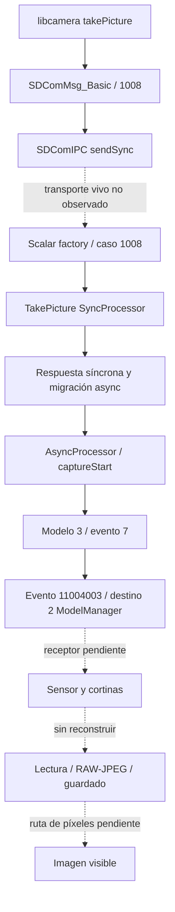

# Captura: protocolo reconstruido parcialmente — 15-10-2026

Prioridad: [obturación, EFCS y fin electrónico](capture/shutter-investigation.md).
E013 amplía E004/E005: **el factory sí despacha 0x1008 a TakePicture**.
Es verificación estática por identificador; el transporte vivo no se observó.
Las direcciones siguientes son **Ghidra**, con base adicional 0x10000 respecto
a VA ELF. No son direcciones medidas en cámara.

## E013: funciones y eventos

| Biblioteca / función / dirección Ghidra | Hecho observado |
|---|---|
| libcamera takePicture 0x270c0 | Envía 0x1008 a SDComMsg_Basic; llamada virtual anterior condicional |
| SDComMsg_Basic 0x26d9c | Mensaje 0x1540432, tipo 5, transacción SDComIPC::sendSync; consulta estado de respuesta |
| Scalar factory 0x118f10 | Caso 0x1008 construye CommandProcessorCameraTakePicture |
| Sync execute 0x117f00 | Comprueba 0x3001/0x3005/0x1342; responde y migra a async |
| Async execute 0x1180b4 | Inhibición 0x4c; esperas 0x1404/0x23; captureStart/checkCapturing |
| captureStart 0xf36de | SysParamList, 0x109=0 y condicional 0x265=0 según 0x12ed; issueEvent(3,7) |
| captureStop 0xf3656 | Preparación análoga; issueEvent(3,8) |
| onCaptureStart 0x117e44 | Según 0x3001 modifica estado o llama captureStop; no prueba cierre físico |
| checkCapturing 0x117d00 | getModelInfo(0x12,6/9); puede llamar captureStop y retirar espera 0x23 |
| issueEvent 0xf6d68 | Resuelve nombres/ID global, entrega parámetros; emite 0x11004003 al destino 2 |
| issueEvent 0xf5e9c | Construye Event, delega en s_postEventFunc; diagnóstico identifica ModelManager |

El ACK síncrono no acredita fin de exposición. `captureStop` es un evento de
software; no se identifica con segunda cortina. Estados numéricos sin tabla
verificada no reciben etiquetas físicas.

## Botón y pantalla: fronteras abiertas

InputServantObserver::notifyKeyEventCallback (ScalarDaemon 0xea20c) recibe
0x14a0002, extrae código/estado, convierte mediante getKeyCode 0xea1a8 y llama
onKeyEventReceived 0xe37b8. Esta última acepta estados menores que 3 y activa
executeSyncProcess(0x102c). Se reconocen códigos 0x213, 0x281, 0x282, 0x287;
todavía no se asignan a S1/S2 o media pulsación. Falta botón→máquina de estados.

AutoReviewStartParamCb (Scalar 0x1044ec) observa 0x1300=5 y convierte 0x1363
en parámetro de mensaje 0x81. libcamera handleAutoReviewStartEvent 0x287bc
lee 0x81 y notifica evento 9 si máscara 0x200.
AutoReviewInfoEventCb 0x103dd4 reúne metadatos, incluido bloque 0x11c;
handleAutoReviewInfoEvent 0x29540 crea memoria 0x524 y callback 8 con máscara
0x100. No se demuestra que contenga el frame completo.
handleShutterEvent 0x2a940 valida parámetros y notifica evento 5: callback,
sin medición del movimiento de una cortina.

libObj pvt_ActionObjectCaptureStartCmpEvt 0x67e77c lee resultado 0x9502,
tipo 0x9505, maneja éxito 0xf000, errores y casos panorama. Se localizaron
rutas ObjRenderer de YUV capture (0x2c4b5c, 0x2c57ec, 0x2c5fe4, 0x2c62bc,
0x2c884c); no se unieron a la fotografía final ni a AutoReview. Preview,
miniatura y reproducción de archivo deben distinguirse por origen/dimensiones.

## Evidencia y límites

Exports: `analysis/rea/capture-scalar-evidence.json` (21 registros),
`capture-libcamera-evidence.json` (6), `capture-libObj-evidence.json` (115),
con snapshots asociados y sesiones cerradas. Hashes:

| Biblioteca | SHA-256 |
|---|---|
| libScalarDaemon.so, nflasha15 | ca28cbf4c5c6402160ad80f6ad9f5e99052f42c3fabc382c557fcded18addc29 |
| libcamera.so, nflasha16 | 7bb156b3c68b802fcdeceb83037d770504c128d0b73a6708122d58589f80c013 |
| libObj.so, nflasha15 | 8e8a937aed23c2783e7bbee8a4afa2fb4bcd897606f190b17dccadd207d05b6a |

Factory: `ev_c374a3272ab14d8d826d55c0605ff761fbbdda3d823d47a19f1bde6163796f64`.
captureStart: `ev_4dde8e7a3b2dafee4c5ae1ad65c69987ce730b8a418aa5352c547ee5e43ca144`.
REA 6.5.0 / Ghidra 12.1.4. libObj: ARM:LE:32:v7, arranque 900000 ms,
sin Decompiler Switch Analysis/Stack; 20 funciones seleccionadas decompiladas,
no cobertura total. Los snapshots no son proyectos Ghidra persistentes.

El recorrido físico botón→imagen no está terminado: sensor, exposición,
lectura, ISP, RAW/JPEG, guardado y píxeles a pantalla siguen pendientes. La
matriz de configuraciones relevantes está en el informe de obturación; no se
afirma haber reconstruido todas las configuraciones de imagen.
