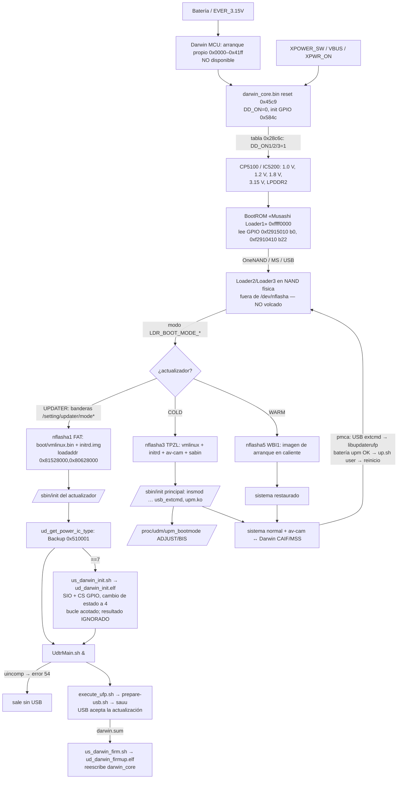

# E24-01 — Arranque, modo actualizador y dependencia de Darwin (27-10-2026)

Solo análisis estático de archivos ya presentes en el repositorio o en disco local. No se conectó, reinició ni modificó la cámara.
Estado de partida: fw 3.22 propio con `darwin_core.bin` tipo 0 (T024). Pregunta: ¿se puede llegar al actualizador USB si la
aplicación Darwin deja de funcionar?

Fuentes (SHA-256 en [§ Pruebas](#pruebas-reproducibles)): volcado NAND `analysis/camera-dumps/nand-20261020/` (`dev_nflasha*.bin`),
BootROM `analysis/camera-dumps/nvram-referencia-20261020-214913/bootrom.bin` (24 KiB leídos de `0xffff0000`),
paquete oficial 3.21 `firmware/extracted/fw321/` (`darwin_core.bin`, `updater.img`, particiones 3/5/7/15), manual de servicio
`references/manuals/a6000_service_L3.pdf` (pág. 9, «4-3. POWER BLOCK DIAGRAM (1/3)»).

## Respuesta

**¿ESTÁ DEMOSTRADO QUE EL MODO ACTUALIZADOR PUEDE INICIARSE SIN QUE LA APLICACIÓN DARWIN FUNCIONE? NO.**

Además de la falta de prueba, hay evidencia **en contra**:

1. IC5700 (Darwin) es «POWER CONTROL, MECHANISM CONTROL» en el esquema. Sus salidas P2C/P43/P44 = `DD_ON1/2/3`. `DD_ON1` activa
   `DD_EN` del convertidor CP5100, que genera `D_1.0V/A_1.0V`, `D_1.2V`, `D_1.8V_MSS`, `D_3.15V` y `LPDDR2_1.2V/1.8V`. Es decir,
   el núcleo y la RAM del BIONZ. VERIFICADO (esquema).
2. Quien sube esas líneas es **`darwin_core.bin`**, la imagen que reescribe la actualización. Su tabla de secuencia de encendido
   (`0x28c6c…`) contiene los manejadores `0x1578d`→`DD_ON1=1`, `0x157a9`→`DD_ON2=1` y `0x157c5`→`DD_ON3=1`. La escritura pasa por
   `0x51c0(pin, valor)` = `str r1,[r0, 0x42668000]`, en bit-band PDOR. Su ruta de reposo, en el reinicio (`0x4818…0x4840`) y en
   `0x6ef6…`, los pone a 0. VERIFICADO (bytes).
3. Por tanto, si `darwin_core` no ejecuta la secuencia de encendido, el BIONZ no recibe alimentación de núcleo, el BootROM no
   corre y no hay modo actualizador (INFERENCIA fuerte). Límite: el arranque propio del MCU (`0x0000–0x41ff`, «darwin_boo», no
   incluido en el paquete) no se ha visto. No se puede descartar que encienda por su cuenta ni que tenga un modo de recuperación.

«Funcionar» se refiere aquí a la parte de gestión de energía. El parche tipo 0 actual no toca esa parte: solo modifica
`0x20c74`, la compuerta de las bobinas, y la cámara arranca y entra en el actualizador. Un parche futuro que rompa el arranque
de Darwin o su máquina de encendido sí afectaría a la recuperación, aunque no tocara el obturador.

## Grafo del arranque



Componentes que deben funcionar antes de que el USB acepte una actualización: **energía (Darwin `darwin_core`) → BootROM →
Loader2/3 → `nflasha1` íntegro → kernel e initrd del actualizador → `nflasha2` montable sin `uincomp` → `sauu` con USB**.
Para entrar desde el sistema normal (camino que usa pmca) se añaden: arranque principal (`nflasha3/5/7/15`), `upm.ko` con
comprobación de batería correcta y `up.sh user`.

## Etapas (con evidencia)

| Etapa | Qué es | Evidencia | Estado |
|---|---|---|---|
| Darwin (MCU FM3 IC5700) | Siempre alimentado; controla `DD_ON1/2/3`, `LDO1_ON`, recibe `XPOWER_SW`, `XPWR_OFF`, `XPWR_ON` y mide la batería (`BATT_AD_IN`→P10/AN00, `BATT_TEMP`→P17/AN07) | Manual pág. 9; `darwin_core` vector `SP=0x20002a00, reset=0x45c9`; tabla `0x28c6c`; `0x51c0` → literal `0x55a0=0x42668000` | VERIFICADO |
| BootROM (Loader1) | `0xffff0000`, «Musashi Loader1 Ver.01.00 Dec 2 2011»; CPU0 entra en `0xffff1063` (Thumb). Lee `0xf2915000+0x10` b0 (`0xffff1094`) y `0xf2910410` b22 (`0xffff10ea`, rama `0xffff0fa0`), carga en SRAM `0xc0000000…` y salta (`0xffff013c`→`0xc0030000`, `0xffff0144`→`[0xc000500c]`); errores → `0xffff0d62` «Loader boot failed», LED | `bootrom.bin` desensamblado (Capstone) | VERIFICADO; semántica de cada rama NO_VERIFICADO |
| Loader2/Loader3 | Se escriben con `pformat_safe/normal.elf /dev/nflasha` (acceso físico) desde `loader_writer.sh`, solo si el paquete trae `loader_sum`; el 3.21 **no** lo trae | `updater.img/bin/loader_writer.sh`, `config.xml`; `firmware.tar_unpacked` sin `*_loader` | VERIFICADO; binario del loader NO disponible |
| Tabla de particiones | `dev_nflasha.bin[0:0x200]` = cabecera `82461.00` + tabla (= `partinf.conf`); `nflasha1` en `0x40000` | Bytes; `README` del volcado | VERIFICADO |
| Selección de modo | Modos `LDR_BOOT_MODE_{COLD,HOT,UPDATER,CIPA,ADJUST,USB_CHARGE,WARM,SS,BIS}` y `bkid_ldr_boot_mode` en `upm.ko`; banderas `/setting/updater/mode`, `mode1…6` en `nflasha2` escritas por `up.sh`; `ud_send_lsi.elf` solo notifica si el tipo LSI (Backup `0x4b0000`) es 1 o 2 | `nflasha15/kmod/upm.ko`, `up.sh` (idéntico en sistema y actualizador) | VERIFICADO el productor de las banderas; **quién las lee y decide es el loader (INFERENCIA)**: el siguiente arranque carga `nflasha1` y ningún código Linux principal las consulta |
| Actualizador | `nflasha1` FAT: `boot/vmlinux.bin` (zImage, Linux 3.0.27 1-10-2013), `boot/initrd.img` (cramfs, `version.txt`=41.01.28), `loadaddr.txt`, `p1chksum` (MD5 de ambos) | `mdir`/`mcopy`, `file` | VERIFICADO |
| Arranque normal | `nflasha3` TPZL (`vmlinux.bin` sin comprimir, Linux 3.0.27 24-1-2019, `initrd.img`, `av-cam.bin`, `sabin`); `/sbin/init` (ELF con símbolos) carga módulos (`nand`, `osal_*`, `backup`, …, `usb_extcmd`, `dmm`, `upm`, …), lee `/proc/udm/upm_bootmode` (ADJUST/BIS), hace `pivot_root` y lanza `bootin.elf`, `sen.elf` y Android | `strings`/`objdump` de `init` (idéntico en `nflasha3` initrd y `nflasha7`) | VERIFICADO |
| Arranque en caliente | `nflasha5` = `WBI1` (imagen del paquete); parámetros `warm.mode=2`, `wbimem=…`, `cmpr.path=/system/sabin/ssboot.bin`; toda actualización con particiones la invalida (`us_mkfs.sh` → `ud_wbi_drop.elf`) | `shell.txt` de `senser-shell-20261020`, `updater.img/bin/us_mkfs.sh` | VERIFICADO; restauración por el loader NO_VERIFICADO |

## Cuándo se inicializa Darwin y cuándo BIONZ lo espera

- **Darwin arranca antes que el BIONZ.** Su reinicio deja `DD_ON1/2/3=0` y configura los GPIO (`0x584c`, `PDDR2=0x1ffe`,
  `PDDR4=0x7e3f`, `PDOR*=0`). El BIONZ solo recibe núcleo y RAM cuando la secuencia `0x28c6c` sube `DD_ON*` (VERIFICADO por
  bytes). El disparador exacto (`XPOWER_SW`, VBUS u otro) no se ha trazado (NO_VERIFICADO).
- **BootROM y loader:** todos los literales cargados por PC en el código Thumb del BootROM son: SRAM `0xc000xxxx`,
  temporizador `0xf2403000/0xf2403100/0xf240310c`, GPIO `0xf2910000/0xf2910410/0xf2912000/0xf2915000`, `0x46689000` (sin
  identificar) y la constante CRC-32 `0xedb88320`. No hay polinomio CRC-16 `0x1021`, tramas `0x80` B ni cadenas del protocolo
  Darwin (VERIFICADO estático). No se puede descartar del todo un acceso indirecto. El loader no está disponible (NO_VERIFICADO).
- **Actualizador:** `/sbin/init` monta, carga módulos y lee el tipo de circuito de energía (`get_power_IC_type` =
  `Backup_read(0x510001)`; un error de lectura devuelve el código negativo y **salta** la inicialización de Darwin). Con tipo 7
  ejecuta `ud_darwin_init.elf` **antes** de `UdtrMain.sh &`. Este binario:
  - lee de Backup el canal SIO y el CS (`0xf900d4`, `0xf900b1`, `0xf9006d`) y ajusta multiplexado en `0xf2910000`;
  - abre `/dev/sioN`, llama a `ioctl` BAUD/CONTROL y abre el GPIO CS;
  - envía tramas de 0x80 B (`[0]=0x11`, `[1]=0x04`, CRC-16-CCITT en `+0x7e`) y espera la respuesta `com_id=0x10` y `rx[1]==4`.

  Reintenta con `usleep(20000)` hasta el éxito, un error de E/S o un límite de `29 999 999` unidades del reloj OSAL (mensaje
  `0x910042`; 30 s si son µs, unidad NO_VERIFICADA). **`us_darwin_init.sh` ignora el código y siempre hace `exit 0`; `init`
  tampoco lo comprueba** (VERIFICADO). Una lectura del controlador `sio.ko` que no vuelva colgaría `init` antes de `UdtrMain.sh`
  (NO_VERIFICADO).
- **Sistema normal:** `upm.ko` (gestor de energía: batería, factor de arranque `BF_KEY_*`, MSS, `liro`) y `av-cam` (CAIF/MSS,
  ver [darwin-via-actualizacion](darwin-via-actualizacion-2026-10-26.md)) son los consumidores. Quién espera respuesta y con qué
  límite de tiempo no se ha cerrado (NO_VERIFICADO).

## Dependencias y bloqueos que pueden impedir el actualizador

| Componente | Si falla… | Evidencia | Estado |
|---|---|---|---|
| `darwin_core` (encendido) | Sin `DD_ON*` no hay núcleo ni RAM del BIONZ | Esquema + tabla `0x28c6c` | VERIFICADO el control; efecto INFERENCIA fuerte |
| Arranque propio del MCU (`0x0000–0x41ff`) | Desconocido | No hay binario | NO_VERIFICADO |
| `darwin_core` (comunicación SIO) en el actualizador | `ud_darwin_init` falla o agota el tiempo; el actualizador sigue | `init`, `us_darwin_init.sh` | VERIFICADO (salvo bloqueo del controlador) |
| BootROM | Ninguna dependencia de Darwin encontrada en sus literales | `bootrom.bin` | VERIFICADO (estático, con el límite indicado) |
| Loader2/3 | Decide el modo; no lo cambia el paquete 3.21 | `loader_writer.sh`, `config.xml` | Lógica NO_VERIFICADA |
| `nflasha1` | Kernel e initrd del actualizador; el paquete 3.21 no lo reescribe; `p1chksum` lleva sus MD5 (quién lo comprueba: NO_VERIFICADO) | Volcado, `0701_part_image_sum` | VERIFICADO contenido |
| `nflasha2` (`/setting`) | `insmod.sh` lo monta; si falla → error 72. `UdtrMain.sh`: si existe `/setting/updater/uincomp` → **error 54 y salida sin USB** (lo maneja `libupdaterbody.so`, cadena `updater/uincomp`) | Scripts del initrd | VERIFICADO el bloqueo; quién crea `uincomp` NO_VERIFICADO |
| Backup (NVRAM) | Tipo de circuito de energía, canal SIO y pines de Darwin; boot device | `Backup_read*` en los ELF | VERIFICADO el uso |
| Entrada desde el sistema normal (pmca) | Exige sistema principal arrancado, `usb_extcmd`, `libupdaterufp` (modelo/región/versión, **batería vía `upm_get_power_status`/`battery check`**, temperatura de batería), `crypter.elf`, `up.sh user` y reinicio | `libupdaterufp.so` (`up.sh user`, «battery NG», `upm_get_heat_alert`) | VERIFICADO; que la lectura de batería venga de Darwin es INFERENCIA (las entradas ADC de batería van a IC5700) |
| Reinicio y apagado desde el actualizador | `ud_reboot.elf`/`ud_darwin_reboot.elf`: `darwin_xpwr_off`, GPIO `XPWR_OFF`; un Darwin que no responda impide el reinicio limpio | Cadenas de ambos ELF | VERIFICADO la vía; efecto NO_VERIFICADO |
| Reescritura de Darwin en una actualización | `ud_darwin_firmup.elf` habla con el MCU por SIO; si falla, «NG» y LED `0x63` | [darwin-via-actualizacion](darwin-via-actualizacion-2026-10-26.md) | VERIFICADO (sesión previa) |

## Correcciones y precisiones a hipótesis anteriores

- [custom-fw-recovery-and-install](custom-fw-recovery-and-install.md) § «Cómo volver atrás», punto 3: «entrar en modo actualizador
  (botón/USB)». En el software no aparece ninguna entrada por botón. La entrada por USB conocida pasa por el **sistema normal**
  (`libupdaterufp` → `up.sh user` → reinicio). Las otras vías del BootROM (MS/USB, `is_valid_boot.sh`) están en el código, pero
  su disparador no se conoce. Además, todo depende de que `darwin_core` encienda el sistema.
- [darwin-via-actualizacion](darwin-via-actualizacion-2026-10-26.md) § «Qué implicaría un parche», punto 4: la recuperación
  por USB depende también de que **`darwin_core` siga ejecutando su secuencia de encendido**, no solo de `nflasha1` y
  `ud_darwin_firmup`. Darwin no es solo el controlador del mecanismo: es el control de energía del cuerpo.
- [boot-and-recovery](../boot-and-recovery.md): `sbin/init` de `nflasha3` es un ELF con símbolos. Su secuencia de módulos y
  `check_bootmode` quedan reconstruidas aquí. El volcado de `/dev/nflasha` **no** incluye el loader: sus primeros `0x40000`
  solo contienen la tabla de particiones.

## Pruebas reproducibles

`python -m pytest -q tests/test_e24_01_boot.py` (7 pruebas; se omiten si faltan los binarios locales; requiere `mtools`, `7z`
y `capstone`). Comprueba: tabla `82461.00` y ventanas de partición, cabeceras `TPZL`/`WBI1`, contenido de `nflasha1`, orden
`us_darwin_init.sh` → `UdtrMain.sh &` sin comprobar el resultado, literales de `ud_darwin_init.elf` (ids Backup, `0xf2910000`,
límite `29 999 999`), `Backup_read(0x510001)`, literales del BootROM y la tabla y las llamadas `DD_ON1/2/3=1` de `darwin_core`.

Comandos manuales:

```bash
mcopy -s -n -i analysis/camera-dumps/nand-20261020/dev_nflasha1.bin ::boot ::p1chksum OUT/ && 7z x -oOUT/ird OUT/boot/initrd.img
llvm-objdump -d --triple=thumbv7-linux-gnueabi OUT/ird/usr/bin/ud_darwin_init.elf   # main 0x8a18–0x8e52
pdftoppm -f 9 -l 9 -r 150 -png references/manuals/a6000_service_L3.pdf OUT/p9     # IC5700 «POWER CONTROL», DD_ON1/2/3
```

| Archivo | SHA-256 |
|---|---|
| `nflasha1:/boot/vmlinux.bin` | `95de734890828c9987bc6ebf8fae9012967d45130163fc36cb3ba559a8de78a7` |
| `nflasha1:/boot/initrd.img` | `0f5ead138286c3077d54fb81576b2ac82e054671d346bd571d011f76ce15d6dd` |
| `initrd:/sbin/init` (actualizador) | `23773fcd4c931b4d5df84d367090191c956c9a531f045f6bb9699cbe419dc693` |
| `initrd:/usr/bin/ud_darwin_init.elf` | `fb9e62b80dda2a8804131f1b543545de9a7b2eca085a5a4361dfea3d0e05504c` |
| `initrd:/usr/bin/ud_darwin_firmup.elf` | `fc1df1b27c191b10971637a97f24e62ea59bccaace7251708aae1e17c9594881` |
| `initrd:/usr/lib/libupdaterufunc.so` | `7cf7baf872ff9f1a53244777fd1f5db0c16d98f0b374a91f192699c3e3b9a496` |
| `bootrom.bin` | `81a17e039a2debfe589b127e12384ed4d7c2ba0d0c819238d0b021b466246026` |
| `dev_nflasha*.bin` | `analysis/camera-dumps/nand-20261020/SHA256SUMS` |

## Qué falta para responder SÍ con evidencia (sin avanzar a E24-02)

1. Binario del arranque propio del MCU Darwin (`0x0000–0x41ff`): ¿enciende `DD_ON*` o tiene modo de recuperación sin `darwin_core`?
2. Loader2/3 (NAND física, fuera de `/dev/nflasha`): quién lee las banderas `/setting/updater/mode*` y `bkid_ldr_boot_mode`, y
   qué hace el BootROM con `0xf2910410` b22 y `0xf2915010` b0 (posible arranque por USB/MS sin NAND).
3. Comportamiento de `sio.ko` en lectura sin esclavo (para descartar un bloqueo de `ud_darwin_init.elf`).
4. Disparador de la secuencia de encendido `0x28c6c` en `darwin_core`.
