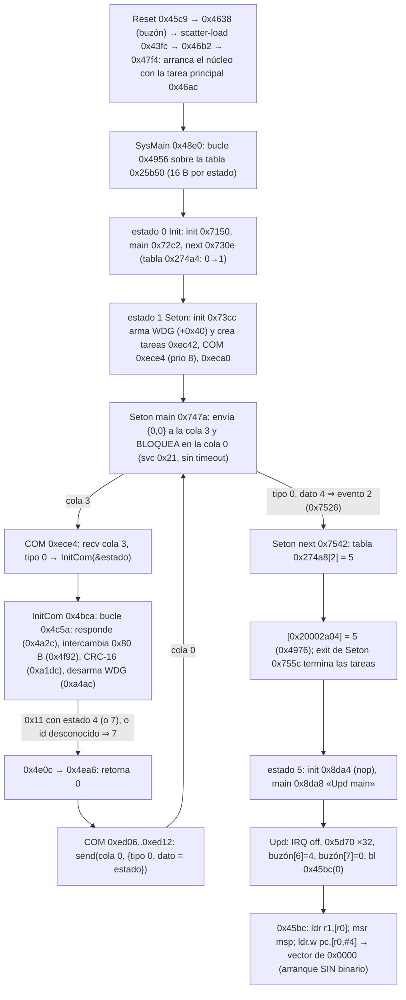

# E24-05 — Ruta `InitCom → Upd → bootloader` y origen de la máquina de rearme (27-10-2026)

Sesión 100 % offline: no se conectó la cámara, no se emitió ningún comando USB, no se escribió RAM, NVRAM, NAND ni firmware, no se generó ningún FDAT y no se tocó el watchdog. Continúa [E24-04](e24-04-dictamen-seguridad.md) (commit `93d7326d`). **Nada de lo que sigue es una autorización ni un candidato instalable**, y demostrar una ruta sin motor **no elimina ninguno de los bloqueantes de recuperación de E24-04** (X1–X8: siguen en pie; esta sesión cierra X3 solo en lo estático).

Binario único analizado: `darwin_core.bin` A6000 3.21, SHA-256 `5f2be06d9885d154e8e0df46a611d6830d29754b4353f6e82cecfe66dd6a0bf4` (157 276 B, base ROM `0x4200`). Dirección = ROM; offset de archivo = dirección − `0x4200`. Método: desensamblado Capstone (Thumb, M-class) propio ([`scripts/e24_05/`](../../scripts/e24_05/)) y un intérprete abstracto mínimo con poda de ramas; **REA/Ghidra** (`raw-binary`, ARM v7 genérico: no admite Cortex-M/Thumb de forma nativa) se abrió sobre el mismo binario y solo se usó para contrastar una función (`0x1e53c` = escribir un evento en la variable de la máquina bajo sección crítica, coherente con los bytes). Lo decisivo se verificó contra bytes en [`tests/test_e24_05_upd_rearme.py`](../../tests/test_e24_05_upd_rearme.py) (28 pruebas).

## Respuestas

### Las seis preguntas de E24-05

| | Pregunta | Respuesta | Alcance exacto |
|---|---|---|---|
| **A** | ¿Está reconstruida la ruta completa hacia `Upd`? | **SÍ** (estático) | Cadena `COM 0xece4 → InitCom 0x4bca → cola 0 → Seton main 0x747a → next 0x7542 → estado 5 → Upd main 0x8da8 → 0x45bc` cerrada con bytes (§2). Límite: el destino del salto (arranque `0x0000–0x41ff`) sigue sin binario, y la clausura estática **no** es una garantía de recuperación física |
| **B** | ¿Está identificado el evento exacto que inicia la máquina exterior de rearme? | **NO** | Identificado: las tres funciones que la arrancan (`0x1fee2`, `0x1ff72`, `0x1ffce`), sus llamantes y la fuente interna/BIONZ de cada uno (§3.2). **Falta el eslabón** «mensaje BIONZ→Darwin concreto que pone en marcha la máquina de 49 estados (`0x28fdc`) en una captura»: el paquete `0x0c` llega al analizador `0x17f8c`, pero no se trazó quién arranca esa máquina (§3.2) |
| **C** | ¿Está identificada la notificación de fin de rearme y su receptor? | **SÍ, solo interna** | Estado 9 (`0x200e6`) → `0xd18e(0x1000000)` libera una máscara local de ocupación; el fin lo detectan los sondeos `0x1ff2a/0x1ffbe/0x20018` (flag `S+0x12c` y id terminal `0xa`). **No** es un mensaje a BIONZ y no se ha localizado qué lee BIONZ para saber que terminó (§3.4) |
| **D** | ¿Existe una ruta de control volátil del rearme demostrada estáticamente? | **NO** | Lado Darwin demostrado (la compuerta se lee en vivo de RAM y `InitCom 0x12/0x16` escriben en ella). **Falta el eslabón BIONZ**: quién emite ese bloque y qué contiene; además solo existe en la ventana `Seton` (§5) |
| **E** | ¿Se puede afirmar que esa ruta no afecta a alimentación y actualización? | **NO** | `0x12` es código de `InitCom`, dentro de la clausura de recuperación, y reescribe 0x78 B que incluyen los bytes del watchdog y el indicador de log (§5) |
| **F** | ¿Se conoce el comportamiento del watchdog ante un bloqueo de rearme? | **NO** | Se conoce la estructura (armado/desarmado/alimentación por estado). **Faltan**: reloj/periodo del HWWDT (capítulo ausente del repositorio), valores de `+0x40..+0x43` (datos, no código) y la política de planificación entre la tarea alimentadora y la de operaciones (§6) |

### La auditoría de la afirmación pendiente (`0x1fe66 = 0`)

| | Pregunta | Respuesta | Alcance exacto |
|---|---|---|---|
| **A** | ¿`0x1fe66 = 0` selecciona la secuencia `00-07-08-09-0a`? | **SÍ** | Los tres arrancadores de la máquina exterior eligen su lista con la misma función (`0x1f5a2` es `b.w 0x1fe66`); con 0 los tres eligen `0x29cd8` = `[0,7,8,9,10]` (VERIFICADO por bytes y por la poda de alcanzabilidad, §3.5) |
| **B** | ¿Evita todas las activaciones del motor por captura? | **SÍ para la captura y el rearme; NO si se incluye la recuperación tras error** | Con compuerta 0 no se alcanza `0x1fe50/0x1fe86/0x1feb6/0x1fe32` desde las APIs de cargar ni desde ninguno de los 49 estados. **Excepción verificada**: la operación 5 (recuperación tras cualquier error `0x16558` y orden BIONZ `0x3e`) llama `0x1fcb8 → 0x1feb6` (freno P4=3 durante `0x7a120` cuentas) **sin compuerta** (§3.5) |
| **C** | ¿Conserva la notificación de finalización necesaria? | **SÍ (la nombrada); su necesidad para BIONZ no está medida** | La lista `[0,7,8,9,10]` contiene el estado 9, que llama `0xd18e(0x1000000)`; es una máscara local, no un mensaje (§3.4) |
| **D** | ¿Evita las rutas de error 6 durante esa captura? | **SÍ en la secuencia de 49 estados; NO como afirmación general** | Hay **cinco** sitios de error de categoría 6, no dos. Con compuerta 0 y tipo de bobina 0 ninguno se alcanza desde los estados de captura; pero `0x1989c` (dentro de `0x1984e`, tras el rearme) sigue vivo y depende del ADC de posición, no de la compuerta (§3.6) |
| **E** | ¿La clase EFCS llega y permanece en `0x20003a01`? | **SÍ (como copia del byte); su significado ON/OFF no está medido** | `0x20003a00..15` es la copia estable del mensaje `0x0c` (22 B); `0x20003a01` = `pkt[+1]`; único escritor `0x1efb8`. Darwin pasa el byte a `S+0x31` y **sobrescribe los bits 0-1 según el tipo de bobina** (1/2/3/4); con tipo 0 no lo hace (§4) |

**Veredicto sobre la última conclusión de Claude: 6 de 7 afirmaciones se confirman (la 3 y la 7 con salvedades) y 1 se refuta en parte (la 5)** (§1). Se corrigen explícitamente E23 y E24-04.

## 1. Auditoría de las siete afirmaciones y corrección de E23/E24-04

| # | Afirmación | Veredicto | Evidencia |
|---|---|---|---|
| 1 | `0x1fe66 = 0` evita el rearme por captura al elegir `00→07→08→09→0a` | **CONFIRMADA** (VERIFICADO) | `0x1fee2/0x1ff72/0x1ffce` llaman `0x1f5a2` y con 0 pasan `0x29cf0−0x18 = 0x29cd8` a `0x1e150` (bytes `1ff0a…1ff14`, `1ff9c…1ffa2`, `1fff6…1fffc`); lista = bytes `00 07 08 09 0a` |
| 2 | Esa secuencia no entra en los estados 2 y 4 | **CONFIRMADA** | Las listas con compuerta ≠ 0 son `[0,2,3,6,9,10]`, `[0,4,5,6,9,10]` y `[0,1,4,5,6,9,10]`; los estados 2/4 son los únicos que arrancan la máquina interior (únicos llamadores BL de `0x1f396`/`0x1f3b6`: `0x20126`/`0x2013a`) |
| 3 | Sus llamadores de rearme no serían alcanzables | **CONFIRMADA, con una excepción** | Todos los llamadores de `0x1fe50/0x1fe86/0x1feb6` son manejadores de la máquina interior, de la de 6 estados (solo se arranca dentro del estado `0x10` interior), `0x1f5a6` (comprueba la compuerta al entrar) o los pulsos de servicio (tras la compuerta). **Excepción**: `0x1fcb8` (freno) la llama `0x1f600` sin compuerta, desde la operación 5 |
| 4 | Conserva `0xd18e(0x1000000)` | **CONFIRMADA** | Estado 9 de la lista (`0x200e6`); es un liberador de máscara local, no un mensaje (§3.4) |
| 5 | Las dos rutas de error 6 no son alcanzables | **REFUTADA parcialmente** | Hay cinco sitios con `r0 = 6` (`0x1989c`, `0x1f518`, `0x1fab8`, `0x20878`, `0x20894`). `0x1f518` está tras la compuerta y `0x20878/0x20894` tras el tipo de bobina; `0x1fab8` solo existe dentro de la máquina interior; **`0x1989c` sigue activo con compuerta 0** en `0x1984e` (depende de un ADC de posición) |
| 6 | Con el tipo 0 se evitan bobinas P4D/P4E y motor P40/P41 | **CONFIRMADA en lo estático** | Con tipo de bobina 0 `0x20c90/0x20cb2` no llegan a `0x51c0`; con compuerta 0 no se llega a las primitivas del motor. Salvedad: freno de la operación 5 |
| 7 | `0x20003a01` conserva la clase | **CONFIRMADA como copia; interpretación NO medida** | §4 |

**Qué se corrige en los documentos.** E23 (`darwin-via-actualizacion-2026-10-26.md`, párrafos «Corrección (misma fecha)…» y «Consecuencia…») afirmaba que `0x1fe66 → 0` *no* desactiva el rearme porque las máquinas «se arrancan sin pasar por `0x1fe66`». Es falso para la máquina exterior: la lista de estados que ejecuta se **elige** con la misma función. E24-04 §5 (alternativa 3) y §8 (X8) heredaban esa lectura. Ambos se corrigen en este commit con una nota que remite a este informe. Lo que E23 sí acertó y se conserva: `0x1fe50` y `0x1feb6` no consultan la compuerta (solo `0x1fe86`); `0x1fa3a` emite el error 6 si la compuerta ≠ 4; las tablas de 27 y 10 estados.

## 2. Investigación A — `InitCom → Upd → bootloader`

### 2.1 Diagrama



### 2.2 Tareas 1–10 de A

| # | Tarea | Resultado | Clase |
|---|---|---|---|
| 1 | Recepción de `0x11` con estado 4 | `InitCom` (r5 = puntero al byte de estado del llamante) compara el id (`0x4cdc: cmp r1,#0x11`), guarda `[rx+1]` en `[r5]` (`0x4d28`), y con estado 4 salta a `0x4e0c → 0x4ea6`, retornando `r4 = 0` (el resultado de la recepción `0x4c74`). No responde a esa trama: la respuesta con `[0]=0x10 [1]=4` es la **siguiente** transferencia, que ya no hace el núcleo (INFERENCIA, arranque sin binario) | VERIFICADO |
| 2 | Cómo `InitCom` publica el estado | **No lo publica**: lo deja en el byte del llamante y retorna 0. Lo publica la tarea COM: `strh r5,[r4]` (tipo 0), `strh r0,[r4,#2]` (dato = estado), `movs r0,#0`, `bl 0x452c` (`0xed06–0xed12`), es decir, `svc #0x20` a la **cola 0** con el mensaje de 32 bits `{tipo 0, dato = estado}` | VERIFICADO |
| 3 | Quién recibe | `Seton main` (`0x747a`), en el contexto de la tarea principal `0x46ac`: `movs r0,#0; bl 0x4530` (`0x74ea–0x74ec`, `svc #0x21`, bloqueante). Única otra fuente de la cola 0: el callback `0x6f6c` (mensaje tipo 1) | VERIFICADO |
| 4 | Hasta la tabla `0x25b50` | `Seton main` devuelve el **evento** (r4): tipo 0 y dato 4 ⇒ 2 (`0x7526`); datos 1/2/3 ⇒ sigue esperando; otro dato (p. ej. 7) ⇒ 0; tipo 1 ⇒ 1. El motor `0x4972–0x4976` llama a `next(evento)` = `0x7542`, que devuelve `[0x274a8 + 4·evento]` | VERIFICADO |
| 5 | Transición exacta | Tabla `0x274a8 = [2, 3, 5, 3]`: **evento 2 → estado 5 (Upd)**; es el único `next` de todos los estados que contiene un 5; `[0x20002a04]` solo se escribe en `0x4976` | VERIFICADO |
| 6 | Condiciones para llegar a `0x8da8` | (a) estar en `Seton` (la tarea COM y por tanto `InitCom` solo existen mientras dura `Seton`: la crean `0x7452/0x7462/0x7470` y las termina el exit con `svc #6`, `0x7580–0x758c`; nombre de la llamada por contexto); (b) recibir una trama `0x11` válida (CRC-16 correcto) con estado 4; (c) que `Seton main` no haya salido antes por otro evento. **Desde `On` no se puede** (`On next` = `[3,3]`, y `InitCom` no existe) | VERIFICADO |
| 7 | Imprescindibles | §2.3 | VERIFICADO / INFERENCIA |
| 8 | Error, cancelación, timeout, watchdog | §2.4 | VERIFICADO |
| 9 | Clausura conservadora | §2.5: 480 funciones (C1), 571 con vectores y `Off` (C2) | VERIFICADO (grafo) |
| 10 | No modificar / abiertas | §2.6 | — |

**Hecho nuevo y relevante (VERIFICADO):** el estado `7` de `0x11` y **cualquier id de orden no reconocido** (`0x4ec0: movs r0,#7; strb r0,[r5]`) terminan el apretón de manos igual que el 4, pero conducen al evento 0 (`On`). Por tanto una trama `0x14`/`0x15` recibida en `Seton` (antes del salto) no actualiza: manda a `On`. Y como la actualización solo es posible en `Seton`, **el actualizador depende de que Darwin esté en `Seton` cuando llega la trama `0x11/4`**, es decir, del apretón de manos tras encender el BIONZ (las entradas a `Seton` son `Init` (arranque en frío de Darwin, `0x274a4 = [1]`) y `Off` (`0x27628 = [1]`, encendido con Darwin ya vivo)).

### 2.3 Funciones, variables y estados imprescindibles

| Grupo | Elementos | Por qué |
|---|---|---|
| Arranque y núcleo | `0x45c8`, `0x4638`, `0x43fc/0x4404` (scatter-load), `0x44e4`, `0x46b2`, `0x5f04` (arranca el núcleo), `0x4538/0x6580` (SVC), `0x4504–0x4534` (envoltorios `svc`), colas/tareas | Sin ellos no hay tareas ni mensajes |
| Máquina de estados | `0x48e0` (motor), tabla `0x25b50`, variable `0x20002a04`, `next` `0x274a4/0x274a8`, callbacks de Init (`0x7150…0x7328`), Seton (`0x73cc…0x755c`), Upd (`0x8da4`, `0x8da8`) | La ruta pasa por ellos |
| Comunicación | COM `0xece4`, `InitCom 0x4bca`, respuesta `0x4a2c`, intercambio SIO `0x4f92`, CRC `0xa1dc` (CRC por hardware `0x40039000`), `0x255a6/0x25642/0x25738` (memcpy/memset/lectura), buffer de estado `0x20002a08` (bandera de parada `+7`) | Recepción y validación de la trama |
| Salto | `0x8da8`, `0x5d70` (×32), buzón `0x20000700..0xb`, `0x45bc` | Entrega al arranque |
| Watchdog | `0xa4c4` (armar), `0xa4ac` (desarmar; `InitCom` lo llama tras cada trama válida), `0xa524` (alimentar; fuera de C1) | Que no reinicie a mitad |
| Energía hacia `Seton` | tabla `0x28c6c`, `0x51c0`, `Off main 0x8909` (`C2`) | Sin `DD_ON*` no hay BIONZ (E24-01) |
| Datos | `[0x20000000+0x31/+0x32/+0x40]` (WDG), `[0x20000714]`, `[0x200278b4+0xc]` | Leídos en el camino |

### 2.4 Errores, cancelación, timeout y watchdog

| Caso | Comportamiento | Clase |
|---|---|---|
| CRC erróneo | `0x4caa` activa el bit 0 del estado de enlace (`[0x20002a08]`) y vuelve a esperar: **reintento sin límite** | VERIFICADO |
| Recepción fallida (`0x4f92 ≠ 0`) | vuelve al bucle (`0x4c58`); el intercambio recibe un límite `0x7a120` (unidad no extraída) | VERIFICADO |
| Orden desconocida | estado := 7 → evento 0 → `On` (cancela la actualización) | VERIFICADO |
| Cancelación | bandera de parada `[0x20002a08+7] = 0` (`0x4ed8`, llamada por `0xed18` desde el epílogo de `Seton` main): `InitCom` retorna 1 (`0x4ea4`); la tarea COM la ignora y espera `{0xff,0}` (`0xed18–0xed2e`) y termina | VERIFICADO |
| Timeout del receptor | **No hay**: `svc #0x21` bloquea sin límite (r2 = 0 en `0x66f8`; `svc #0x22` es la variante sondeo, r2 = 1, devuelve 4). La única acotación es el reintento del intercambio SIO | VERIFICADO |
| Watchdog | `Seton init` lo arma con `[0x20000040] × 0x1869f` (`0x73d4`); **cada trama válida lo desarma** (`0x4cd4`); se re-arma en `On`/`Exiton`/`Off`; el alimentador está solo en `On` (`0x79a6`) y `Off` (`0x8a3e`). Con el byte en 0 queda desarmado (`0xa4c6: cbnz; 0xa4ca: b 0xa4ac`) | VERIFICADO |

### 2.5 Clausura conservadora

[`analysis/e24-05/recovery-closure.json`](../../analysis/e24-05/recovery-closure.json) (generado por `python scripts/e24_05/report.py --write`):

* **C1** = descenso recursivo de llamadas directas, colas (`b.w`) y punteros Thumb cargados por literal, desde reset, tarea principal, SVC/PendSV, los 4 callbacks de Init y Seton, el main de Upd y las tres tareas de Seton: **480 funciones** (de 2203 descritas en el core).
* **C2** = C1 + los 9 manejadores del vector de interrupciones + los 4 callbacks de `Off`: **571 funciones** (es lo que el diff por bytes de un parche debe respetar).
* **Sitios de llamada indirecta en C1: 52; 43 abiertos.** Los 9 resueltos son el motor de estados (×4), el scatter-load `0x442e` (×2), el salto al scatter-load `0x45ce` (×2) y el salto al arranque `0x45c2` (cuyo destino queda fuera del core).

### 2.6 Qué no modificar y qué queda abierto

**No modificar** (todo C2; en particular): reset y núcleo (`0x45c8–0x4638`, `0x4538`, `0x6580`, `0x5f04`, envoltorios SVC), motor de estados `0x48e0`, tablas `0x25b50`, `0x274a4/0x274a8`, callbacks de Init/Seton/Upd, COM `0xece4`, `InitCom 0x4bca`, `0x4a2c`, `0x4f92`, `0xa1dc`, `0x8da8`, `0x45bc`, `0x5d70`, `0xa4ac/0xa4c4/0xa524`, la tabla `0x28c6c`/`0x51c0` y `Off main`.
**Dependencias indirectas abiertas**: (i) destino de `0x45bc` (arranque, sin binario); (ii) 43 sitios `blx/bx` sin resolver en C1; (iii) `[0x278b4+0xc]` llamado en `0x48ec`; (iv) cómo reaccionan el arranque y `DD_ON*` al salto (E24-02 §1); (v) manejadores de ISR (unidad de tiempo del límite `0x7a120`).

### 2.7 ¿Está cerrada la cadena `InitCom → Upd → bootloader`?

**SÍ**, hasta el vector `0x45bc` (cada eslabón con bytes y productor/consumidor). **No** está cerrado lo que ocurre en el arranque, y la clausura es un límite inferior de lo que no se debe tocar: **no demuestra** que la cámara se recupere (E24-04 sigue en NO).

## 3. Investigación B — origen de la máquina de rearme

### 3.1 Estructura (VERIFICADO)

* **Biblioteca de máquinas**: dieciocho descriptores (cinco de ellos son las cinco tablas de la misma máquina interior) de 7 palabras `{tabla id→manejador, id máximo, ptr índice, ptr id actual, ptr lista, id terminal, banderas}` (barrido de `darwin_core`); el motor es `0x1e33e`, el selector de lista `0x1e150`, la consulta de fin `0x1e16e`.
* **Máquina exterior** (descriptor `0x29cf0`, tabla `0x29d0c`, estado `0x200037fc/fd`, lista `0x200037f8`): 11 ids (0–10) — `0:0x20100`, `1:0x2011c`, `2:0x20120`, `3,5,8:0x200e2` (espera), `4:0x20134`, `6:0x20148`, `7:0x2014c`, `9:0x200e6`, `10:0x200fc`. **Ejecuta una lista de ids**, no recorre todos: la lista la fija `0x1e150(desc, ptr)` y el motor avanza por ella hasta el id terminal `0xa`.
* **Listas** (bytes `0x29cd8…0x29cef`): `L0 = [0,7,8,9,10]`, `L1 = [0,2,3,6,9,10]`, `L2 = [0,4,5,6,9,10]`, `L3 = [0,1,4,5,6,9,10]`.
* **Máquina interior** (descriptor `0x297c0`, 27 estados, variables `0x200037dc/dd/d8`, cinco tablas de manejadores `0x29868` (entrada), `0x29940`, `0x29a18`, `0x29af0`, `0x29bc8` (eventos)). Secuencias: `S1` en `0x29797` = `18 19 00 15 05..10 02 03 04 17 1a`, `S2` en `0x297ac` = `01 05..10 02 03 04 17 1a`. Solo la arrancan los manejadores exteriores 2 (`0x20120 → 0x1f396`, S1) y 4 (`0x20134 → 0x1f3b6`, S2); `0x20120` y `0x20134` no tienen llamadores BL (solo las palabras `0x29d20`/`0x29d30` de la tabla).
* **Máquina de 6 estados** (`0x2984c`, tabla `0x29ca0`): solo se arranca desde el manejador interior `0x1f978` (id `0x10`); sus manejadores (`0x1fbc8`, `0x1fbfc`, `0x1fc30`) son los demás llamadores de `0x1feb6`/`0x1fe86`.

### 3.2 Productores y consumidores de eventos

| Evento / entrada | Productor | Consumidor | Origen | Clase |
|---|---|---|---|---|
| `1e150(0x29cf0, L1 \| L0)` + `0x20184` | `0x1fee2` («cargar», sin argumento) | motor `0x1e33e` | llamado solo por `0x1984e` | VERIFICADO |
| `1e150(0x29cf0, L2 \| L0)` + `0x20184` | `0x1ff72(arg)` | idem | llamado solo por `0x19998` (y `0x199d8`) | VERIFICADO |
| `1e150(0x29cf0, L3 \| L0)` + `0x20184` | `0x1ffce(arg)` | idem | llamado solo por `0x199b8` | VERIFICADO |
| `0x1984e(0)` (cargar condicional) | **«On init» `0x75f0` → `0x1b260` → `0xcee6`** (cada entrada en `On`); **operación 22** (`0x1b137` → `0x197ce`; la publica el callback de sondeo `0x1bc12`, registrado en la tabla `0x2831c`, cuando el bit 2 del byte 5 del registro de estado id `0xa` —tabla `0x28198`, que rellena el enlace con BIONZ— pasa a 0 con el estado local 1) | `0x1984e` | interno + BIONZ | VERIFICADO (cadena), INFERENCIA (origen BIONZ y semántica del bit) |
| `0x1984e(1)` | orden BIONZ **`0x60`** (`0x1f22c`) y bucle de N cargas de la orden **`0x67`** (`0x1f24e`), por el despachador `0x1f0a0` (órdenes `0x40–0x9f`, todas con manejador `0x1bfb3` en la tabla `0x2a19c`) | idem | BIONZ | VERIFICADO |
| `0x19998` | estado **4** de la máquina de 49 estados (`0x18637`, tabla `0x28ff8`) | `0x1ff72` | secuencia de captura | VERIFICADO (tabla); arranque de la máquina de 49: NO trazado |
| `0x199b8` | estados **5** (`0x1865b`) y **0x1f** (`0x190fd`) de la misma máquina | `0x1ffce` | idem | idem |
| `0x199d8` | operación 25 (`0xceb9`, publicada por `0x1bfea`, sin referencias) | `0x1ff72` | no alcanzable por referencia | VERIFICADO (ausencia de referencias) |
| `0x20638 → 0x1f5a6` (rearme directo, **con compuerta**) | operación **5** (`0xd46e`) | motor | recuperación tras error | VERIFICADO |
| operación 5 | `0xd380(código…)`, llamado por el notificador de errores `0x16558` (`0x165a8`) y por la orden BIONZ `0x3e` (`0x1bf38`) | tarea `0x7de2` (cola 2) → `0x1ba00(5)` | interno y BIONZ | VERIFICADO |
| mensaje `0x0c` (paquete de 22 B) | BIONZ | copia `0x1efb8(6)` → analizador `0x17f8c` (§4) | BIONZ | VERIFICADO |
| lista exterior terminada (id 10) | motor `0x1e33e` | sondeos `0x1ff2a` (≤ 1000 unidades), `0x1ffbe`, `0x20018` (consultan `0x1e16e`: «id actual ≥ `0xa`») | interno | VERIFICADO |

**Respuesta a «¿puede iniciarse por un evento evitable desde BIONZ sin modificar persistentemente Darwin?» — NO DEMOSTRADO, con alcance exacto.** El rearme se inicia por una **combinación**: (a) transiciones internas de Darwin (entrada en `On`, errores, la secuencia de captura) y (b) órdenes/mensajes BIONZ (`0x60`, `0x67`, `0x3e`, mensaje `0x0a`, paquete `0x0c`). Ninguna es una interrupción de hardware: ningún puntero de datos ni vector apunta a los arrancadores, a las primitivas ni a sus envoltorios (inventario de referencias cerrado, §3.7). La vía que sí está demostrada para **evitar** el motor sin tocar el binario es cambiar el **dato** del que depende la compuerta, y ese dato lo escribe el protocolo (§5), no una orden aislada. Lo que no se ha cerrado es el mensaje BIONZ que arranca la máquina de 49 estados en una captura.

### 3.3 Condiciones de accionamiento del motor

El motor se mueve escribiendo PDOR4 (`P41:P40`) con máscara `0xfffc` vía `0x51cc`. Primitivas (VERIFICADO por bytes): `0x1fe32` = 0 (apaga y espera), `0x1fe50` = 1, `0x1fe86` = 2, `0x1feb6` = 3.

| Primitiva | Llamadores | Condición | ¿Compuerta `0x1fe66`? |
|---|---|---|---|
| `0x1fe50` (1) | interior id 0 (`0x1f68a`) e id 1 (`0x1f6e4`); `0x1f5a6`; pulsos `0x1f474` | estado interior 0/1 activos; `0x1f5a6` tras `0x1f5a8 bl 0x1fe66; cbz` | no la comprueba; **sí** sus llamadores (el interior solo se arranca por L1/L2/L3 y `0x1f5a6`/`0x1f474` la comprueban) |
| `0x1fe86` (2) | interior id `0x18` (`0x1f636`); 6 estados (`0x1fbfc`); pulsos `0x1f474` | 4, 1 o 2 (`0x1fe88–0x1fe9e`) | **sí** |
| `0x1feb6` (3) | interior ids 4 y `0x19`; 6 estados (`0x1fbc8`, `0x1fc30`); `0x1fcb8`; pulsos | `0x1fcb8`: **ninguna** (sin compuerta) | **no** (`0x1fcb8` la llaman `0x1f5a6` y `0x1f600`) |
| pulsos de servicio `0x1f474` | órdenes BIONZ `0x90`/`0x91` (`0x19a32/0x19a36 → 0x2008e/0x200a6 → 0x1f4b2/0x1f4b6`) | `bl 0x1f5a2` + `cbz`; `0x1f4b6` exige además compuerta == 4 | sí |

Condiciones previas al primer accionamiento del rearme interior: lista L1/L2/L3 (compuerta ≠ 0) ⇒ estado exterior 2 ó 4 ⇒ `0x1f396/0x1f3b6` ⇒ secuencia interior ⇒ id 0 (`0x1f68a`: bobina + `0x1fe50`) o id 1 (`0x1f6e4`) ⇒ espera de levas (`0x1fd8c`: P25/P26/P27) con tiempos de los estados; los eventos de tiempo agotado de `0x29940` envían a `0x1fa3a` (error 6 si la compuerta ≠ 4).

### 3.4 Notificación de fin y receptor

* Al empezar, cada arrancador toma `0xd116(0x01000000, 1)` (`0x1fee8`, `0x1ff7a`, `0x1ffd6`) y fija `[S+0x126]` (código de modo: 0 = L1, 1 = L2, 2 = L3, **3 = L0**) y `[S+0x128]` (espera: 1 o `0x8ca0`).
* El estado exterior 0 pone `[S+0x12c] = 1` (ocupado); los estados 2/4/7 (o 6/7) lo ponen a 0 (`0x2016e`).
* **El estado 9** (`0x200e6`) llama `0xd18e(0x01000000)`: borra el bit en `[0x20002bd0+4]` y `+8`. Esa estructura es una máscara de **ocupación/energía** local (la consultan `0xd098`, `0xd1fc`, y `0xd116` la usa para la línea GPIO `0x22c`); **ningún manejador exterior llama `0x452c` ni `0xd380`**, es decir, no envían mensajes (probado).
* Receptores del fin: `0x1ff2a` (espera ≤ 1000 unidades de `0x1e512`), `0x1ffbe`/`0x20018` (devuelven 0 mientras `[S+0x12c] ≠ 0`; si no, `0x1e16e`: «id actual ≥ id terminal»), y el árbitro de energía.
* **Lo que BIONZ lee** para saber que terminó (bits de la respuesta/estado) **no se localizó**: eslabón que falta para afirmar que la ruta `L0` es compatible con las esperas del BIONZ. Con `L0` el fin llega tras `0x8ca0 + 0x5dc0` unidades de temporizador (unidad no extraída) en lugar del movimiento real: **NO se afirma que BIONZ lo acepte**.

### 3.5 Prueba diferencial de alcanzabilidad (`reach.py`)

Intérprete abstracto sobre los bytes (constantes de literales, banderas, ramas podadas por el valor de `0x1fe66`/`0x20c74` y exploradas por ambos lados si no son constantes; expansión de listas y tablas de manejadores). Reproducible: `python scripts/e24_05/report.py`. Compuerta convencional: **4** (INFERENCIA: es el valor que exigen `0x1fa3a` y `0x1f4b6`; el valor real depende del dato).

| Entrada | Compuerta | Lista elegida | Estados exteriores | Máquina interior | Primitivas alcanzadas | Sitios de error 6 alcanzados |
|---|---|---|---|---|---|---|
| `0x1984e(0)`/`(1)` | 4 | `0x29cdd` | 0,2,3,6,9,10 | S1 | `0x1fe32/50/86/b6` | `0x1989c`, `0x1f518`, `0x1fab8` |
| `0x1984e(0)`/`(1)` | **0** | `0x29cd8` | 0,7,8,9,10 | **no** | **ninguna** | `0x1989c` |
| `0x19998` | 4 / **0** | `0x29ce3` / `0x29cd8` | 0,4,5,6,9,10 / 0,7,8,9,10 | S2 / **no** | `0x1fe32/50/b6` / **ninguna** | `0x1fab8` / **ninguno** |
| `0x199b8` | 4 / **0** | `0x29ce9` / `0x29cd8` | 0,1,4,5,6,9,10 / 0,7,8,9,10 | S2 / **no** | `0x1fe32/50/b6` / **ninguna** | `0x1fab8` / **ninguno** |
| 49 estados (`0x28ff8`), unión de 50 manejadores | 4 / **0** | — | — | sí / **no** | `0x1fe32/50/b6` / **ninguna** | `0x1fab8`, `0x1f518` / **ninguno** |
| operación 5 (`0xd46e`) | 4 | — | — | — | `0x1f5a6→0x1fe50`, `0x1fcb8→0x1feb6` | — |
| operación 5 (`0xd46e`) | **0** | — | — | — | **`0x1fcb8→0x1feb6` (sin compuerta)**; `0x1f5a6` vuelve al entrar | — |
| pulsos `0x2008e`/`0x200a6` | 4 / **0** | — | — | — | `0x1fe50/86/b6` / **ninguna** | — |

Con compuerta 0 y tipo de bobina 0: `0x20c90`/`0x20cb2` se alcanzan (estado 7 y `0x20638`) pero **no llegan a ninguna escritura PDOR** (`0x51c0`); con tipo 2 sí (`0x234`).

**Caminos alternativos.** *Interrupciones*: por **inventario inverso** (no por simulación de cada vector): ningún puntero de datos apunta a las primitivas, a los arrancadores ni a sus envoltorios, y las cadenas de llamada hacia ellos terminan en la tabla de operaciones (`0xd46f`), el despachador de órdenes, «On init», el callback de sondeo `0x1bc12` y los estados de la máquina de 49 estados (`test_motor_entry_points_have_a_closed_set_of_references`); una ISR solo podría actuar publicando eventos en una máquina ya activa. *Inicialización*: «On init» sí alcanza `0x1984e(0)` y, por tanto, el rearme condicional de cada encendido; con compuerta 0 elige `L0`. *Servicio*: órdenes `0x58–0x5d` (`0x16876`, `0x166ba`…) sin primitivas; `0x90/0x91` (pulsos) tras la compuerta; `0x60/0x67` por `0x1984e`; `0x3e` por la operación 5.

### 3.6 Sensores y error 6

Cinco sitios con `r0 = 6` ([`0x16558`](#)): VERIFICADO por barrido.

| Sitio | Función | Condición | Con compuerta 0 |
|---|---|---|---|
| `0x1989c` | `0x1984e`, tras el rearme | `0x1b1fa(0) == 0`: lectura ADC canal 8 (`0x24330`) **por encima** del umbral `[0x200001e6]`, solo si el canal 6 está presente (`0x1b096(6)`); si no está presente devuelve 1 | **sigue vivo** (no depende de la compuerta) |
| `0x1f518` | `0x1f4ce` (comprobación de leva `0x1fd8c(0/1/2)`) | tras `0x165c0 == 0` y `0x1fe66 ≠ 0` | no |
| `0x1fab8` | `0x1fa3a` (tiempo agotado) | `0x1fe66 ≠ 4` ⇒ **emite**; con 4 reintenta una vez | no alcanzado (solo dentro de la máquina interior) |
| `0x20878`, `0x20894` | `0x2083c` (fase ADC del seguimiento) | `0x20c74 ≠ 0` (tipo de bobina) | no con tipo 0 |

El sensor de leva (`0x1fd8c`) solo lo leen los caminos con compuerta. La posición se vigila, además, por el ADC (`0x1b1fa`), independiente. **Un rearme omitido deja la posición que lea el ADC**: lo que el hardware haga con ella no está medido.

### 3.7 ¿Es alcanzable la máquina de rearme desde la captura que selecciona la compuerta 0?

Con `0x1fe66 = 0`: **no**, en el sentido estático de §3.5 (ni desde las APIs, ni desde los 49 estados, ni —por inventario inverso— desde interrupciones/inicialización/servicio, salvo el freno de la operación 5). Las ejecuciones de `reach.py` sobre todos los callbacks de estado y vectores no se completaron en tiempo razonable (exploración con 4000 pasos por función): **esa parte se apoya en el inventario, no en la simulación**. Hipótesis del análisis: sin llamadas indirectas no resueltas relevantes (los sitios abiertos de las exploraciones se listan en `Result.open_indirect`), el valor de la compuerta constante en el intervalo y los datos (tipos) tal como se leen.

## 4. La clase de captura en `0x20003a01`

| Eslabón | Evidencia (bytes) | Clase |
|---|---|---|
| El mensaje asíncrono `0x0c` (22 B, `0x27c68`) llega y se copia | índice 6 del lector → id `0x0c` (`0x29784[6]`); `0x1efb8(6)` copia `0x16` B al destino `0x20003a66 − 0x66 = 0x20003a00` (`0x1efde–0x1efe2`) | VERIFICADO |
| Único escritor | `0x1efb8` (llamado desde `0x17198`, idx 6; `0x17378`, idx 7; `0x1747e`, idx 8 — solo el 6 toca esta región); los 12 usos del literal `0x20003a66` son lectores/escritor listados | VERIFICADO |
| Persiste hasta el siguiente mensaje | no hay otra escritura en el core | VERIFICADO (ausencia en el core) |
| Se consume | `0x17f8c → 0x16c9c → 0x1ef06(6)` lee la copia y guarda `pkt[+1]` en `S+0x31` (`0x17fc4/0x17fcc`) | VERIFICADO |
| Reescritura | `0x19b5e` (→ `0x202ba`, tipo de bobina `[0x20003cd8+0x20]`): 1/2 → `S+0x31 &= ~3`; 3 → `(S+0x31 & ~3) + 1`; 4 → `((S+0x31 & ~3) + 2) & ~0x40`; **otro valor (0) → intacto** | VERIFICADO |
| Consumo de `S+0x31` | doce funciones de la zona `0x1850a–0x1972c` (varias son manejadores de la máquina de 49 estados); prueban los bits 0-1 (`lsls #0x1e`) y el bit 6 (`lsls #0x19`): elección de tiempos (`0x18500`, `0x18a2e`, `0x19726`) y del predicado `0x196a2` | VERIFICADO |

**Interpretación:** bits 0-1 ≠ 0 y bit 6 son clases que cambian la temporización de la secuencia. **No se asume ningún valor EFCS ON/OFF**: no hay medida y el valor depende del BIONZ (en A7S el constructor pone clase 2 para Silent; en A6000 no hay evidencia equivalente). Con el parche de tipo 0 de T024 el byte llega **sin** reescritura a `S+0x31`. Es un hecho útil: la A6000 en 3.22 conserva la clase recibida.

## 5. Investigación C — control volátil

| Opción | Estado | Evidencia y alcance |
|---|---|---|
| Dato de la compuerta `[0x20000050 + canal]` (nibble alto) y presencia `[0x200002c0 + canal]` | **candidata** | Lo lee `0x1b080` en **cada** llamada (sin caché); lo consultan los 12 sitios de `0x1fe66` (todos de mecanismo) y el selector de listas. Ningún código del core lo escribe (barrido): lo fijan `InitCom 0x12/0x16` o el arranque |
| `InitCom 0x12` (bloques de 0x78 B en `0x20000000 + desplazamiento múltiplo de 0x78`) | **candidata, no demostrada** | Escribe el bloque 0 completo (`+0x00..+0x77`: gate `+0x50`, flag de log `+0x10`, bytes WDG `+0x31/+0x32/+0x40..+0x43`). Solo existe mientras vive la tarea COM (`Seton`); el emisor BIONZ (`adjstctl`/`libsencore`) no se ha leído |
| `InitCom 0x16` (escritura absoluta en `0x20000000..0x20004000`) | **candidata, descartada para uso** | Puede escribir cualquier variable de Darwin (incluida `0x20002a04`); sin relación verificable con el control mecánico y de alcance enorme |
| `InitCom 0x13` | no analizado (sin relación demostrada) | — |
| Tabla de órdenes de `On` (`0x2a19c`) | **no hay escritura de configuración demostrada** | Los manejadores `0x1bd7b`, `0x1cd7b`, `0x1b167`… son lecturas/sondeos; sin análisis exhaustivo |
| Parche de tipo de bobina (T024) | **funcionalmente demostrado para bobinas, no para el rearme** | Cambia `0x20c74`, no `0x1fe66` |

1. **Valores de RAM que condicionan el inicio:** nibble alto de `[0x20000050 + 0]` y `[0x200002c0 + 0]` (compuerta); nibble bajo (tipo de bobina) `0x20c74`; ADC de posición `[0x200001e6]`.
2. **Escritores:** ninguno en el core; lectores: `0x1b080/0x1b096`.
3. **¿Puede BIONZ influir legítimamente?** Sí, por el protocolo `0x12` (descarga de parámetros de ajuste), **pero solo en `Seton`**; durante captura y servicio la tabla `0x2a19c` no lo ofrece (no demostrado).
4. **Se consulta por captura**, no solo al arrancar (sin caché).
5. **Efecto sobre alimentación, comunicación, watchdog y actualización:** un bloque 0 completo cambia los bytes de watchdog y el indicador de log; no hay forma de cambiar un byte aislado con `0x12`. La SRAM de Darwin **no se reinicia al apagar la cámara** (está siempre alimentada): el efecto persiste hasta que Darwin se reinicie (E24-04 §5).
6. **Mensajes de finalización que seguiría esperando BIONZ:** no identificados (§3.4).
7. **No se ha escrito ni se escribirá RAM ni se ha generado ningún script que la toque.**

## 6. Investigación D — watchdog

* **Quién inicializa `+0x40..+0x43`:** nadie en el core (barrido: ninguna escritura desde una base `0x20000000`); lo fijan `InitCom 0x12/0x16` (bloque 0) o el arranque. **Valores posibles:** 0 desarma (`0xa4c6`); n ≠ 0 recarga `n × 0x1869f` (= 99 999·n). Tampoco el core escribe `+0x31/+0x32`: `+0x31 == 1` carga el contador pero **no lo arranca** (`0xa4ea–0xa4ec`), `+0x32 == 1` quita el bit 1 del control.
* **Estados:** Seton `+0x40` (`0x73d4`), On `+0x41` (tarea `0x7914`, `0x7956`) y tras cada orden BIONZ (`0x1bfae`), Exiton `+0x42` (`0x804e`), Off `+0x43` (`0x823c`, `0x8460`). Desarme: tras cada trama de `InitCom` (`0x4cd4`), al salir de On/Exiton/Off (`0x7978`, `0x81d0`, `0x83d4`, `0x8c78`), al empezar a ejecutar una orden BIONZ (`0x1bf74`: **las órdenes `0x60/0x67/0x90/0x91` se ejecutan con el watchdog desarmado**) y en `0x70dc` (función `0x70d4`, llamada desde el arranque).
* **Alimentación:** solo `0x79a6` (bucle de la tarea `0x7914` en la cola 1, con temporizador) y `0x8a3e` (Off).
* **Reloj efectivo:** el HWWDT está en `0x40011000` (mapa de periféricos) pero **el capítulo del HWWDT no está en el manual local**: periodo NO verificable. La constante `0x1869f` es 100 kHz·1 s − 1, de modo que `n` ≈ segundos si el reloj es el CR de baja velocidad de 100 kHz (INFERENCIA).
* **¿Un rearme bloqueado reinicia Darwin?** Los bucles de espera del rearme están acotados (`0x1ff2a` ≤ 1000 unidades; `0x1f5a6` ≤ `0x1e8480` por fase) y corren en la tarea de operaciones, **no** en la alimentadora; con la política de planificación sin analizar y `+0x41` desconocido, **NO se puede afirmar ni negar**. Un reinicio de Darwin deja `DD_ON1/2/3 = 0` (E24-01): se apaga el BIONZ.

## 7. Matriz de evidencia

| Hallazgo | Dirección | Instrucción / tabla | Productor → consumidor | Clase | Comprobación |
|---|---|---|---|---|---|
| Motor de estados | `0x4956–0x497c` | `add.w r4,r7,r0,lsl #4; blx [r4..r4+0xc]; str r0,[r5]` | `0x48e0` → callbacks | VERIFICADO | `test_state_engine_walks_init_main_next_exit` |
| Tabla de estados | `0x25b50` | 6×16 B | — | VERIFICADO | `test_state_table_names_and_upd_entry` |
| `next` de Seton | `0x274a8` | `[2,3,5,3]` | `Seton main` → `next` | VERIFICADO | `test_seton_next_table_…` |
| Seton espera cola 0 | `0x74ea–0x7528` | `svc 0x21`, `cmp #4`, `movs r4,#2` | COM → Seton | VERIFICADO | `test_seton_main_waits_…` |
| COM publica | `0xed06–0xed12` | `strh`, `bl 0x452c` | COM → cola 0 | VERIFICADO | `test_com_task_runs_initcom_…` |
| Estados 4/7 y desconocido | `0x4d20–0x4d3c`, `0x4ec0` | `cmp #4/#7`, `movs r0,#7` | InitCom → COM | VERIFICADO | `test_initcom_state4_…` |
| Salto | `0x8da8–0x8df6`, `0x45bc` | `bl 0x45bc` | Upd → arranque | VERIFICADO | `test_upd_main_leaves_…` |
| Recepción sin timeout | `0x66f8`, `0x653e` | `movs r2,#0; cbz r2` | kernel | VERIFICADO | `test_kernel_receive_blocks_…` |
| Clausura | `analysis/e24-05/recovery-closure.json` | — | — | VERIFICADO (grafo) | `test_recovery_closure_…` |
| Listas del rearme | `0x29cd8..0x29cef` | `00 07 08 09 0a` … | wrappers → motor | VERIFICADO | `test_outer_machine_state_lists_…` |
| Compuerta única | `0x1f5a2`, `0x1fe66` | `b.w 0x1fe66` | 3 arrancadores | VERIFICADO | `test_three_wrappers_…` |
| Selección con 0 | — | poda | — | VERIFICADO | `test_gate_zero_selects_…` |
| Interior solo por 2/4 | `0x20126`, `0x2013a` | `bl 0x1f396/0x1f3b6` | exterior → interior | VERIFICADO | `test_inner_machine_is_started_only_…` |
| Llamadores de primitivas | ver §3.3 | — | — | VERIFICADO | `test_every_caller_of_a_motor_primitive_is_known` |
| Compuerta sin caché | `0x1fe66`, `0x1b080` | `lsrs r4,r0,#4`; `ldrb [r0,#0x50]` | — | VERIFICADO | `test_gate_function_reads_…` |
| Diferencial | — | poda | — | VERIFICADO (modelo) | `test_differential_reachability_…` |
| Freno sin compuerta | `0x1fcb8`, `0xd46e` | `bl 0x1feb6` | error/`0x3e` → op 5 | VERIFICADO | `test_error_recovery_op5_…` |
| Error 6 | 5 sitios | — | — | VERIFICADO | `test_category6_error_sites_…` |
| Máscara de fin | `0x200e6`, `0xd18e` | `mov.w r0,#0x1000000` | estado 9 → máscara | VERIFICADO | `test_completion_mask_…` |
| Arranques y órdenes | `0x2a19c`, `0x1f22c`, `0x75f0` | — | BIONZ → rearme | VERIFICADO | `test_rearm_start_points_…`, `test_dispatcher_commands_…` |
| Clase `0x20003a01` | `0x1efb8`, `0x17f8c`, `0x1807a` | — | BIONZ → `S+0x31` | VERIFICADO / ON-OFF NO MEDIDO | `test_capture_class_byte_…` |
| Config WDG sin escritor | — | barrido | — | VERIFICADO (ausencia) | `test_nothing_in_darwin_writes_…` |
| WDG por estado | `0xa4c4/ac/24` | — | — | VERIFICADO | `test_watchdog_arm_disarm_feed_…` |
| Reloj WDG | `0xa540` | `0x1869f` | — | INFERENCIA | `test_hw_watchdog_reload_constant_…` |

## 8. Scripts de verificación reproducibles

```bash
python -m pytest -q tests/test_e24_05_upd_rearme.py          # 28 pruebas sobre bytes, tablas e instrucciones (≈ 15 s)
python scripts/e24_05/report.py                               # clausura y tabla diferencial
python scripts/e24_05/report.py --write                       # regenera analysis/e24-05/recovery-closure.json
python scripts/e24_05/dwn.py dis 0x4bca 0x120                 # desensamblado con literales resueltos; también: callers | words | lit | u32
```

`scripts/e24_05/dwn.py` (lectura, desensamblado y búsquedas), `graph.py` (grafo de llamadas por descenso recursivo), `reach.py` (alcanzabilidad diferencial con poda) y `report.py`. Todo es de solo lectura.

## 9. Límites y bloqueantes

* El arranque `0x0000–0x41ff` sigue sin binario: no se sabe si acepta una aplicación rota ni qué hace con `DD_ON*` (E24-02, E24-04 X1).
* La alcanzabilidad es un cierre estático con 4000 pasos por función, sin ejecución, sin memoria del heap y con llamadas indirectas sin resolver (abiertas y listadas); el valor de la compuerta y del tipo de bobina son **datos**, no se midieron.
* **Un camino sin motor no es seguro por serlo**: con `L0` el obturador no se rearma, y qué posición física queda y qué espera BIONZ **no está medido** (el estado de las cortinas con el parche tipo 0 sí encaja: sin liberar cortinas no hay nada que rearmar, pero es una coherencia, no una prueba).
* E24-04 sigue en pie: sin una vía de recuperación independiente de la aplicación Darwin demostrada (C y D = NO), **no hay base técnica para flashear**; M6 se refina con la clausura de §2.5 pero no se declara cerrado; X1, X2, X4–X7 sin cambios.
* No se avanza a E24-06.
