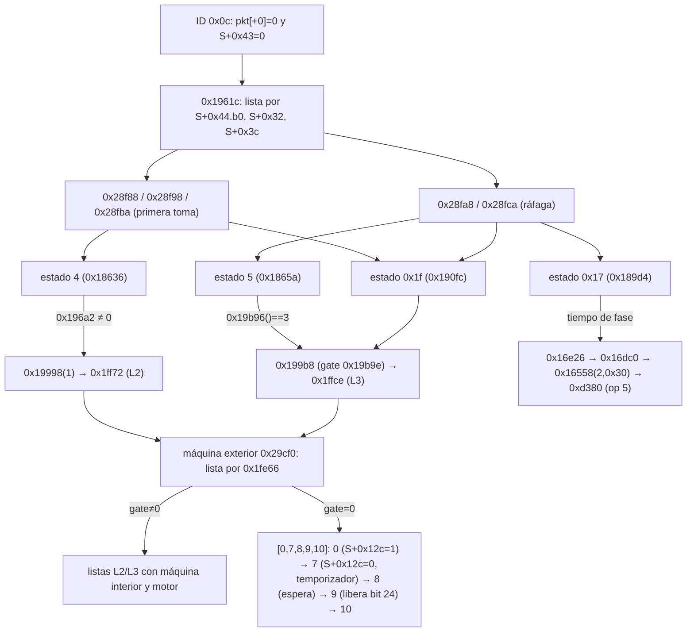

# E24-05a — Origen de la captura y confirmación BIONZ–Darwin (27-10-2026)

Sesión 100 % offline: sin cámara, sin comandos USB, sin escrituras de RAM/flash, sin FDAT, sin tocar el watchdog ni las protecciones del mecanismo. Continúa [E24-05](e24-05-upd-y-rearme.md) (base `e37f50f5`) y reutiliza sus scripts (`scripts/e24_05/`), su prueba y `analysis/e24-05/recovery-closure.json`. **Nada de lo que sigue autoriza un parche ni un flasheo**; E24-04 no cambia.

Binarios: `darwin_core.bin` A6000 3.21 (SHA-256 `5f2be06d…6bf4`, base ROM `0x4200`) y `av-cam.bin` (base `0x43541000`). Método: desensamblado Capstone propio sobre Darwin; REA/Ghidra (sesión única sobre `av-cam.bin`, cerrada al acabar) para xrefs/llamadores/pseudocódigo del lado BIONZ y Capstone para verificar los bytes decisivos. Reproducible: `python scripts/e24_05/capture_flow.py` (→ `analysis/e24-05a/capture-flow.json`) y `pytest tests/test_e24_05a_captura_fin.py` (27 pruebas).

## Veredictos obligatorios

| | Pregunta | Resp. | Alcance exacto |
|---|---|---|---|
| **A** | ¿Está identificado el mensaje BIONZ que inicia la máquina de 49 estados? | **SÍ** | Es el mensaje asíncrono **ID `0x0c`** (22 B, BIONZ→Darwin). Lo acepta la tarea de captura `0x1811a` (analizador `0x17f8c`) y, aceptado, `0x1961c` ejecuta la máquina. Lado BIONZ: lo construye `FUN_43841070` (VERIFICADO bytes). Límite: que el ID `0x0c` sea el CAIF ev1 op `0x10300` sigue siendo INFERENCIA fuerte (longitud y código `03 01`), no un emparejamiento byte a byte del transporte |
| **B** | ¿Está reconstruido el camino completo de inicio hasta la selección de lista? | **SÍ** | `On` `0x7ece` → veneno `0xce84` → tarea `0x1811a` → `0x17f8c` (admisión) → `0x196b6` → `0x17cee` → `0x1961c` (selector de 5 listas) (§1, VERIFICADO). Del lado BIONZ la cadena llega hasta el constructor; el enlace constructor → emisor CAIF `0x436ba234` es INFERENCIA |
| **C** | ¿Está identificada la señal que BIONZ recibe para saber que terminó el rearme? | **NO** | Del lado Darwin hay candidatas verificadas (bit 24 de la máscara de ocupación publicada en el bloque de estado, eventos `0x90/0xe0/0xf0` del anillo, flag `S+0x12c`), pero **no se ha localizado la función de BIONZ que las lee** (§4.4) |
| **D** | ¿`[0,7,8,9,10]` produce un estado de finalización compatible con la espera de BIONZ según el código? | **NO** | Compatible con las **esperas de Darwin** (sondeos `0x199d0`/`0x20018`: SÍ, §5). Lo que BIONZ espera no está identificado (C), así que no se demuestra |
| **E** | ¿Se conocen las condiciones que pueden activar la operación 5 en una captura sin rearme? | **SÍ** | Dentro de la clausura de la captura solo hay **dos** sitios del notificador `0x16558`: rechazo del paquete (`0x17f8c`, cat 2/`0x51`) y tiempo límite de fase (`0x16dc0`, cat 2/`0x30`); más la orden `0x3e` y los errores de categoría 4/6 de fuera de la captura (§6, VERIFICADO por callers y clausura). Los valores de ejecución no están medidos |
| **F** | ¿Se ha demostrado que `0x1989c` no provocará error por omitir el rearme? | **NO** | `0x1989c` solo existe en la API de rearme `0x1984e`, **fuera** de la captura y de los 49 estados (VERIFICADO), así que omitir el rearme *dentro de una captura* no la ejecuta. No se demuestra que BIONZ no invoque esa API después (órdenes `0x60/0x67`, ráfaga) ni qué lee el ADC con el mecanismo sin rearmar (§6.3) |
| **G** | ¿Puede seleccionarse la ruta sin rearme con un dato que BIONZ controla en el protocolo existente? | **NO** | Hay **cuatro** datos del protocolo que la condicionan (§5.3), pero ninguno está demostrado como suficiente: el único que cambia la lista exterior (la compuerta `0x1fe66`) lo fija `InitCom 0x12/0x16`/arranque, cuyo emisor no se ha leído, y los otros tres solo omiten *algunas* llamadas de rearme |

## 1. Grafo de inicio de captura

```text
BIONZ (av-cam)                                         Darwin (darwin_core)
────────────────────────────────────────────────────  ──────────────────────────────────────────────────────────────
FUN_43842158  fija clase (obj+0x60 ∈ {1,3,5}) y flag    mss-async  ID 0x0c  (rx 0x2000344c, 22 B, código 03 01 02)
  └ FUN_4383f5e4 copia clase→0x43eedecc, flag→0x43f9b503 │  → 0x1efb8(6) copia estable 0x20003a00..15 (pkt[+1]=0x20003a01)
      └ FUN_43841070 construye pkt de 22 B                ▼
          ← 0x437f87ac ← 0x43b1bc24 (etapa)            On (0x7ece/0x7f20):  bucle  bl 0xce84 → b.w 0x1811a
  stage 0x438d02xx ─► 0x437db858(ev=1)                   tarea de captura 0x1811a
        └► 0x436b8a50 ─► 0x436ba234(0x10300,0x16,buf)     │ 0x1815c  0x196fa  (borra S+0x30..0x47 → S+0x44.b0 = 0)
              [INFERENCIA: mismo buffer]                  │ 0x18160  0x19a06  (b.w 0x200be)
        → cola CAIF → MSS/CSIO  ····················►      │ 0x18164  0x17f8c  ANALIZADOR (§2)  ── 0 ─► 0x18202 fin de tarea (§4)
                                                          │ 0x18178  0x196b6  limpia bits de S+0x44 y S+0x4c
                                                          │ 0x1817c  0x17cee  preparación (rearme L2 condicional, §3.3)
                                                          │ 0x18180  0x1961c  EJECUTOR de la máquina de 49 estados
                                                          │ 0x181a4  0x1e5f2(0x90,0,0x80|0x81) ; bucle: S+0x44.b0 = 1 → 0x18164
```

Aristas verificadas por bytes: `0x7ece/0x7f20 bl 0xce84`; `0xce84 b.w 0x1811a`; el orden de llamadas de `0x18160..0x18180`; `bl_callers(0x1961c) == [0x18180]`. El ID `0x0c` es el único de 22 B de la tabla `0x27c68` (`test_message_table_*`).

### 1.1 Selector de lista (`0x1961c`)

Lee `S+0x44.b0` (¿ya hubo una toma en esta ráfaga?), `S+0x32` (u16 = `pkt[+2..3]`) y `S+0x3c` (`pkt[+0x0c]` & `0x3f`) y escoge una de **cinco** listas de ids de la tabla `0x28ff8` (pares `(id, manejador)`, el id coincide con el índice; terminal `0x31`):

| Lista | Condición | Ids |
|---|---|---|
| `0x28f88` | `S+0x32 = 0` o `S+0x3c ∉ 1..4` | `02 09 03 04 0d 0a 0f 06 13 14 1a 1c 1f 20 30 31` |
| `0x28f98` | tipo `S+0x3c`=1, primera toma | `02 09 03 04 0a 06 13 14 1a 1c 1f 21 22 20 30 31` |
| `0x28fa8` | tipo 1, toma de ráfaga | `0b 0c 07 17 05 08 15 16 18 19 1d 1e 1f 21 22 20 30 31` |
| `0x28fba` | tipo 2–4, primera toma | igual que `0x28f98` |
| `0x28fca` | tipo 2–4, ráfaga | igual que `0x28fa8` |

El selector guarda el índice (1–4) en `S+0x26` y reitera `0x1e33e` hasta que `0x1e16e` indica el id terminal. **No lee `S+0x31` (la clase)**: la clase no elige lista (§7).

Medición previa útil ([T022](registro-pruebas-camara.md)): el paquete real tras un disparo fue `00 02 00 16 bd 13 … 00 40 …` → `pkt[+0x0c]=0` ⇒ `S+0x3c=0` ⇒ **lista `0x28f88`** (contiene los estados 4 y 0x1f, no el 5). Es un solo disparo y no sabemos el tipo de mecanismo ni el estado de EFCS.

## 2. Tabla de mensajes BIONZ ⇄ Darwin y mapa del paquete `0x0c`

Tabla `0x27c68` (16 B por entrada `{tx, rx, long, código}`, desde el ID `0x0b`; `test_message_table_has_single_22_byte_rx_id_0c`):

| ID | Dir. | Long. | Buffer | Papel |
|---|---|---|---|---|
| `0x0b` | Darwin→BIONZ | 7 | `0x200032cc` | NO_VERIFICADO |
| **`0x0c`** | **BIONZ→Darwin** | **22** | `0x2000344c` | **solicitud de captura** (único de 22 B) |
| `0x0d` | Darwin→BIONZ | 0x4b | `0x200032cc` | NO_VERIFICADO |
| `0x0e` | Darwin→BIONZ | 2 | `0x200032cc` | NO_VERIFICADO |
| `0x0f` | BIONZ→Darwin | 2 | `0x2000334c` | observado en [T023](registro-pruebas-camara.md) (`03 04`) |
| `0x10` | Darwin→BIONZ | 0x150 | `0x200032cc` | compatible en tamaño con la región `0x20000af0` (0x150) del bloque de estado (INFERENCIA) |
| `0x11` | Darwin→BIONZ | 0x10 | `0x200032cc` | NO_VERIFICADO |
| `0x12` | BIONZ→Darwin | 4 | `0x2000334c` | observado en T023 (`03 07`) |
| `0x13` | BIONZ→Darwin | 10 | `0x2000334c` | observado en T023 (`03 08`) |
| `0x14`, `0x15` | Darwin→BIONZ | 2 | `0x200032cc` | NO_VERIFICADO |
| `0x16` | BIONZ→Darwin | 0xd2 | `0x200032cc` | bloque 0 (E24-05: *no* porta el tipo de mecanismo) |
| `0x17` | Darwin→BIONZ | 6 | `0x200032cc` | NO_VERIFICADO |

Campos del paquete `0x0c` (`pkt[k]` = `S+0x30+k`, `S=0x200036d8`; bytes de `0x17fc0–0x1804a`):

| pkt | Destino | Efecto |
|---|---|---|
| `+0` | `S+0x30` | debe ser 0 para aceptar |
| `+1` | `S+0x31` | clase; se reescribe por tipo de mecanismo (§7); la consulta `0x196a2` |
| `+2..3` | `S+0x32` | 0 ⇒ `S+0x3c := 0` |
| `+4..0x0b` | `S+0x34..3b` | tiempos; `S+0x3a = 0` ⇒ 7000 |
| `+0x0c` | `S+0x3c` (bits 0–5, solo si `S+0x44.b0 = 0`) y `S+0x46` bits 2–3 (bits 6–7) | **elige la lista** (§1.1) |
| `+0x0d` | `S+0x3d` | bit 0 elige el mensaje final `0xe0/0xf0` (§4) |
| `+0x12` | bit 3→`S+0x42`; bit 0→`S+0xa0.b0` | |

**Admisión (VERIFICADO, `0x180b8–0x180ce`)**: se acepta (retorno 1) solo si `pkt[0] = 0` **y** `S+0x43 = 0`. `S+0x43` lo calcula `0x17e94` a partir de la **máscara de ocupación** `[0x20002bd0+8]` (`0xd294(1)`): cada bit activo da un código distinto de 0 (bit 6→1, bit 0→2 … **bit 24→`0x16`**, bit 16→`0x10`) y, si hay alguno, el paquete se **rechaza** con `0x16558(2, 0x10, 0x51, S+0x43)` y el mensaje `0xb0`. Es una condición de estado interno de Darwin, no física directa; el bit 24 es el que levantan los tres arrancadores de la máquina exterior y baja el estado 9 (`0xd18e(0x1000000)`), de modo que **un rearme en curso rechaza una captura nueva**.

Qué órdenes BIONZ→Darwin (no mensajes mss) intervienen alrededor de la captura: tipo de mecanismo 1–4 (`0x1f23a–0x1f24a` → `0x19b62` → `0x205e6` → `[0x20003cd8+0x20]`), API de rearme (`0x1f22c`, `0x1f260`, `0x197ce` ← `0x1b136`, «On init»), operación 5 (`0x3e`, E24-05). **Preparación** = tipo de mecanismo + paquete `0x0c`; **captura** = estados de la lista; **rearme** = estados 4/5/0x1f y `0x17cee`/`0x17a44`; **recuperación de errores** = `0x16558` → operación 5.

## 3. Las dos máquinas



### 3.1 Qué estados de los 49 inician el rearme (VERIFICADO por clausura de llamadas)

| Estado | Manejador | Acción | Condición |
|---|---|---|---|
| 4 | `0x18636` | `0x19998(1)` → `0x1ff72` (lista L2) | `0x196a2() ≠ 0` (clase, §7) |
| 5 | `0x1865a` | `0x199b8(0)` → `0x1ffce` (L3) | `0x19b96()==3` (= `0x20c74`, tipo de bobina del canal) |
| 0x1f | `0x190fc` | `0x199b8` | `0x199b8` exige además `0x19b9e() ≠ 0` (sin error cat 6 y `S+0x170.b0 = 0`) |
| 0x17 | `0x189d4` | espera con tiempo límite hacia BIONZ (`0x16e26`) | solo en las listas de ráfaga |
| 2, 3, 6, 0x0d | | `0x196a2` condiciona su acción | no arrancan el rearme |

Los estados 4, 5 y 0x1f no consultan `0x1fe66` directamente: llaman a los arrancadores, que sí la usan (E24-05). `0x17cee` (preparación) puede además llamar `0x19998(1)` si en ráfaga (`S+0x44.b0=1`) `S+0x31` tiene algún bit de `0x30` **y** el bit 7 **y** `0x196a2 ≠ 0` (`test_prep_rearm_l2_in_0x17cee_*`).

### 3.2 Qué elige el camino con y sin rearme

| Dato | Quién lo fija | Efecto verificado |
|---|---|---|
| `0x1fe66` (`[0x20000050+canal]>>4`) | `InitCom 0x12/0x16`/arranque (E24-05) | 0 ⇒ la máquina exterior ejecuta `[0,7,8,9,10]` en los tres arrancadores |
| Tipo de mecanismo `[0x20003cd8+0x20]` ∈ 1–4 | **orden BIONZ** `0x1f23a–0x1f24a` (`0x205e6`); otro valor ⇒ 0 | reescribe `S+0x31` (§7) y por tanto `0x196a2` |
| `0x20c74` (`0x1b080 & 7`) | mismo dato de canal | 3 ⇒ estado 5 y rearme final `0x17a44` |
| `S+0x44.b0`, `S+0x3c`, `S+0x32` | paquete `0x0c` (`pkt[+0x0c]`, `pkt[+2..3]`) y la propia tarea | elige la lista de los 49 estados |

## 4. Finalización y respuesta

### 4.1 Fin de la lista `[0,7,8,9,10]` (exterior)

| Estado | Manejador | Efecto sobre el estado de Darwin |
|---|---|---|
| 0 | `0x20100` | `S+0x12c := 1` (ocupado), temporizador de `S+0x128` |
| 7 | `0x2014c` | `0x20c90` (bobina, nada con tipo 0), `S+0x12c := 0`, temporizador `0x5dc0` (unidad no medida) |
| 8 | `0x200e2` | marca de espera (`0x1e4aa`) |
| 9 | `0x200e6` | `0xd18e(0x1000000)`: baja el bit 24 de `[0x20002bd0+4]` y `+8` |
| 10 | `0x200fc` | id terminal |

Los sondeos `0x1ff2a` (≤ 1000 unidades), `0x1ffbe` y `0x20018` (llamado por `0x199d0`) devuelven «terminado» cuando **`S+0x12c = 0` e id actual ≥ `0xa`** (`0x201a0 → 0x1e16e`). Con la lista sin rearme no hay ninguna espera de sensores de leva (esas son de los estados 2/3/6 de las listas convencionales): los pasos 0 y 7 son por temporizador. (VERIFICADO bytes; `test_terminal_state_probes`.)

### 4.2 Fin de la tarea y fin de la máquina de 49 estados

La máquina de 49 estados acaba al llegar al id `0x31`. Después, si `S+0x3c ≠ 0`, la tarea emite `0x90` con `0x80` (normal) o `0x81` (cuando `0x1ec52(2) = 0` y `0x16c54() ≠ 0`; se corta además la ráfaga: su semántica no está fijada) y, mientras `r5 = 1`, pone `S+0x44.b0 = 1` y vuelve a `0x18164` a esperar el siguiente paquete. Al terminar llega a `0x18202`: `0x17a44` (rearme final condicional: `0x199b8(0)` solo si `0x19b96()==3`, `S+0x3d.b0 = 0` y `S+0x90.b2 = 1`), `0x19a0e`, mensaje **`0xe0`** (`S+0x3d.b0 = 1`) o **`0xf0`**, `0xd18e(0x200)` (baja el bit 9 que subió el inicio) y, si hay error pendiente `S+0x9c`, evento 1 con ese error (`0x16adc`).

### 4.3 Campos de estado que cambian al terminar

`S+0x12c` (1→0), bits 24 y 9 de la máscara de ocupación (→0), `S+0x44.b0` (1 tras la primera toma; se borra en el siguiente `0x196fa`), `S+0x26` (índice de lista), la variable de estado `0x200036fc/fd` de los 49 estados (terminal `0x31`), `S+0x444` (máscara de errores) y los eventos del anillo.

### 4.4 Cómo llega a BIONZ (lo que sí está probado y lo que no)

* `0x1e5f2(código, a, b)` emite eventos con los códigos `0x10/0x20/0x30` (estado deduplicado por tipo), `0x90`, `0xa0`, `0xb0`, `0xe0/0xf0`; los escribe con `0x16adc(1, …)` en un **anillo de 24 entradas de 4 B** (`0x20000680…`, índice `0x20000631`) si el bit 0 de `0x20000470` está activo (VERIFICADO).
* El constructor del bloque de estado `0x6c78` (puntero de callback `0x26d28`, regiones `0x26d2c…`) copia a la región `0x200009f8` las dos palabras de la **máscara de ocupación** (`0xd294(1)`→`+4`, `0xd294(0)`→`+8`) y a `0x20000a70` el anillo (`0x16bca`, ≤ 0x60 B + índice), y vuelca la estructura `S` (0x150 B) en `0x20000af0` (`0xceb4`). VERIFICADO el contenido; que estas regiones viajen en los IDs `0x10/0x0d/…` es INFERENCIA por tamaños.
* **CORREGIDO por [E24-05d §3](e24-05d-consumidor-estado-darwin-bionz.md):** `0x6c78` es una instantánea del registro de fallos (llamada `0x45b2`), no un mensaje; la máscara no sale de Darwin.
* **NO_VERIFICADO**: la función de BIONZ que lee esos campos. La máscara de ocupación **no es un mensaje CAIF**: es un campo del bloque de estado, y por eso su lectura por BIONZ queda sin demostrar (veredicto C).

### 4.5 Diferencias entre la lista sin rearme y la convencional

| | Convencional (gate ≠ 0) | Sin rearme (gate 0) |
|---|---|---|
| Estados exteriores | `0,2,3,6,9,10` (L1) / `0,4,5,6,9,10` (L2) | `0,7,8,9,10` |
| `S+0x12c` | 1→0 por estados 2/4/7 | 1→0 por el estado 7 |
| Bit 24 | sube al arrancar, baja en el 9 | idéntico |
| Esperas | leva `0x1fd8c` (P25–P27), tiempos de estado | temporizadores de los estados 0 y 7 |
| Eventos `0x90/0xe0/0xf0`, `S+0x9c` | los emite la tarea | los emite la tarea (no dependen de la lista exterior) |
| Posible bloqueo | error cat 6 por leva | ninguno por leva; **sigue vivo** el tiempo límite de fase (§6.2) |

Los campos de estado y los mensajes de la tarea de captura **no dependen de la lista exterior**, así que, según el código de Darwin, se producen igual (INFERENCIA fuerte: la tarea solo observa `S+0x12c`/id terminal). La diferencia observable es temporal y física (el mecanismo no se mueve), no de protocolo.

## 5. Compatibilidad de `[0,7,8,9,10]`

### 5.1 Lo que sí se demuestra

* El objeto de espera de la tarea (`0x199d0` en `0x17cee`/`0x17a44`) se satisface con esa lista (§4.1).
* El bit 24 se baja (condición para admitir el siguiente paquete).
* No hay camino hacia error cat 6 por leva dentro de la captura (E24-05 + §6).

### 5.2 Lo que no se demuestra (por qué D = NO)

1. Qué función de BIONZ consume el bloque de estado (§4.4).
2. Que BIONZ no use, además, el estado de la leva/posición (el ADC `0x1b1fa` se evalúa solo en la API de rearme).
3. Que el tipo de mecanismo y el `pkt[+1]` reales dejen que los estados 4/0x1f actúen o no (§7); eso decide qué rearmes se ejecutan **sin** tocar la compuerta.

### 5.3 Datos de protocolo que condicionan «sin rearme» (para G)

Compuerta del canal (lista exterior), tipo de mecanismo (orden 1–4), `pkt[+1]` (predicado), y `pkt[+0x0c]`/`pkt[+2..3]`/`S+0x44.b0` (lista). Ninguno se ha leído en el emisor de BIONZ para el arranque normal; por eso G = NO.

## 6. Excepciones del motor y error ADC

### 6.1 Operación 5

Todo `0x16558` (notificador de errores) llama a `0xd380` (`0x165a8`), que encola la operación 5 (E24-05: `0x1fcb8 → 0x1feb6`, freno P4=3, **sin compuerta**). Sitios de `0x16558` (nueve; `test_every_error_notifier_call_triggers_operation_5`): `0x16dea` (cat 2, `0x30`, tiempo de fase), `0x180ca` (cat 2, `0x51`, admisión), `0x1989c` (cat 6, ADC), `0x1ad30` y `0x21340` (cat 4), `0x1f518`, `0x1fab8`, `0x20878`, `0x20894` (cat 6, tras compuerta/tipo/máquina interior). La orden BIONZ `0x3e` llega a la operación 5 por `0x1bf38` (E24-05).

### 6.2 En una captura sin rearme

Clausura de llamadas de la tarea + los 49 estados (497 funciones): contiene `0x16558` solo desde `0x17f8c` (rechazo por ocupación) y desde `0x16dc0` (único llamador dentro: `0x16e26`). **No** contiene `0x1ad10`, `0x2130c`, `0x2083c`, `0x1984e`, `0x1fcb8` ni `0x1feb6` (`test_capture_closure_reaches_only_two_error_sites`). Es decir:

* una captura sin rearme **no** provoca por sí misma la recuperación de errores: ningún sitio comprueba «rearmado»;
* sí puede provocarla un **tiempo límite de fase**: `0x16df8(fase, plazo)` arma `S+0x18/0x1c` y `0x16dc0` emite cat 2/`0x30` si se agota; en la captura lo usan `0x17cee` y el estado `0x17` (listas de ráfaga). Hay otros 15 llamadores de `0x16dc0` en los manejadores de mensajes (fuera de la clausura): el plazo es una espera a BIONZ, no un sensor;
* un paquete que llega con la máscara de ocupación activa se rechaza con cat 2/`0x51` (p. ej. un segundo `0x0c` durante un rearme).

### 6.3 ADC `0x1989c`

`0x1989c` está en `0x1984e` tras `0x1fee2`+`0x1ff2a`: `0x1b1fa(0)` lee el ADC (canal 8, `0x24330`) y compara con el umbral; si no pasa, cat 6. `0x1984e` tiene **cuatro** llamadores, todos órdenes o arranque (`0xcee8`←«On init», `0x197d0`←`0x1b136`, `0x1f22e`, `0x1f262`): **ninguno** en la tarea de captura. Con `r4 = 0` el propio `0x1984e` usa `0x1b1fa(0) ≠ 0` para *saltarse* el rearme (posición ya correcta), lo que sugiere que la lectura es una comprobación de posición real. Si el mecanismo queda sin rearmar y BIONZ llama después a esa API, el ADC dependerá de la posición física (no medida): F = NO.

### 6.4 Qué comprobaciones deben mantenerse

La admisión por máscara de ocupación y el tiempo límite de fase (detectan pérdida de sincronía con BIONZ); el error cat 6/ADC (posición real); el bit `S+0x444.b4` que veta `0x199b8` tras un error de posición. No se propone desactivar ninguna.

## 7. Clase de captura y EFCS

| Eslabón | Hecho | Estado |
|---|---|---|
| Productor de la clase en BIONZ | `FUN_43842158` fija `obj+0x60 ∈ {1,3,5}` según `cap+0x4bc` (bits `0x20/0x60/0x80`), `cap+0x41c`, el tiempo `u16` de `param_2+0x162` frente a un umbral y un byte de `param_4+2`; `obj+0x64` (flag) lo fija a 1 según `cap+0x41c` o un ajuste `+0x10f` | pseudocódigo REA (INFERENCIA); los getters `0x43842404/0x43842420` leen `+0x60/+0x64` (VERIFICADO bytes) |
| Copias | `FUN_4383f5e4` copia a `0x43eedecc` y `0x43f9b503` | VERIFICADO bytes |
| `pkt[+1]` | `strb [pkt] = 0`; si `cap+0x4bc & 0x20`: `0x40` solo con el flag = 1; si no: clase 1→`0x40` (flag=1) ó `0`; clase 3→`0x42` ó `0x02`; luego `+0x14` si un byte de `param+2` = 1 y `\| 0x80` si `[r6+0x14]` ∈ 1–3 | VERIFICADO bytes |
| Medición T022 | `pkt[+1] = 2` ⇒ clase 3 y flag ≠ 1 en ese disparo | medido (1 disparo) |
| Conservación | `0x20003a01` es copia estable; único escritor `0x1efb8` (E24-05) | VERIFICADO |
| Copia `S+0x31` | `0x17fc4–0x17fcc`; luego reescrita por `0x19b5e`: tipos 1/2 → `&~3`; 3 → `(&~3)+1`; 4 → `((&~3)+2) & ~0x40`; otro → intacto | VERIFICADO |
| Consumidor principal | predicado `0x196a2`: devuelve **1 si `S+0x31&3 = 0` o bit 6 = 1**, si no 0; lo usan los estados 2, 3, 4, 6 y 0x0d y `0x17cee` | VERIFICADO |
| Otros consumidores | doce funciones de `0x1850a–0x1972c` (tiempos `0x18500/0x18a2e/0x19726`) | VERIFICADO (E24-05) |
| Selector de lista | **no** depende de `S+0x31` | VERIFICADO |

Tabla de verdad de `0x196a2` (calculada con la emulación de `0x17f8c`, `class_predicate`):

| Tipo | `pkt[+1]` = 0 | 0x02 | 0x40 | 0x42 |
|---|---|---|---|---|
| 1, 2 | 1 | 1 | 1 | 1 |
| 3 | 0 | 0 | 1 | 1 |
| 4 | 0 | 0 | 0 | 0 |
| 0 (sin orden de tipo) | 1 | 0 | 1 | 1 |

Con `pkt[+1] = 2` (el disparo medido): el estado 4 solo rearma con tipo 1 ó 2. **El bit 6 sí viene de BIONZ** (`0x40` con flag=1), así que el protocolo existente transporta un dato que decide si los estados 2/3/4/6/0x0d actúan, pero **cuál valor equivale a EFCS ON/OFF no se ha medido** y no se infiere.

**Medición mínima para una futura sesión autorizada** (solo lectura): con la cámara en reposo, leer por USB los 22 B de `0x83f91e32` (como T022) tras ≥ 3 disparos con EFCS ON y ≥ 3 con EFCS OFF a la misma velocidad y modo, registrando `pkt[+1]`, `pkt[+0x0d]`, `pkt[+0x0c]` y `pkt[+2..3]`; leer además el tipo de mecanismo si hay vía (RAM de Darwin no es accesible por la vía actual, así que el tipo seguiría inferido).

## 8. Tests reproducibles

`tests/test_e24_05a_captura_fin.py` (27 pruebas, 5 s) verifica con Capstone sobre los bytes: descriptor y tabla de 49 estados; usuarios del descriptor; ejecutor llamado solo desde la tarea; selector (desplazamientos `0x54/0x44/0x34/0x22/0x12`) y las cinco listas; tabla de mensajes; mapa de campos del paquete y condiciones de admisión; decodificación de la máscara (bit 24→`0x16`); arrancadores/estado 9 del bit 24; mensajes `0x1e5f2` y anillo; constructor del bloque de estado; nueve sitios de `0x16558`; clausura de captura; llamadores de `0x1984e`; compuerta `0x19b9e`; predicado `0x196a2` y tabla de verdad; orden de tipo; y, con `av-cam.bin`, los bytes del constructor de `pkt[+1]`, las dos variables y el origen común de clase/flag. Reutiliza `analysis/e24-05/recovery-closure.json` y las 28 pruebas de E24-05 siguen verdes.

## 9. Separación de evidencia

**VERIFICADO por bytes**: todo lo marcado así arriba (ruta de la tarea, selector y listas, admisión y bit 24, estados 4/5/0x1f, sondeos de fin, anillo y bloque de estado en Darwin, sitios de `0x16558`, clausura de captura, llamadores de `0x1984e`, predicado y tabla de verdad, constructor de `pkt[+1]` en BIONZ).

**INFERENCIA**: ID `0x0c` = CAIF ev1 `0x10300`; que el buffer de `FUN_43841070` sea el que envía `0x436ba234`; que las regiones `0x26d2c` viajen en los IDs Darwin→BIONZ; semántica de `FUN_43842158` (pseudocódigo REA); que la tarea no dependa de la lista exterior.

**NO DEMOSTRADO**: lector BIONZ del fin de rearme (C, D); valor real de la compuerta y del tipo de mecanismo en el arranque (G); lectura del ADC sin rearmar (F); correspondencia EFCS ↔ clase/flag/`pkt[+1]`; unidad de los temporizadores `0x5dc0`/`0x7148`.

## 10. Correcciones de conocimiento verificadas

1. E24-05 §«B = NO» (falta el mensaje que arranca la máquina de 49 estados) → **resuelto**: es el ID `0x0c` aceptado por `0x17f8c`; el ejecutor `0x1961c` lo arranca (una sola llamada, `0x18180`).
2. E24-05 trataba los 49 estados como una unión de manejadores sin lista: **hay cinco listas** y los estados 4 y 5 son mutuamente excluyentes (primera toma / ráfaga); el 0x1f está en todas.
3. E24-05 §3.4 «la máscara `0xd18e(0x1000000)` no es un mensaje»: se mantiene, pero **no es solo interna**: es un campo del bloque de estado que Darwin publica (`0x6c78`) y que **bloquea la admisión** del siguiente paquete (bit 24 → `S+0x43 = 0x16`).
4. E24-05 §3.6/§5 situaba `0x1989c` «tras el rearme» como riesgo de la captura: **no está en la clausura de la captura**; solo en la API `0x1984e`.
5. E24-05 §4 «con tipo 0 no reescribe la clase» se completa: el tipo lo **fija una orden BIONZ 1–4**, y de él depende el predicado `0x196a2` (tabla de verdad).
6. Las direcciones de las variables BIONZ de clase y flag son `0x43eedecc` y `0x43f9b503` (cálculo `literal + PC` corregido durante la sesión; un primer cálculo erróneo se descartó antes de escribir pruebas).

## 11. Siguiente análisis exacto

**E24-05d — consumidor BIONZ del bloque de estado de Darwin**: en `av-cam.bin` (REA + Capstone), partir de los receptores CAIF `0x4379b6ac` y de los códigos `0x122/0x129/0x12a/0x12b/0x131` ([S54](s54-bionz-darwin-sync.md)) para localizar qué función lee, de los IDs Darwin→BIONZ `0x0d/0x10/0x11`, los dos u32 de la máscara de ocupación (bit 24 = fin de rearme) o los eventos `0xe0/0xf0`, y qué hace si no llegan (plazo). Criterio de cierre: dirección de esa función, campo/bit leído y rama de espera/tiempo límite; con eso C y D pasan a SÍ/NO definitivo sin tocar la cámara.
