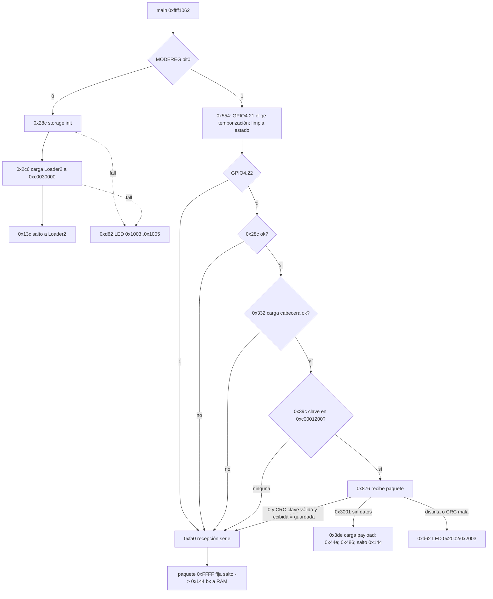

# E26-R20 — Selector del BootROM (`FUN_ffff1062`): bit 0 de `MODEREG`, GPIO(4) y clave de arranque serie

Fecha: 30-10-2026. Continúa [R19](e26-r19-darwin-usb-static.md) (pendiente `E26-R19-BOOTMAIN`), [R9](e26-r9-bootrom-ram-execution.md) y [R12](e26-r12-bootrom-static-audit.md). **Solo estático y emulación offline.** Sin cámara, USB, UART ni NAND.

Etiquetas: **BINARIO** = desensamblado Capstone del BootROM (`analysis/camera-dumps/updater-20261020-175427/bootrom.bin`, SHA `81a17e03…`, Thumb sobre ARM, base `0xffff0000`; aquí el mapeo es dirección = base + offset) · **REA** = descompilación Ghidra de `FUN_ffff1062` (sesión abierta y cerrada en este hito) · **EMULACIÓN** = [`r20_bootrom_selector.py`](../../analysis/e26-recovery/r20_bootrom_selector.py) (Unicorn; auxiliares sustituidas; solo valida la lógica de decisión) y [`tests/test_e26_r20_bootrom_selector.py`](../../tests/test_e26_r20_bootrom_selector.py) · **INFERENCIA** · **NO VERIFICADO**.

## 1. Resumen

1. **BINARIO + REA.** El BootROM se identifica a sí mismo: `Musashi Loader1 Ver.01.00 Dec  2 2011 10:45:17` (`0xffff1288`). `main` = `0xffff1062`. Tras inicializar (`0xd14`, `0xefc`, `0xd4c`, `0x244`) lee **un solo bit de selección: `MODEREG` (`0xf2915010`) bit 0** (`0xffff1094–109e`, guardado en `[0xc0010010]`). No hay otra lectura de ese bit en la ROM (`0xf2915000` se referencia en `0x1094` y en los receptores serie, que solo leen el bit 1).
2. **Bit 0 = 0 → arranque normal.** `0x28c` (inicializa almacenamiento) → `0x2c6` (carga Loader2 a `0xc0030000`) → `0x13c` (salto). Cualquier fallo → `0xd62` (LED de error, códigos `0x1003–0x1005`).
3. **Bit 0 = 1 → ruta de servicio**, que termina siempre en la recepción serie o en un arranque alternativo (§3). Con la cámara bloqueada pero que muestra el LED de Loader3 (R13), el BootROM tomó la ruta del bit 0 = 0.
4. **GPIO(4,RDATA) (`0xf2910410`) aporta dos bits más en la ruta de servicio:** bit 21 elige entre dos juegos de temporización (`0x554`); bit 22 (guardado en `[0xc0010010+4]`) salta directamente a la recepción serie (`0xfa0`).
5. **Hay una clave de arranque serie.** Si el almacenamiento carga una cabecera con una entrada de clave (4 B + CRC-32 reflejado, polinomio `0xEDB88320`) en `0xc0001200`, la recepción serie solo se habilita si el host envía la misma clave (`KEY f:%x r:%x`); con la tabla vacía no hay clave.
6. **INFERENCIA (moderada-fuerte): bit 0 = `BOOT_MAIN` (P7 del BIONZ, único pin de la red `CL1000`).** El bit 1 es `BOOT_SERIAL_IN` (Sony OSS CXD90014: `MISC_MODEREG_BOOT_SERIAL_IN`); en el chip hermano CXD4132 el mismo registro define `MODEREAD_BM1 = 0x2` (bit 1) y `DDRCKSEL` en el bit 24, no en el 0. El bloque BOOT del BIONZ en el esquema tiene exactamente tres entradas: `DDRCKSEL`, `BOOT_SERIAL_IN`, `BOOT_MAIN`. Por exclusión, bit 0 = `BOOT_MAIN` (BM0). Nivel por defecto: **0 en uso normal** (si no, la ROM no habría llegado a Loader2/3). Falta el nivel eléctrico (tensión, pull) del pad `CL1000`. **Cerrado estáticamente en [R31](e26-r31-bootmain-bit0-cierre.md).**

## 2. Diagrama (condiciones verificadas)

## 3. Tabla de decisiones (emulación)

| Escenario | Resultado |
|---|---|
| bit0=0, almacenamiento ok | salto a Loader2 |
| bit0=0, `0x28c` falla | LED de error |
| bit0=1, GPIO4.22=1 | recepción serie (`0xfa0`) |
| bit0=1, `0x28c` falla | recepción serie |
| bit0=1, `0x332` (cabecera) falla | recepción serie |
| bit0=1, sin clave en `0xc0001200` | recepción serie |
| bit0=1, clave presente, sin datos serie | arranque alternativo de payload, salto a RAM (`0x144`) |
| bit0=1, clave presente y coincide | recepción serie |
| bit0=1, clave distinta o CRC mala | LED de error (`0x2002/0x2003`) |

Códigos del LED (`0xd62`): corto = `código & 0xfff`, largo = `(código>>12) − 1` (`0xd78–0xd84`); no hay patrón de 3+2 posible desde la ROM (confirma R12).

## 4. Qué cambia respecto a R8/R9/R12

- **R12/R9 «condición del selector no determinada»: determinada.** Bit 0 de `MODEREG` (+ GPIO4.21/22 + estado del almacenamiento y de la clave).
- **El almacenamiento sano no impide la ruta serie:** con bit0=1 y GPIO4.22=0 hace falta además una cabecera cargada con la tabla de claves vacía (o ninguna clave) para llegar a `0xfa0`; con GPIO4.22=1 no se consulta el almacenamiento.
- **La ruta serie sigue siendo la de R9** (tipo 0 escribe RAM, tipo `0xFFFF` salta), ahora con una puerta de clave opcional.

## 5. Límites y pendientes

- **NO VERIFICADO:** contenido de la tabla `0xc0001200` (cabecera cargada por `0x332` con argumentos `(0,0,3,6)` hacia `0xc0000600`; el lector `0x150`/`0x1352` no se ha traducido a una posición en `bootloader.bin`); pines de GPIO(4) bits 21/22; significado de los dos juegos de temporización (bit21=1: `0x4a0,0x38d,0x70a,0x33e,1,0x15f900`; bit21=0: `0xe74,0xb18,0xf05,0xa23,0x14,0x44aa20`) en baudios; nivel y pull de `CL1000`.
- La emulación sustituye las auxiliares con valores controlados y **no** prueba su comportamiento real ni el hardware.
- ROM = volcado histórico (R7B); no prueba que la cámara actual lo ejecute igual.
