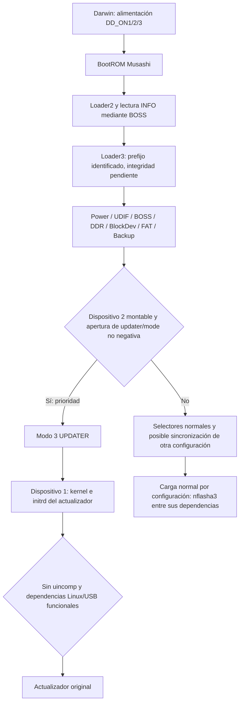

# E26-RECOVERY R5 — Loader3, servicio BIONZ y diagnóstico de SY-1028

> **Corrección R6 §1 (29-10-2026):** implementación BLDR del payload local recuperada y cotejada con upstream fijado. Solicita die0/plane0; INFO requiere plane1 para las últimas 21 páginas. Descarta metadatos y estados ECC tolerados por Loader2; concatenación pierde tramas vacías. El mapa físico y Loader3 íntegro siguen sin demostrarse. Véase [R6](e26-r6-recuperacion-bionz.md).

Fecha: 29-10-2026. Base comprobada: `480056cd`, tras revisar `fb1be962`, `0446275f` y `b998b31a`. Investigación exclusivamente sobre archivos locales: sin encendido, conexión, comandos a la cámara, escrituras ni firmware instalable. Continúa [E26](e26-recovery.md); no repite la auditoría TPZL ni el transporte de 0x32.

## Resultado y estrategia

**VERIFICADO EN ESQUEMA:** CN4906 de SIDE A tiene **UART0 de BIONZ en 4/5**, UART Darwin en 6/7 y enlaces opcionales a **SWD de BIONZ** en 11/12. Por tanto, la huella no pertenece exclusivamente a Darwin. No demuestra continuidad en esta unidad, acceso al depurador, un downloader ni escritura de NAND.

**VERIFICADO EN BINARIO:** el selector examinado prioriza abrir `\updater\mode` en el dispositivo 2 y asigna modo 3. La función no lee su contenido. La carga de kernel/initrd usa dispositivo 1. **La imagen contigua de 128 KiB no queda validada:** aparecen inconsistencias de checksum y de referencias de arranque en su tramo final. Sus funciones iniciales siguen siendo evidencia estática; no autorizan ejecutar ni escribir el candidato.

La primera vía que merece evaluarse es **observar UART0 de BIONZ**, después de identificar la cara y verificar el punto y nivel, para distinguir energía/Loader2/Loader3/carga/Linux. Si el arranque llega a Loader3, la recuperación deseable sigue siendo el actualizador original desde `nflasha1`; **no hay todavía una forma demostrada de activar su bandera en esta cámara bloqueada**. Si la bandera se borró al finalizar, no se ha demostrado un atajo de botones, USB o CN4906 que la sustituya. La reparación NAND directa continúa sin especificación física suficiente.

## 1. Validación del candidato y límites de la extracción

Fuentes: respaldo `analysis/camera-dumps/updater-20261020-175427/bootloader.bin`, SHA-256 `eb420385120f2cd7c9b071f67ce5808721b7de44fb78e2884a856e3c438a327f`; [inspector](../../scripts/e26_recovery/inspect_loader3.py), [resultado](../../analysis/e26-recovery/loader3-info.json) y [evidencia REA](../../analysis/e26-recovery/r5-rea.json). No se alteró el respaldo.

**VERIFICADO OFFLINE:** INFO en `0x18000` tiene registros de 64 bytes y página declarada `0x800`. Entradas 5→6 contienen 43 y 21 páginas; ambas repiten checksum `0xeda2f689`, versión `0x21015a00`, carga y entrada `0xc01f0000`. El parser local de referencia `references/fwtool/fwtool/sony/bootloader.py` identifica los campos checksum, versión y carga; su lector no resuelve la geometría die/plane/block ni la cadena de INFO. No sirve para certificar por sí solo este recorte.

**VERIFICADO EN BINARIO:** `Loader2:0xc0030de8` concatena los fragmentos leídos por `0xc00306ce`, avanzando el destino `pages × page_size`, y sigue el índice `next`. El lector pasa die/plane/block/page a BOSS, acepta retorno 0 o `-0x20006` si se completó exactamente el número de páginas solicitado. Esta rutina no compara el campo checksum. No convertir las entradas en copias redundantes.

El recorte `0x22800–0x427ff` conserva SHA-256 `8fd98a4140bf85f955c994ea263c4a295846e049121b593c0a823aec01620c07`, pero **igual longitud no demuestra igual contenido que la cadena BOSS**:

| Comprobación | Resultado | Alcance |
|---|---|---|
| Tamaño 64 × 2048 | Coincide: 131072 B | Solo longitud |
| Suma de palabras LE32 módulo 2³² | `0x05c12355`, frente a INFO `0xeda2f689` | No coincide; algoritmo del checksum del loader aún no confirmado |
| Controles del mismo respaldo | BossFirm: suma `0x229c438e`; DGU: `0xe334abeb`, ambas iguales a sus campos INFO | Respalda investigar suma32; otros miembros tampoco coinciden, no generalizar autenticidad |
| Entrada ARM | `0xc01f0000: b 0xc01f0028`; allí configura SP y llama a `0xc020e090` / `0xc020e024` | Entrada nominal y destinos comprobados contra instrucciones |
| Tabla de inicialización | `0xc01f0078` calcula límites `0xc020fd5c–0xc020fd7c`; las dos filas presentes no tienen destinos/tamaños coherentes con una tabla de inicialización de SRAM | Contradice interpretar el recorte entero como imagen ejecutable íntegra |
| Destinos tempranos del runtime | REA encuentra instrucciones inválidas en `0xc020e090`, `0xc020e024` y `0xc020c45c` | No usar sus pseudocódigos como semántica válida; no prueba daño en la cámara |

**NO DEMOSTRADO:** reconstrucción física completa, causa exacta de la incoherencia, ausencia de transformaciones del volcado, checksum del loader, firma y totalidad de segmentos externos. Se buscó un segundo fragmento de 21 páginas en posiciones de página del mismo respaldo manteniendo el primero: ninguna combinación coincidió con la suma32 de INFO. Esto no agota mapeos/intercalados ni descarta que los bytes correctos existan en otra representación.

El origen del archivo importa: `scripts/updater_info_dump.py:28` concatena los bloques devueltos por `readBootloader()`; `references/pmca/pmca/platform/backend/usb/__init__.py:91` recibe bloques del comando BLDR; `updatershell/usbshell.cpp:121–141` utiliza `bootloader_get_blocks` y `bootloader_read_block`, omitiendo errores de lectura de bloque. La implementación de esas dos funciones pertenece al submódulo `updatershell/platform`, ausente del checkout local. No se conoce aquí el orden ni la cobertura física de los bloques concatenados. **Siguiente comprobación offline concreta:** recuperar esa implementación de la revisión usada para el volcado, establecer su mapa y reconstruir INFO 5→6 antes de seguir rutinas del tramo incoherente. No exige tocar la cámara.

**Corrección de alcance de [E26 R3](e26-recovery.md):** sigue existiendo un candidato con código útil; la hipótesis de contigüidad no ha superado la validación. No denominarlo «Loader3 validado» ni interpretar el resultado del inspector como certificación de integridad.

## 2. Dependencias anteriores y selección de UPDATER

Las siguientes direcciones son del prefijo coherente del candidato; el runtime y sus copias/segmentos no están completamente validados. **VERIFICADO EN BINARIO**, con ese límite de procedencia:

1. `0xc01f11ec` llama a `0xc01f0cca` antes de seleccionar modo. Esta inicializa Sync (`0x5130`), Power (`0x55dc`), UDIF plataforma (`0x686c`), UDIF drivers (`0x68a4`), BOSS (`0x2a48`), DDR (`0x39de`), BlockDev (`0x2a4c`) y FAT (`0x3d50`); cambia la fuente de Backup (`0x49d2`), ajusta log, inicializa Power2 y evalúa reset de Backup (`0x21c6`). Los errores comprobados abortan hacia la ruta de fallo; no hay paso automático universal a UPDATER.
2. `0x49d2` intenta Backup en memoria cuando procede; en la ruta de archivo monta dispositivo 2 y carga `\Backup.bin`, con alternativa `\Backup.bak`. Si falla el cambio de Backup, `0x0cca` solo tolera ese error si `0x159a` encuentra la bandera. **No significa que pueda operar sin toda información Backup**: parámetros previos y `0x3108` usan Backup. Existen ramas de reset de Backup; no son una restauración conservadora ni se proponen como acción.
3. `0xc01f159a` llama `fat_mount(2)` y `0xc01f44c6("\updater\mode")`. Devuelve 1 si el resultado es no negativo; no llama al lector de contenido. `0x44c6` resuelve el nombre en FAT y devuelve tamaño/error. Un archivo vacío puede satisfacer la comprobación. Un montaje o búsqueda fallidos devuelven falso; no se distinguen «ausente» y «dañado» mediante ese booleano.
4. `0xc01f1de6` asigna 3 cuando la comprobación es verdadera, antes de los selectores normales. La ruta tiene consultas Backup, pero no exige un valor particular dentro de `mode`. **No** confundir el número 3 de Loader3 con `mode3`, que selecciona una modalidad posterior del actualizador Linux.
5. Tras elegir, `0xc01f1544` registra modo con Backup `0x51000f` y emite `BOM:<<BootMode: %u>>`. No basta cambiar históricamente ese valor: el selector vuelve a calcularlo y escribirlo. En el respaldo de actualización vale 3; no es lectura posterior al bloqueo.
6. `0xc01f1312` despacha 3 a `0xc01f1378`; configura energía, estado y hardware mediante Backup y llama a `0xc01f068a`. Esta monta dispositivo 1 y carga `\boot\loadaddr.txt`, `\boot\vmlinux.bin`, `\boot\initrd.img`. `0xc01f04b6` exige una dirección de kernel no nula antes del salto. `0x1378` no comprueba todos los retornos locales: su retorno cero tampoco prueba que el kernel se haya cargado.

**INFERENCIA RESPALDADA:** dispositivos 1 y 2 corresponden al contenido lógico de `nflasha1` y `nflasha2`: archivos de arranque, Backup y `updater/mode` coinciden con sus respaldos y con los montajes explícitos del software Sony. `0xc01f4690 → 0xc01f2c2a` pasa el índice de partición a BlockDev. La traducción física/tabla completa y las dependencias del firmware BOSS no están validadas. **La función de carga UPDATER no accede a `nflasha3`; la independencia total previa sigue NO DEMOSTRADA.**

### Otras entradas, prioridades y alternativa por sincronización

`0xc01f1de6` parte de modo 1 (COLD). Además de 3, puede producir 2 por `chk_hotboot`, 4 por `chk_cipa`, 5 por ajuste/ANK, 6 por `0x2620`, 7 por condiciones de apagado, 8 por reinicio, 9 por `0x272e`, 10 por `chk_warmboot`, 11 por `chk_ssboot`, 12 por reset Backup y 13/14 por variantes de apagado/carga de imagen. Varios predicados usan Backup, estado del controlador de energía, reset, fecha y memoria retenida. La asignación de nombres no presentes en el código queda pendiente; no traducir todos a modos de servicio.

Hay una excepción relevante a «solo bandera»: sin bandera, el selector llama `0xc01f51f4(&modo,4,1)`. La configuración derivada de Backup `0x51001c` controla `0xc01f50f4`: byte 0→tipo interno 1, byte 1→3, byte 2→2. Solo el tipo interno 2 permite que el intercambio copie de vuelta los cuatro bytes del modo. `0xc01f5148/0x5278/0x6e3e` intercambian un paquete de firma `REIO` mediante SIO `0xf2405810`, con número de secuencia y checksum. **Es una entrada alternativa del código para otra configuración, no un comando USB ni un puerto UART de usuario probado.**

**VERIFICADO OFFLINE:** tanto `LdrBkup.bin` del mismo respaldo (propiedad `0x51001c`, offset `0x1e4` de ese miembro) como su BK4 `backup.bin` contienen byte `01`: el tipo interno resultante es 3 y `0x51f4` retorna sin intercambio. La alternativa de recepción no está habilitada en ese estado histórico A6000. Suponer que Darwin puede enviar modo 3 por UART o cambiar Backup para habilitarla no está justificado. No se leyó el valor actual.

| Entrada propuesta | Evaluación para activar UPDATER |
|---|---|
| Bandera existente | **VERIFICADO EN BINARIO:** basta apertura válida; su existencia actual es **PENDIENTE DE MEDICIÓN** |
| Escribirla desde Linux principal | Productor Sony `up.sh`; depende del sistema que ahora no arranca. No aporta independencia |
| Backup `0x51000f` | Es salida del selector observado; no hay orden de forzado demostrada |
| Intercambio SIO `REIO` | Código alternativo condicionado; deshabilitado con el byte histórico `01` |
| Botones/servicio/ANK | Hay selectores para otros modos, ninguno documentado aquí como sustituto de la bandera para modo 3 |
| Fallo de arranque | La ruta identificada emite error/LED; no se ha demostrado fallback automático a 3 |
| BOOT_MODE de CN4906 | Red compartida opcional FIQ/MD0; no se ha enlazado con el selector 3 |
| USB | Sin productor de modo 3 previo al kernel demostrado |

La cobertura describe el selector identificado, no todos los programas que podrían modificar memoria ni el firmware completo. Ninguna de estas conclusiones autoriza forzar entradas.

## 3. Qué puede persistir tras el éxito declarado

**VERIFICADO EN BINARIO:** en `libupdatercommon.so`, `ModeFlagFile:0x1633c` usa `updater/mode` y `CompleteFlagFile:0x16444` usa **`updater/comp`**. `BaseFlagFile::Create:0x16220` abre, hace `fsync` y cierra; si el cierre falla solo registra. `Delete:0x161b4` usa `unlink` y lanza excepción al fallar. `MountPoint::Umount:0x15354` devuelve éxito únicamente si `umount` devuelve 0. Direcciones REA de ELF reubicados, no RAM física.

| Orden parcial verificado | Operación | Implicación y límite |
|---|---|---|
| Inicio interno | `StartUpdate:0x24e88` crea `mode` para el modo de acción USER=3 y ciertos otros modos; elimina `comp` anterior | Ruta condicionada por acción/predicado; no fotografía del estado actual |
| Procesamiento | Imágenes de partición y scripts; Darwin configurado como hilo | Comprobación de datos y retornos no equivale a arranque posterior |
| Espera ya resuelta en R3 | Join de hilos; después HasError | No se repitieron thunks/vtables de Join |
| Errores residuales | `ThreadPlugin::HasError:0x23c42` lee byte `this+0x48` bajo mutex; `setError:0x247d4` lo pone a 1 | El flag no es simplemente ignorado |
| Landing pads | Bytes `0x24860–0x248c6`: `__cxa_begin_catch`, callback de error, llamadas a thunk `0x1d8bc = setError`, `__cxa_end_catch` y retorno | REA omitió estos bloques en el cuerpo de startRoutine; comprobados por Capstone. La cobertura completa de excepciones/fallo de join sigue abierta |
| EndUpdate | `endupdate.sh:25–97` gestiona Backup, desmonta, borra MPR y vuelve a montar settings | Hay operaciones persistentes ajenas a nflasha3; no recomendar ejecutar el script manualmente |
| Finalización normal | `CompleteUpdate:0x2516c` revisa metadatos, elimina mode1/2/3/5/6 existentes, crea `comp`, borra `mode`, desmonta | `mode4` no figura en esa lista; no afirmar que elimina mode1–6 completos |
| Salida del gestor | `mf:0xa038` espera Complete, cierra entrada, comprueba HasError y escribe **un byte 2** a FIFO2 si no hay error | No hay comprobación de arranque Linux normal en esa rama |
| Adaptador | `libsenupdater:0x11b28` espera hasta 300000 ms el retorno; con resultado 2 actualiza numerador a `0x99`; `Status::Get:0x1199e` devuelve estado | Frontera de éxito interna comprobada; el punto exacto del texto gráfico «Done» del PC sigue **NO DEMOSTRADO** |

**VERIFICADO OFFLINE:** `endupdate.sh:64` compara `$? -lt 0` tras `ud_backup_write.elf`. Un estado de salida del shell es no negativo; se reprodujo con `/bin/sh`, salida 255 → prueba falsa. Esa condición no detecta retornos no cero de la herramienta. No prueba que fallara en el incidente. El `ud_keep_backup.elf` posterior sí se comprueba y los desmontajes tienen manejadores de error.

El initrd respaldado añade dos condiciones distintas:

- `usr/bin/UdtrMain.sh:56–59`: si existe `updater/uincomp`, desmonta y entra en `ERROR_UINCOMP=54` antes de `execute_ufp.sh`. **No es `comp` ni `mode`**. No se ha identificado aquí todo el ciclo de creación/eliminación de `uincomp`.
- `usr/bin/execute_ufp.sh:13–17`: si encuentra `comp`, elimina `mode*` y desmonta; más adelante arranca `sauu`. Por eso también existe limpieza de banderas fuera de CompleteUpdate.

**INFERENCIA RESPALDADA:** una finalización normal puede dejar `comp` presente y `mode` ausente antes de intentar arrancar la imagen principal. Es compatible con éxito del proceso y fallo en el siguiente encendido, con Darwin escrito según su herramienta y sin validación de arranque, o con un payload que pasa sus comprobaciones pero falla en el lector real. **No demuestra cuál ocurrió.** Un fallo comprobado de `umount` lanza excepción: no se afirma que produzca éxito en la ruta normal. Operaciones aún pendientes tras un join fallido son una posibilidad condicionada al error residual, no una propiedad de toda actualización. La UI del host no está trazada hasta su última instrucción y no se leyó NAND tras el bloqueo.

## 4. CN4906 pin por pin y separación de procesadores

**VERIFICADO EN ESQUEMA:** manual L3 PDF 38 (impresa 6-26) para CN4906; PDF 26 (6-14) para BIONZ; PDF 23 (6-11) para Darwin. **VERIFICADO OFFLINE:** PDF 50/51 sitúa la huella en SIDE A y Darwin/CL5701/CL701/CL703–707 en SIDE B. `XX` significa componente no montado en el esquema; la población/continuidad de esta placa continúa **PENDIENTE DE MEDICIÓN**.

| Pin | Nombre en CN4906 | Origen/destino trazado | Intermedios y montaje según esquema | Nivel/estado durante reset | Función y acceso |
|---:|---|---|---|---|---|
| 1 | REG_GND | Masa de placa | Directo | Referencia 0 V | Referencia; huella A, acceso real pendiente |
| 2 | BOOT_MODE_1 | IC6000 FIQ (AB22) / Darwin MD0 (L10) | FIQ por R4910 **XX**, MD0_DWN por R4927 **XX**; CL4910 en rama de huella, CL5701 lado MCU | No hay nivel de strap garantizado en la huella; depende de enlaces | No equivale a forzar modo UPDATER; A frente a islas B |
| 3 | EVER_3.15V | Rail de placa | Directo; CL4911 | Nominal 3,15 V de alimentación; estado real desconocido | No es permiso para alimentar ni referencia segura de todos los I/O |
| 4 | UART_RXD_MSS | IC6000 UART0_RXD AB18, red DEBUG_UART0_RXD | Sin resistencia serie mostrada en esta rama | Entrada BIONZ; nivel/reset efectivo pendiente | Puerto BIONZ; no usar TX externo en diagnóstico pasivo |
| 5 | UART_TXD_MSS | IC6000 UART0_TXD AA18, red DEBUG_UART0_TXD | Sin resistencia serie mostrada en esta rama | Salida BIONZ; dominio de alimentación del I/O debe comprobarse | **Primer candidato de observación pasiva**, huella A |
| 6 | UART_RXD_DWN | Darwin P21/SIN0 B3, DWN_UART_RXD | Directo en hoja 38; CL722 lado MCU | Entrada; mux/reset y nivel efectivos pendientes | Puerto Darwin, distinto del de BIONZ |
| 7 | UART_TXD_DWN | Darwin P22/SOT0 B2, DWN_UART_TXD | Directo; CL721 lado MCU | Salida configurable; no garantiza mensajes de arranque | Observación Darwin si aporta diagnóstico |
| 8 | NSRST | Darwin INITX L7, XDWN_RESET | Directo; CL701 | Entrada reset activa en bajo; tensión actual pendiente | No demostrar reset de BIONZ por el nombre NSRST |
| 9 | TDO | Darwin P04/TDO/SWO | Directo, TDO_DWN; CL707 | Salida de debug/configurable | No es TDO del JTAG BIONZ |
| 10 | RTCK | Sin conexión dibujada fuera de la huella | No hay ruta verificable | Indeterminado | No asignar a un MCU por etiqueta |
| 11 | TCK(SWCLK) | BIONZ SWCLK W25 **o** Darwin P01/TCK/SWCLK | BIONZ por R4911 **XX**; Darwin por R4915 **XX**, CL704 | Rutas opcionales; estado efectivo indeterminado | Puerto compartido por opciones, no asumir que ambos procesadores están conectados |
| 12 | TMS(SWDIO) | BIONZ SWDIO W26 **o** Darwin P03/TMS/SWDIO | BIONZ por R4912 **XX**; Darwin por R4916 **XX**, CL706 | Bidireccional; selección/pull reales pendientes | Mismo límite de exclusividad/continuidad |
| 13 | TDI | Darwin P02/TDI | Directo, TDI_DWN; CL705 | Entrada de debug; función inicial genérica FM3 no acredita acceso en placa | No conectar al TDI BIONZ |
| 14 | NTRST | Darwin P00/TRST | Directo, TRST_DWN; CL703 | Reset de debug activo bajo; estado real pendiente | No es XRESET_CR del BIONZ |
| 15 | DEBUG_MODE | VIO_FLD / XDWN_RESET | VIO por R4913 **XX**; reset por R4917 **XX** | Dependiente de montaje; no nivel garantizado | No es una orden de recuperación demostrada |
| 16 | REG_GND | Masa de placa | Directo | Referencia 0 V | Igual cautela de identificación que pin 1 |

La huella aparece **XX/no montada**; contactos mecánicos 17/18 también van a masa en el dibujo, fuera de los 16 funcionales. La tabla es de conectividad documental, **no guía de orientación física de una foto ni instrucciones para conectar un adaptador**.

La traza BIONZ es independiente de Darwin: IC6000 `UART0_TXD AA18 → DEBUG_UART0_TXD → CN4906.5`; `UART0_RXD AB18 → DEBUG_UART0_RXD → CN4906.4`. La hoja PDF 37 (6-25) prolonga estas redes hacia el Multi Terminal (TX rotulado contacto 8 mediante CM4008, RX contacto 9). Eso verifica la red del esquema, **no la numeración del conector vista desde fuera ni el nivel eléctrico o mux en este cuerpo**. Permite considerar un breakout externo como alternativa a retirar la placa, después de verificar orientación/continuidad/niveles. No emitir una conexión basada en la numeración de un blog.

El JTAG convencional de BIONZ **no** está trazado a TDI/TDO/NTRST de CN4906: PDF 26 muestra TDI G25/TCK H25/TMS F26 unidos a alimentación, TDO F25 y RTCK G26 sin salida de servicio trazada, y NTRST H26 en XRESET_CR. Sus señales SWD W25/W26 son una ruta distinta, opcional por R4911/R4912. **No demuestra que el puerto esté desbloqueado, qué AP/controlador expone, que permita detener CPU o que pueda programar NAND.**

## 5. BootROM, almacenamiento y punto más temprano de acceso

**VERIFICADO EN BINARIO:** BootROM `0xffff1062` lee `0xf2915010` bit0. La rama cero inicializa la ruta `0xffff028c`, carga por `0xffff02c6` y salta al destino fijo `0xc0030000`. Con bit0 distinto de cero examina `0xf2910410` bit22 y otras condiciones; `0xffff0fa0` llega a un salto indirecto por `[0xc000500c]` a través de `0xffff0144`. Los errores tienen rutas propias. **NO DEMOSTRADO:** identidad eléctrica de esos bits, su correspondencia con pines/straps, formato y transporte utilizables de la ruta alternativa o ejecución arbitraria desde un puerto externo. En particular no vincular BOOT_MODE_1/FIQ a esos bits por similitud del nombre y no inferir recuperación USB.

El punto externo más temprano **documentado eléctricamente** es el SWD opcional de IC6000; su disponibilidad lógica es **NO DEMOSTRADA**. El punto interno más temprano con una ruta concreta al actualizador es el selector de Loader3, después de inicializar la pila de energía/almacenamiento. UART0 aporta observación; no se identificó un prompt, monitor, downloader ni primitiva UART de escritura ejecutable por el usuario.

| Pregunta de almacenamiento | Evidencia actual y límite |
|---|---|
| Chip exacto | Manual identifica IC6000 **MHZ4G8G01A**, procesador/sistema; no documenta un componente NAND separado con modelo y pinout recuperables. No se deduce de su nombre la composición interna |
| Encapsulado combinado | PDF 27 muestra conexiones POP/LPDDR2. Eso prueba alimentación de memoria asociada, **no demuestra dónde está el die NAND** ni permite equiparar RAM y almacenamiento |
| Bus externo | PDF 24 muestra interfaz FLASH, FLS_AD/FLS_ADDR, puentes R1012–R1014 XX y puntos LND. No identifica por sí sola el destino físico que contiene nflasha3 ni un bus SPI |
| Controlador | Loader3 `0x2a48` inicializa/reinicia MuMin por BOSS, `0x2a4c` inicializa BlockDev; `0x2c2a` utiliza índices de partición y offsets de 512 B |
| Páginas/bloques | INFO usa páginas 2048 B y coordenadas die/plane/block/page para arranque. No es una especificación de toda la NAND ni del mapeo físico de nflasha3 |
| ECC/bad blocks/FTL | BOSS distingue al menos retornos de lectura y número completado; no se cerraron algoritmo ECC, OOB, tabla de defectos, remapeos ni gestión de desgaste |
| Imagen lógica | Respaldos `/dev/nflasha*` contienen datos servidos por el controlador. No incluyen por ello necesariamente OOB/ECC ni metadatos físicos; el informe de particiones del respaldo no es geometría del chip |

**NO DEMOSTRADO:** una programación física mínima viable de nflasha3 con un programador concreto. Antes de especificar hardware de escritura faltan identificación del componente/die y encapsulado, esquema/pinout de su bus, topología accesible, tensiones, aislamiento, geometría, ECC/OOB, bad blocks, traducción lógica y herramienta compatible. Un programador SPI genérico no está justificado. Un servicio de placa podría aportar esa información, pero no se afirma que Sony o un taller disponga de un procedimiento compatible con este incidente.

La restauración mínima deseada escribiría únicamente **el contenido lógico original de nflasha3 a través del controlador que conserva su traducción**, después de leer y verificar el estado actual. Una escritura NAND cruda tendría que preservar además OOB/ECC y remapeos y limitar borrados a bloques identificados; con FTL/desgaste no se presume que una partición corresponda a un intervalo físico fijo. Preservar íntegros Backup/NVRAM, nflasha2, identificadores, calibraciones, fábrica, bootloaders, otras particiones y metadatos. Si el diagnóstico señala Darwin, restaurar solo nflasha3 puede no resolverlo. El actualizador original tampoco se promete selectivo: sus scripts pueden tocar Backup/MPR y otras regiones; revisar su alcance antes de cualquier autorización.

## 6. Darwin como diagnóstico alternativo

**VERIFICADO EN ESQUEMA/BINARIO por E24:** Darwin controla DD_ON1/2/3; la ausencia de USB admite fallo de alimentación, arranque BIONZ, almacenamiento, Loader3 o Linux. No es diagnóstico de Darwin. CN4906.6/7 y las islas SIDE B pertenecen a su interfaz; no restauran directamente nflasha3.

El manual FM3 local, impreso p.34, documenta selección Serial Writer con MD1=0/MD0=1 muestreados al liberar reset; remite explícitamente al **Flash Programming Manual del producto** para detalles, ausente aquí. Compatibilidad de una herramienta, canal, contraseña/protección de lectura, bloqueo y consecuencias del desbloqueo en MB9AF004B siguen **NO DEMOSTRADAS**. No recomendar un desbloqueo o borrado masivo.

**Corrección de [E25-04](e25-04-recuperabilidad-y-decision.md) y [E24-02](e24-02-protocolo-actualizacion-darwin.md), limitada al nombre del registro:** el soporte de debug inicial se documenta en capítulo 14 «Debug Interface» y los selectores `JTAGEN0B/JTAGEN1S` de **EPFR00**; SPSR, capítulo 10 §4.27, selecciona USB/osciladores, no demuestra habilitación SWD. El reset inicial de la familia no acredita acceso/protección en esta placa. Tampoco está validado el «3,3 V» genérico de adaptadores propuestos históricamente; la tabla eléctrica de esta unidad debe preceder a cualquier conexión.

## 7. Diagnóstico pasivo preparado, sin ejecución

**PENDIENTE DE ACCESO FÍSICO:** no hay imágenes en `/home/nicolas/.codex/attachments/` con extensiones PNG/JPEG/WebP al comprobar esta sesión. No se buscó indiscriminadamente en fotos personales. No está identificada la cara visible. Fotografía necesaria: vista perpendicular de toda la placa actualmente expuesta, con conectores/flex y orientación del cuerpo visibles; otra macro nítida de CN4906 y su entorno, sin mover placa ni contactos. Comparar con PDF 50/SIDE A (CN4906, IC6000) y 51/SIDE B (IC5700/CL); el lado de la cámara desde el que se tomó no basta.

Esto es un protocolo para otra ejecución **expresamente autorizada**, no una orden de encender o conectar ahora. El circuito de flash puede retener tensión peligrosa incluso sin batería; la inspección y cualquier medición deben quedar a cargo de una persona competente, sin acceder al circuito del flash ni improvisar una descarga.

| Paso | Instrumental / ubicación | Precondiciones | Evidencia esperada y límites | Riesgo/control |
|---|---|---|---|---|
| 1. Identificación visual | Foto y manual PDF 50/51 | Sin mover placa ni cableados | Determina cara y qué huellas quedan expuestas | Evitar tocar circuito de flash; no supone accesibilidad |
| 2. Validación de ruta | Macro, esquema y, solo si se autoriza, medición de continuidad apropiada sin alimentación | Tierra/pin1/orientación identificados; placa segura; enlaces XX inspeccionados | Distingue pin5 BIONZ, pin7 Darwin y rutas SWD realmente pobladas | Cortos y energía residual; sin puentear resistencias ausentes |
| 3. Nivel de UART | Osciloscopio de alta impedancia y sonda adecuada en punto previamente identificado | Referencia de masa inequívoca, instrumento que no introduzca alimentación ni bucle de tierra; encendido autorizado aparte | Amplitud, reposo, actividad y velocidad; establece receptor compatible | No usar tensión nominal de pin3 como prueba del nivel TX |
| 4. Captura BIONZ | Receptor/análisis lógico de alta impedancia; **solo observar TX BIONZ y referencia verificadas** | Nivel, orientación y protección contra backfeed comprobados; sin conductor transmisor, VCC, reset ni straps; autorización de captura/encendido | Mensajes Loader2/LD3/BOM, errores BOSS/FAT, salto a kernel y Linux. 115200 8N1 es hipótesis histórica a cotejar con la señal | No enviar comandos; silencio no demuestra CPU apagado |
| 5. Energía si UART no discrimina | Osciloscopio/multímetro apropiado; DD_ON1/2/3 y rails definidos por CP5100 | Elegir puntos físicamente identificados y accesibles con esquema; autorización específica | Enables ausentes vs enables presentes sin rail; rails presentes reducen hipótesis Darwin/alimentación pero no prueban ejecución | No alimentar BIONZ directamente; no señalar pads no verificados |
| 6. Darwin si procede | Captura de TX Darwin con iguales condiciones | Separada de BIONZ y con nivel validado | Puede acreditar actividad del MCU; no necesariamente tiene consola/boot log | UART sin texto tampoco demuestra que Darwin no corre |
| 7. Debug, solo diagnóstico posterior | Depurador SWD compatible y cadena confirmada | Solo si las medidas apuntan al procesador correspondiente; identificar protección/efectos de attach, sin auto-unlock | Lectura de estado podría reducir la etapa; attach puede detener CPU y alterar energía/tiempos | **No es captura pasiva**. No se incluye dentro de la autorización de UART |

Una traza con último marcador identifica al menos la etapa alcanzada; no garantiza por sí sola la causa exacta. Para diferenciar Darwin que no corre de Darwin que falla en energía hace falta evidencia adicional de su actividad y de DD_ON/rails. `BOM:<<BootMode: 3>>` + errores de FAT1 o carga separaría selección de carga; salto a kernel + registros Linux desplazaría el diagnóstico después del loader. TPZL/LDEC observado situaría esa hipótesis en una ejecución real. Ninguno de estos resultados se inventa a partir del LED.

## 8. Comparación de vías y decisión

En todas las filas, la disponibilidad en la unidad actual está sin medir. «No Linux» significa que la entrada propuesta sería anterior al Linux normal; **no** demuestra que exista un procedimiento usable.

| Vía / objetivo | Evidencia concreta y estado | Herramienta / acceso SIDE B | Dependencias Linux / Darwin | Calibraciones y siguiente comprobación |
|---|---|---|---|---|
| Loader3 → UPDATER: reinstalación original | **VERIFICADO EN BINARIO** condicionado a integridad/dependencias; activación independiente **NO DEMOSTRADA** | Actualizador Sony; entrada por bandera requiere vía de acceso aún desconocida; B no intrínseca | Sin Linux principal; sí kernel/initrd del actualizador y energía Darwin funcional | Revisión de scripts y copia actual antes de escribir; confirmar por UART modo y carga |
| Servicio BIONZ: diagnóstico/posible SRAM | UART0 y SWD opcional **VERIFICADO EN ESQUEMA**, capacidad lógica **NO DEMOSTRADA** | UART pasiva primero; SWD/ICE específico después, enlaces XX; huella A, B no exigida documentalmente | Teóricamente sin Linux; BIONZ alimentado, normalmente depende de Darwin en placa | Sin primitive NAND validada; identificar puerto/AP/protección y efectos antes de attach |
| Controlador NAND/BOSS: escritura lógica selectiva | Lectores e índices de partición **VERIFICADO EN BINARIO**; interfaz de restauración **NO DEMOSTRADA** | Ejecutor/monitor compatible no identificado; acceso físico depende de la entrada elegida | Podría ser previo a Linux; requiere controlador, configuración y energía | Conservar traducción y Backup; demostrar lectura/verificación por misma ruta antes de escritura |
| NAND especializada: partición física | Chip/die, bus, ECC/OOB y mapa **NO DEMOSTRADOS** | Programador/socket/aislamiento específicos todavía indeterminados; desmontaje B o extracción no se puede fijar | Sin Linux; dependencia Darwin depende de aislamiento/alimentación de la técnica | Riesgo alto por borrado/remapeo; identificar almacenamiento y lectura íntegra repetible primero |
| SWD/JTAG Darwin: aplicación MCU | Señales **VERIFICADO EN ESQUEMA**, acceso/protección **NO DEMOSTRADOS** | Depurador FM3; CN A condicionado, islas directas B pueden exigir levantar placa | Sin Linux; entrada de debug no necesita aplicación sana si accesible | Respaldar flash completa y protección; no corrige NAND BIONZ |
| Serial Writer FM3: MCU independiente de aplicación | Modo familiar **VERIFICADO OFFLINE**, protocolo concreto/protección **NO DEMOSTRADOS** | Escritor compatible y MD0/reset/UART; A condicionado R4927, alternativa B | Sin Linux ni aplicación Darwin funcional, con energía/ROM del MCU sanas | No auto-unlock/erase; obtener manual de flash exacto antes de seleccionar herramienta |
| Servicio profesional de placa | Opción de diagnóstico, **no procedimiento de recuperación demostrado** | Técnico con esquema, medida/depuración y recursos de memoria; desmontaje según hallazgo | No se puede fijar hasta conocer técnica | Encargar diagnóstico/conservación de placa, datos y calibraciones; ningún cambio de placa ni borrado general implícito |

**Estrategia concreta:** confirmar foto y punto UART0 accesible sin retirar placa → verificar nivel y obtener traza pasiva autorizada → clasificar energía/loader/kernel → evaluar actualizador original solo si se demuestra cómo seleccionarlo y qué regiones tocará. Si la traza confirma fallo en la imagen principal con `mode` ausente, investigar primero el SWD BIONZ opcional y una entrada al controlador conservando sus metadatos; no saltar a reprogramar Darwin ni a NAND cruda. El montaje faltante de R4911/R4912 puede impedir esa entrada desde la huella; no se propone soldarlo en esta ejecución.

Antes de cualquier escritura faltan: diagnóstico discriminante, lectura del estado actual, copia externa verificada, integridad del loader/mapeo pertinente, acceso de lectura reproducible por la herramienta elegida, validación de sus protecciones/efectos y alcance de la restauración sobre calibraciones y otras regiones. La autorización deberá ser específica de esa operación.

## 9. Respuestas de cierre y pendientes explícitos

| # | Pregunta | Respuesta al cierre de R5 |
|---:|---|---|
| 1 | ¿Loader3 validado? | **NO DEMOSTRADO** como imagen completa; prefijo identificado, incoherencia de recorte documentada |
| 2 | ¿Todas las dependencias? | **NO DEMOSTRADO**; inventario de inicialización y Backup ampliado, runtime/segmentos/BOSS pendientes |
| 3 | ¿Qué activa UPDATER? | **VERIFICADO EN BINARIO:** montaje 2 + apertura no negativa de `updater/mode`, sin leer contenido |
| 4 | ¿Sin nflasha3? | La función carga dispositivo 1 sin nflasha3; independencia global y activación real **NO DEMOSTRADAS** |
| 5 | ¿Activación física? | **NO DEMOSTRADA**; SIO alternativo condicionado y deshabilitado en respaldo histórico |
| 6 | ¿CN4906 SIDE A? | **VERIFICADO OFFLINE** en plano PDF 50 |
| 7 | ¿Qué está conectado? | Conectividad de esquema en §4; resistencias XX y continuidad real **PENDIENTE DE MEDICIÓN** |
| 8 | ¿BIONZ o Darwin? | **VERIFICADO EN ESQUEMA:** ambos; UART BIONZ directa dibujada, SWD BIONZ condicionado |
| 9 | ¿Acceso físico NAND? | Por procesador/controlador sería deseable; programador directo **NO DEMOSTRADO**, sin chip/mapa/ECC completos |
| 10 | ¿Desmontaje? | Huella A no exige B en plano, accesibilidad actual **PENDIENTE DE ACCESO FÍSICO**; técnica NAND directa indeterminada |
| 11 | ¿Calibraciones? | Restauración mínima lógica de nflasha3 si el diagnóstico la justifica; preservar Backup/NVRAM y metadatos; procedimiento de escritura sin validar |
| 12 | ¿Medición discriminante? | UART0 pasiva + DD_ON/rails cuando haga falta; un silencio aislado no localiza el fallo |
| 13 | ¿Primera vía? | Diagnóstico por UART BIONZ; después Loader3→actualizador original si se resuelve entrada |
| 14 | ¿Antes de escribir? | Lectura actual y respaldo, herramienta/ruta verificada, integridad/mapeo, protección y alcance; autorización independiente |
| 15 | ¿Prueba frente a hipótesis? | Pruebas estáticas etiquetadas arriba; TPZL causal, estado actual y recuperación ejecutable permanecen sin prueba física |

La investigación no declara recuperada la cámara ni agotadas todas las vías. Quedan pendientes offline concretos: fuente BLDR de la revisión usada y mapa BOSS; dependencias completas tras reconstrucción; productor/eliminación de `uincomp`; frontera gráfica Done y cobertura EH/join; documentación de NAND/flash FM3. Los pendientes físicos son foto, continuidad/población, niveles, traza y energía. Ninguno se sustituyó por una prueba destructiva.

## Reproducción y validación

REA primero para Loader3, Loader2, BootROM, `libupdaterbody.so`, `libupdatercommon.so`, `mf` y `libsenupdater.so`; instrucciones de entrada/selector/landing pads cotejadas con bytes. Las direcciones ELF de REA incluyen su base de análisis `0x10000`; los offsets de archivo de landing pads son `0x14850–0x148c7`. La evidencia JSON conserva identidades, pseudocódigo y limitaciones, sin volcados ni calibraciones. No reutilizar pseudocódigo de rutinas con bytes incoherentes.

Manual Sony L3 SHA-256 `4ab1630bffdba4aff01fa5934b8a1f3fe4bb54f4fefd6a7c19192836bda31aa5`; manual FM3 `88846b10fcdc7485bee09c08b673c370127dc998f5b39de8cf2e3557971d3c26`. Initrd extraído desde FAT de `nflasha1` con `mcopy` y lector CRAMFS local de fwtool, **solo archivos regulares en /tmp**, sin crear dispositivos ni montar firmware. `UdtrMain.sh` SHA `b90a7c2d721378f07dad1759085038c8da0f21ed40efd4e568530f64d9629e25`; `execute_ufp.sh` `a41f7a36a83a7914009c46074a3edf0ee2b9a0f91ee1bc96f134eac22fa946bd`.

Regresión primero: el nuevo test falló por ausencia de campos de checksum en el inspector; después, **3 pruebas E26 pasaron**, ruff sin avisos y mypy con `--explicit-package-bases` sin errores. El inspector compara suma32 sin certificar algoritmo ni mapeo, incluso si coincide. No se ejecutó firmware, emuló hardware ni midió la cámara.
