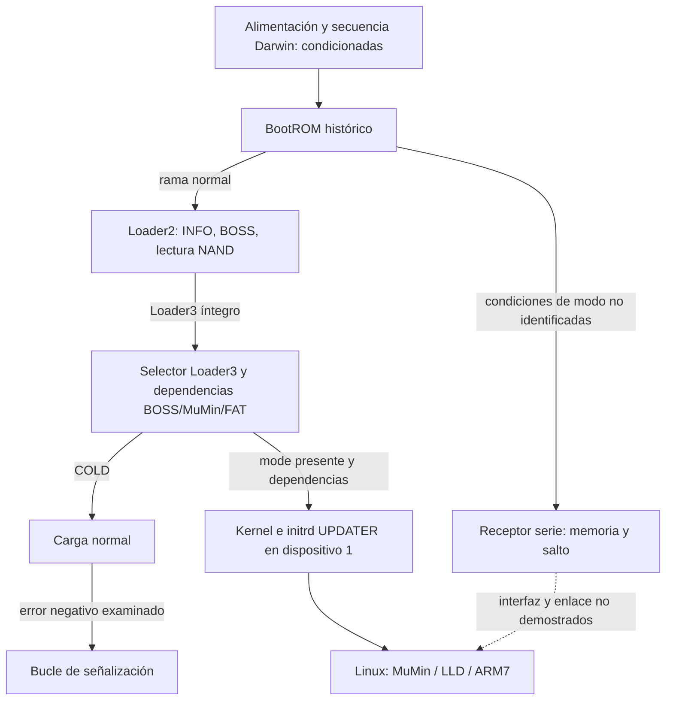

# E26-R7B — recuperación pre-Linux: investigación estática

29-10-2026. Continúa [R6](e26-r6-recuperacion-bionz.md) y [R7](e26-r7-recuperacion-estatica.md). Se analizaron copias locales, sin ejecutar firmware ni acceder a la cámara. **Estado: investigación parcial; ninguna vía de restauración está demostrada.** La ausencia de evidencia de una ruta no demuestra imposibilidad.

## Resultado ejecutivo

Hay dos hallazgos nuevos anteriores a Linux. Loader2 carga un componente BOSS y emplea una lectura NAND interna; una entrada alternativa de BootROM recibe tramas por muestreo de un registro de modo, escribe datos en una dirección suministrada y puede saltar a una dirección recibida. Ninguno demuestra que un interlocutor externo de esta cámara pueda activar esa entrada, ni que el código así cargado pueda restaurar NAND preservando sus metadatos. Además se identificó una copia histórica del firmware ARM7 prácticamente idéntica a BossFirm, lo que permite estudiar el receptor de comandos; no representa el estado actual de la cámara.

Un error negativo en la carga examinada de COLD termina en un bucle de señalización de Loader3; no vuelve al selector en esa rama. La recuperación UPDATER sigue condicionada por BOSS, los dispositivos y un selector accesible. La causalidad TPZL y la restauración selectiva siguen abiertas.

## Inventario y coordenadas

| Componente | Identidad y coordenadas | Cobertura |
|---|---|---|
| BootROM histórico `bootrom.bin` | SHA-256 `81a17e039a2debfe589b127e12384ed4d7c2ba0d0c819238d0b021b466246026`; 24 KiB, base `0xffff0000`; Thumb, offset=VA−base | [REA](../../analysis/e26-recovery/r7b-bootrom-rea.json), [instrucciones y literales Capstone](../../analysis/e26-recovery/r7b-bootrom-bytechecks.json) |
| Loader2 de BLDR | Recorte respaldo `0x600–0x7200`, SHA-256 `1106e8b4…`; base runtime `0xc0030000`, Thumb; offset respaldo=`0x600+(VA−0xc0030000)` | [REA](../../analysis/e26-recovery/r7b-loader2-rea.json), [bytes](../../analysis/e26-recovery/r7b-loader2-bytechecks.json) |
| Prefijo Loader3 | Primeras 43 páginas, SHA-256 `bda777a2…`; `0xc01f0000–0xc0205800`, Thumb; offset respaldo=`0x22800+(VA−0xc01f0000)` | [REA](../../analysis/e26-recovery/r7b-cold-rea.json), [bytes](../../analysis/e26-recovery/r7b-cold-bytechecks.json). No analizar la cola desconocida como código válido |
| BossFirm y ARM7 histórico | BossFirm INFO1: 14 336 B desde BLDR `0x18800`, SHA `b70a89a0…`; SRAM histórica de 16 KiB SHA `776f5867…` | [Comparación](../../analysis/e26-recovery/r7b-arm7-comparison.json), [REA ARM](../../analysis/e26-recovery/r7b-arm7-rea.json), [host LLD](../../analysis/e26-recovery/r7b-lldhost-rea.json). Una copia RAM histórica no certifica contenido actual |
| Actualizador `libupdaterbody.so` | SHA-256 `8d1dc242…`; ELF ARM/Thumb relocatable, direcciones REA con sesgo `0x10000` | [REA](../../analysis/e26-recovery/r7b-updater-rea.json), [literales](../../analysis/e26-recovery/r7b-updater-literals.json) |
| Linux `nand.ko` y `lld.ko` | SHA y bases en [R7](e26-r7-recuperacion-estatica.md) | Primitivas de sectores, páginas y borrado; requieren entorno Linux en la vía examinada |

## A. ROM, Loader2 y fallo COLD

**VERIFICADO EN BINARIO:** ROM `0xffff1062` lee bit 0 de `0xf2915010`. En el camino cero, `0xffff028c` y `0xffff02c6` preceden al salto `0xffff013c → 0xc0030000`; fallos examinados van a `0xffff0d62`, bucle de señalización sin retorno observado. Con bit 0 activo configura temporización `0xffff0554`, examina bit 22 de `0xf2910410` y, según condiciones y errores, invoca `0xffff0fa0`. Identidad eléctrica de bits y condiciones reales de alimentación siguen desconocidas. La ROM es un volcado histórico, no prueba de su ejecución actual.

**VERIFICADO EN BINARIO:** Loader2 `0xc00302d8` inicializa servicios y carga INFO, BOSS y respaldo antes de solicitar los fragmentos 5 y 6 de Loader3. En la secuencia analizada los errores van a `0xc0030c7c`, que señaliza indefinidamente. La carga BOSS pasa por `0xc0031988` y el control/reset por `0xc0031a1e`: la llamada en `0xc0030650` y el reset en `0xc003065c` están corroborados por bytes, aunque REA divide incorrectamente el cuerpo de `0xc0030674`. Lectura previa a Linux: `0xc00306ce → 0xc00323e8 → 0xc0031fc6 → 0xc003333a(6, 0x2800, …)`. Esta ruta es interna; no se ha demostrado una escritura ni un comando externo invocable desde Loader2.

**VERIFICADO EN BINARIO, limitado a la rama observada:** modo COLD 1: `0xc01f11ec → 0xc01f1312 → 0xc01f09e4 → 0xc01f2fe8 → 0xc01f2f24`, montaje y lectura FAT. Un retorno negativo de `0xc01f2f24` se propaga hasta `0xc01f3b74`, que entra en bucle de LED y retardos. No vuelve al selector ni selecciona UPDATER en ese trayecto. No se extrapola a todo error o ejecución: `0xc01f2fe8` solo aborta por negativo; `0xc01f4654` acepta una lectura corta no negativa y devuelve tamaño declarado sin comparar con los bytes procesados. Esto no demuestra lectura corta en el incidente.

## E. Entrada alternativa en BootROM

**Corrección de R7B inicial y E24-01:** `0xf2915010` no está identificado como GPIO. El código fuente Sony CXD90014 define `0xf2910000 + 0x5000 + 0x10` como `MISC_MODEREG` y su bit 1 como `MISC_MODEREG_BOOT_SERIAL_IN`; [extractos y hashes de fuentes](../../analysis/e26-recovery/r7b-register-source.json). La equivalencia del mapa con el BIONZ de A6000 es **inferencia respaldada**, no certificación del pin o conector físico. El manual distingue IC6000 `MHZ4G8G01A` de IC6200 `CXD90027GF`; no se atribuye este último a IC6000. El bit 0 y `0xf2910410` bit 22 no quedan identificados por esa definición; esta última dirección sería GPIO4 RDATA bajo las definiciones CXD90014, sin correspondencia de pin demostrada.

**VERIFICADO EN BINARIO:** `0xffff0876` y `0xffff0634` implementan una recepción por muestreo temporizado del bit 1 de `0xf2915010`. La segunda reconstruye ocho bits, comprueba paridad y escribe cada byte en el buffer indicado (`strb` `0xffff079e`). La primera lee longitud de 32 bits (máximo `0x1000`), tipo de 16 y una palabra de 32 bits. Para tipos distintos de 0 y `0xffff`, tras comprobar longitud mínima 10 recibe `longitud−10` bytes en la dirección de esa palabra y después compara CRC. Tipo 0 guarda un valor; tipo `0xffff` guarda una dirección de salto en `0xc000500c`. Se requiere además la secuencia y comprobaciones de `0xffff0fa0`; `0xffff0144` carga esa dirección y ejecuta un salto indirecto. El receptor termina con éxito al recibir dos tipos consecutivos iguales solo si ya se marcó un tipo 0 o `0xffff`; comprueba CRC después de escribir los datos y no revierte esas escrituras ante discrepancia. `0xffff0fa0` comprueba flags y errores antes de saltar; no todo mensaje produce ejecución. Los bytes verifican los segmentos relevantes, no prueban que toda secuencia arbitraria sea aceptada.

**PARCIAL:** se identificó un receptor de carga a memoria y una posible transferencia de control pre-Linux. No se conoce la red física de esa entrada serie, cómo satisfacer sus condiciones en esta unidad, si hay protecciones adicionales fuera de lo analizado, el reloj efectivo, ni una implementación enlazada a escritura NAND segura. El manual identifica `BOOT_SERIAL_IN` en IC6000 H21 y dibuja esa red hacia el nodo MULTI 9 `UART_RX/BOOT_IN` a través de R4003 marcada XX; `DEBUG_UART0_RXD` llega al mismo nodo mediante R4002 XX y hay una huella CM4003. Es una ruta esquemática condicionada: no se ha demostrado que la red corresponda al bit observado, ni población o continuidad en esta unidad. [Inventario](../../analysis/e26-recovery/r7b-register-source.json). No se identifica con USB, CN4906 ni UART Darwin. Tampoco hay prueba de que la ruta esté disponible sin alimentación y secuenciación de Darwin. Por tanto no es aún una ruta de recuperación utilizable y no se propone usarla en hardware.

## B. UPDATER y estados

En el prefijo Loader3, la existencia de `updater/mode` en dispositivo 2 elige modo 3, antes de Linux normal, condicionado por inicialización BOSS/MuMin y FAT; la carga del actualizador utiliza dispositivo 1. La correspondencia con `nflasha1/2` es inferencia respaldada y no un mapa físico apto para escribir ([R6 §3](e26-r6-recuperacion-bionz.md)). Si BOSS no se inicializa no se ha demostrado que esa vía llegue al actualizador. Ningún productor pre-Linux de `mode` ha quedado demostrado.

**VERIFICADO EN BINARIO:** `UpdaterKeyTag::PreExecute` `0x1ffec` crea y sincroniza `updater/uincomp` sobre `/dev/nflasha2`; `UpdaterChksumKeyTag::PostExecute` `0x20250` lo elimina. Las tablas virtuales contienen el callback `BaseKeyTag::isUpdaterSkip` `0x1ff68`, que comprueba `/tmp_updater/not_write_file/nwu`: si existe, omite esas operaciones. `KeyTagFactory::GetKeyTag` `0x2146c` asocia las clases a etiquetas `updater` y `updater_sum`. La ruta completa se cotejó con literales, pues el decompilador omitió un argumento. Esto describe actualización del entorno updater, no demuestra que toda actualización de `nflasha3` pase por esas etiquetas ni el estado posterior al incidente. El arranque del actualizador ante `uincomp` está documentado en [E24-01](e24-01-arranque-recuperacion.md); falta verificar orden real del paquete y cierre de todos los errores.

**VERIFICADO EN BINARIO, escritura selectiva lógica:** `PartitionImageKeyTag::Extract` `0x20cc0` construye un `NewFirmwareImageFile`; `extractImageFile` `0x22ca4` abre el destino con `O_WRONLY` y transfiere secuencialmente los bytes de la entrada mediante `WriteAll`. En `libupdatercommon.so`, `FileHandler::WriteAll` `0x15d04` reintenta escrituras cortas positivas y falla ante cero o negativo. Esta cadena usa Linux y el destino de bloque; en sus cuerpos examinados no aparece relectura ni `fsync`, sin excluir verificaciones en otras capas. [REA del actualizador](../../analysis/e26-recovery/r7b-partition-rea.json) y [FileHandler](../../analysis/e26-recovery/r7b-filehandler-rea.json).

El tar local tipo0 modificado contiene una entrada `0700_part_image/dev/nflasha3` de 11 489 040 bytes; el manifiesto contiene ese tamaño y `0c047870`, idéntico al CRC-32 calculado offline sobre la entrada. No se ha identificado el consumidor que lo comprueba ni demostrado relectura posterior del dispositivo. `partinf.conf` describe base lógica `0x01340000` y tamaño `0x01e00000`. Son coordenadas lógicas, no físicas; no se atribuye este tar al paquete del incidente. [Inventario](../../analysis/e26-recovery/r7b-partition-inventory.json). La selección de un destino lógico concreto no demuestra protección de Backup, traducción ni ausencia de modificaciones indirectas.

**VERIFICADO EN BINARIO Y ARCHIVOS:** el `config.xml` del updater oficial vincula `part_image_sum/part_image.sum` con `us_crc32sum.sh part_image image`; el script cambia a `/` y ejecuta `uc_crc32sum.elf -s -c`. En `0x8a94` ese programa abre cada ruta en lectura, lee hasta la longitud declarada y calcula CRC; `0x8b0c` compara con el manifiesto. Para `dev/nflasha3`, con ese directorio de trabajo la ruta resuelve a `/dev/nflasha3`. Esta es una verificación programada por relectura, no prueba de que se ejecutara en el incidente ni de integridad del resto de la partición; `UpdaterBody::Execute` `0x1f4c8` procesa encabezados en orden y el tar local tipo0 sitúa la entrada `0701` después de `0700`; el `Execute` de plugin configurado sin `thread=yes` es síncrono. Por tanto la relectura se programa después de la extracción de `nflasha3` en ese flujo, si la extracción tiene éxito y se reconocen la clave y el guard. No se conoce si ocurrió tras el incidente. [REA](../../analysis/e26-recovery/r7b-verify-rea.json), [despacho](../../analysis/e26-recovery/r7b-verify-dispatch.json), [fuentes](../../analysis/e26-recovery/r7b-verify-sources.json). Esto precisa el límite anterior: la cadena `extractImageFile` no hace relectura por sí misma, pero el updater sí contiene una verificación separada.

## C–D. ARM7, NAND, INFO6 y datos únicos

**VERIFICADO EN ARCHIVOS:** los 14 336 B de BossFirm en BLDR y los primeros 14 336 B de SRAM histórica ARM7 coinciden en 14 305 bytes; los primeros 12 288 son idénticos. Hay 31 bytes distintos en `0x3790–0x37ff`; no se atribuye su función. La tabla de 18 punteros en `0x379c` coincide entre ambas copias. Esto identifica una fuente plausible para estudiar el receptor, no certifica la RAM actual ni justifica modificar firmware.

**VERIFICADO EN BINARIO:** el LLD Linux `0x1605c` sitúa el índice de operación en SRAM `+0x3f48`, segundo argumento en `+0x3f4c` y punteros en `+0x3f50/+0x3f54`. El despachador ARM `0x0ec8` consulta la tabla y actualiza estado `+0x3f40` y resultado `+0x3f5c`. El índice 0 lleva a `0x1338`, coherente con la solicitud LDEC Linux; índices 9 y 12 llevan a `0x2eb4` y `0x10c8`, correspondientes a las solicitudes de escritura y borrado documentadas en R7. Es evidencia de una cadena host–receptor, no de accesibilidad pre-Linux para cada operación.

**VERIFICADO EN BINARIO, residuo TPZL:** `muminlzp_request` conserva `offset & 0x1ff` en `+8` de la solicitud; `mumin_devif_ldec_read` `0x11048` lo copia al `+8` del descriptor enviado por LLD. En los cuerpos ARM7 examinados `0x1338` y `0x3f4` se leen `+0/+4` y `+0x0c/+0x10`, respectivamente, sin una lectura explícita de `+8`. Otro resto calculado por `0x1688` utiliza geometría en sectores y no se ha identificado con el residuo en bytes. **NO DEMOSTRADO:** que el residuo se descarte en toda la cadena, ni que la operación falle o funcione con 256; quedan por trazar los registros LDEC, el hardware y otras rutas. [REA NAND](../../analysis/e26-recovery/r7b-lzp-rea.json), [LLD](../../analysis/e26-recovery/r7b-lldhost-rea.json) y [ARM7](../../analysis/e26-recovery/r7b-arm7-rea.json).

**VERIFICADO EN INSTRUCCIONES:** la tabla ARM7 envía índice 6 a `0x22d4`; esta rutina no fue reconocida como función por REA, por lo que se comprobó con [Capstone](../../analysis/e26-recovery/r7b-arm7-cmd6-capstone.json). Procesa la solicitud desde SRAM `+0x3f54` y alcanza subrutinas del motor y controlador. Es coherente con la lectura solicitada por Loader2, condicionada a que se cargue ese firmware; aún no se certifica el comportamiento físico ni una interfaz externa.

**VERIFICADO EN INSTRUCCIONES, límite LDEC:** `nand.ko` calcula sector de inicio `offset >> 9` y suma el residuo al redondear el número de sectores. En ARM7 `0x3f4`, las instrucciones `0x424–0x430` copian `descriptor+0x0c/+0x10` a registros `0xf290300c/+0x10`; no se observa uso del campo `+8` en ese tramo. La entrada FIFO observada usa `0xf0020000`; la configuración completa y el tratamiento del silicio siguen desconocidos. No concluir que los primeros 256 bytes se ignoran o rechazan. [ARM7](../../analysis/e26-recovery/r7b-ldec-arm7-rea.json), [Linux](../../analysis/e26-recovery/r7b-ldec-linux-rea.json).

INFO6 es el segundo fragmento de **Loader3**, no una partición: `(die0, plane1, block2, pages0–20)` completa el runtime `0xc0205800–0xc0210000`. Esas páginas no tienen correspondencia identificada en BLDR; un [inventario acotado por nombres](../../analysis/e26-recovery/r7b-info6-inventory.json) no encontró otro archivo identificado de Loader3. Los dos volcados RAM de 1 GiB están nombrados con base 0x80000000 y no abarcan directamente la dirección virtual 0xc0205800; no se conoce traducción que demuestre su contenido. Se buscaron además cinco anclas de 64 B del prefijo válido en cada uno de esos dos volcados RAM: ninguna coincidió ([resultados](../../analysis/e26-recovery/r7b-info6-ram-search.json)). Esto no excluye una copia fragmentada, modificada o sin esas anclas, ni demuestra la ausencia de INFO6. No se rellenan ni sustituyen ([R6 §1–2](e26-r6-recuperacion-bionz.md)). La tabla de particiones lógica y el contenido `nflasha3` no establecen ubicación física sin traducción MuMin, ECC, bloques defectuosos y metadatos. Backup, calibraciones y datos de unidad deben considerarse únicos; no se ha demostrado su preservación mediante escritura o borrado físico.

## F. Comparación local

**VERIFICADO EN ARCHIVOS:** `loader_writer.sh` incluido en los actualizadores A6000 3.21, A7S 3.20 y A6300 2.01 tiene el mismo SHA-256 `2f38d367c14ac5a0755e05fc06011a256c5cd5f0e234a899cf54ee11fff1b885` ([inventario](../../analysis/e26-recovery/r7b-compare-scripts.json)). El script, bajo Linux, extrae el loader, recopila MIS/DGU y Backup, comprueba MD5 y llama `pformat_normal.elf` y `pformat_safe.elf` sobre `/dev/nflasha`. Identidad del script no demuestra igualdad de sus ejecutables, ROM, firmware ARM7, geometría ni acceso pre-Linux; tampoco prueba que una imagen sea intercambiable. No se ejecutó el script.

## G–H. Grafo y matriz de recuperación

| Candidata | Clasificación | Evidencia y bloqueo |
|---|---|---|
| Selector `mode` → UPDATER | **PARCIAL** | Selector pre-Linux existente; requiere BOSS, dispositivo 2, bandera, dispositivo 1 y sistema updater funcional. Activación independiente y estado actual desconocidos. |
| COLD fallido → UPDATER | **DESCARTADA EN EL TRAYECTO NEGATIVO EXAMINADO** | El retorno negativo acaba en bucle; no se descartan otros caminos no cubiertos. |
| BootROM serie → memoria/salto → NAND | **PARCIAL** | Receptor y salto estáticos; sin conexión física identificada ni cadena de escritura conservadora demostrada. |
| Loader2 → lectura NAND | **DEMOSTRADA ESTÁTICAMENTE como primitiva interna** | No es interfaz externa ni restauración. Requiere la secuencia previa y componentes de arranque. |
| Linux MuMin/LLD → NAND | **PARCIAL para recuperación** | Escritura/borrado existen; necesitan Linux en el camino identificado, y no se ha verificado restauración selectiva o preservación. |
| SWD/CN4906, USB/Multi, UART Darwin → NAND | **NO DETERMINADA** | Esquema o servicios Linux no demuestran protocolo pre-Linux, autorización ni cadena hasta NAND; no atribuir el receptor serie de BootROM a un conector. |

Una escritura por rango lógico podría modificar tablas, asignación o bloques de mantenimiento. Faltan límites del destino, mapeo lógico-físico, política ECC/bad-block, validación y pruebas offline de preservación. La existencia de acceso por partición no demuestra que solo cambien sus datos.

## Preguntas pendientes y próximos pasos

1. Trazar el tratamiento de residuo TPZL dentro del ARM7 identificado y relacionar sus estructuras con la solicitud LDEC; identificar error real sin introducir reglas artificiales.
2. Resolver el receptor ROM hasta su red física y condiciones de activación solo mediante esquemas/archivos; comprobar carga a memoria, destino, validación y posible enlace a BOSS sin proponer conexiones.
3. Resolver la tabla de callbacks PBM y la selección de bloques, ECC/metadatos y rango afectado por escritura lógica.
4. Analizar orden y validaciones de etiquetas del paquete y el flujo real de selección de imagen; identificar productores de `mode` y dependencias de BOSS.
5. Inventariar fuentes que pudieran contener INFO6 con identidad y geometría verificables; no fabricar la cola.
6. Comparar ejecutables y formatos de otras plataformas solo donde existan fuentes identificadas; la identidad del script no basta.

La investigación sigue abierta hasta agotar las rutas estáticas razonables. No se requiere una captura UART para ejecutar estas tareas.
