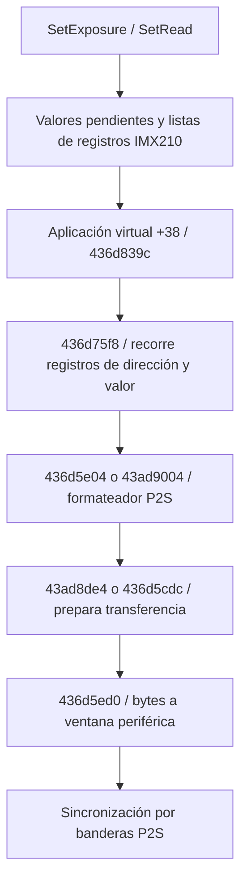

# Exposición IMX210, EFCS y transferencia P2S — E019

Firmware A6000 3.21, análisis estático del mismo av-cam.bin de E016.
SHA-256 `b60c845ccb90c0ff86b7f62f1f3f2ecda714aa20c37805959ebee2b429e56bb9`.
Direcciones lógicas con base 0x43541000. Complementa
[los consumidores y correcciones de entradas](silent-imager-consumers.md).

**Resultado:** se reconstruyó una ruta del controlador IMX210 hasta el
formateador P2S y escrituras periféricas. No se demostró que el campo
SilentShutter llegue a esa ruta. Tampoco se identificó una modalidad que
sustituya de forma comprobada la cortina mecánica trasera en una foto completa.

## Parámetros de exposición: cinco casos, sin nombres físicos inventados

El wrapper `C_Imager::SetExposure`, 0x436d6320, llama al slot virtual +0x28.
La tabla IMX210 resuelve ese slot a **0x436d6f6c**. Este método:

- Rechaza el estado de driver 0x11 con retorno 2.
- Lee palabras de 16 bits en el argumento de exposición y un selector en
  **byte +9**. El diagnóstico SetExps lo imprime en el campo `shut`.
- Actualiza registros de una tabla, calcula temporización y acepta casos 0–4;
  otros valores del selector devuelven 1.

La rama del selector modifica el byte +2 del registro de tabla
**0x4401ca2c**. Resolución independiente mediante bytes originales:
base GOT 0x4401eee4, literal 0x436d72d4, slot 0x44020f9c → 0x4401ca2c.
Los cuatro bytes iniciales de ese registro son `01 00 40 00`.

| Selector en +9 | Bit 0x04 | Bit 0x80 | Bit 0x10 | Bit 0x40 |
|---|---|---|---|---|
| 0 | 0 | 0 | 0 | 1 |
| 1 | 1 | 1 | 0 | 1 |
| 2 | 1 | 1 | 1 | 0 |
| 3 | 1 | 1 | 1 | 1 |
| 4 | 0 | 1 | 0 | 1 |

Tabla derivada de las operaciones AND/OR de esa función. Representa estados
de un byte de software; **no asigna nombres a bits del CMOS**. Hace falta
resolver la documentación y el protocolo del sensor antes de interpretarlos
como reset, integración, cortina delantera o cortina trasera.

En recorridos de captura, el argumento se pasa desde objeto+0x64c; por tanto,
el selector reside en objeto+0x655. Se observaron escrituras de 4, 0 y 1 en
0x438c7800, 0x438c828c y la rama de 0x43b1af3a que alcanza 0x438c87f0.
Son valores por fase y condiciones, no etiquetas verificadas de métodos de
obturación. El escritor 0x4389cb8c es una copia de numerosos campos: su
coincidencia con +0x655 no demuestra por sí sola que use el mismo objeto.

### Ruta del coordinador hasta el selector del sensor

Se añadió una ruta de exposición distinta de las llamadas por fases anteriores:

1. El contexto compartido enlaza su slot +0x24 con base+0x1aec, mediante
   0x43ae8d56: bloque **0x43e9d034**, dentro del estado iniciado en 0x43e9b548.
2. 0x4378fef4 llama a 0x437b4e88 con contexto 0x43e99208 y ese bloque de salida.
   0x437b617c llama a 0x43849fb8, que construye el bloque de exposición.
3. La fuente del constructor es GOT 0x44020c9c → **0x43eb35d0**. Copia desde
   fuente+0xc4; por tanto, fuente+0xcd termina en salida+9, el selector.
4. Antes, 0x43b08750 llama a 0x43b0893c. Este selecciona una fila de
   16 bytes según el primer byte del bloque: fuente+0xc4/+0xcc se cargan de
   `fuente + banco*0x10 + 4/+0xc`. El selector procede de
   **fuente + banco*0x10 + 0xd**. El significado físico de los bancos sigue abierto.
5. 0x4381106c, con diagnóstico StrtExps, copia 16 bytes del slot +0x24 a la
   pila, ajusta temporización y llama a 0x43ae935a. Este usa el getter
   0x436d6118 y el wrapper 0x436d6320: ya se llega al método IMX210 de exposición.

En una rama de 0x43843a44 se preparan cuatro bancos de 16 bytes a partir de
otra estructura; el origen pasado es GOT 0x44020b20 → 0x43eb05d8, más 0x224.
Los valores de inicialización en el archivo son cero: no representan parámetros
observados durante una captura. Falta unir la producción de esos bancos con
Silent y con un fin electrónico de exposición completo. Esta ruta sí acota
el punto donde continuar; no basta forzar el byte del selector.

## Aplicación de registros y P2S

`C_Imager::SetRead` → slot +0x30 → 0x436d7e08 prepara parámetros de lectura
por un camino separado. Las llamadas a 0x436d9f70 con flags 1/8 filtran
**diagnósticos**: inspeccionan un byte de máscara y deciden si imprimir.
Corrección de interpretación: esos flags no aplican parámetros al sensor.

La aplicación está en otros métodos. El wrapper 0x43ad911c selecciona:
argumento no cero → slot +0x38 → **0x436d839c**; cero → slot +0x3c →
**0x436d6a34**. El primero prepara varias listas y llama a **0x436d75f8**.

Se verificó también la identidad de la lista, no solo la existencia de un
transporte genérico: 0x436d79b0 devuelve el puntero del slot GOT **0x44023598**
→ **0x43fe995c**. La lista tiene **119 punteros y terminador cero**; su entrada
de índice 1 es **0x4401ca2c**, el mismo registro cuyo byte +2 modifica
SetExposure. 0x436d839c pasa esa lista a 0x436d75f8 con modo de transferencia 2.
Queda unido ese byte con el formateador y la rama de transferencia P2S; no se
ha observado su ejecución ni se ha identificado el significado físico de sus bits.



0x436d75f8 recorre una lista de punteros hasta cero. De cada registro extrae
un campo de 16 bits y su byte +2; los entrega al formateador. Las rutas
0x436d5e04 y 0x43ad9004 usan 0x43ad8fe0; este comprueba espacio/orden mediante
0x436d5d9c y formatea con 0x43ad8fa2. Los diagnósticos incluyen
P2SFormatter y CheckAddrOrder. La rama síncrona admite fragmentar al llenarse.

0x436d5ed0 copia cada byte del buffer a una palabra en
`base + (índice + 0x10) * 4`. La base se selecciona en la tabla a la que
apunta GOT 0x440202b0 → **0x43bc14e8**:

| Canal | Triple de destinos codificados |
|---|---|
| 0 | 0xf3c00300 / 0xf3c00800 / 0xf3c00900 |
| 1 | 0xfc088300 / 0xfc088800 / 0xfc088900 |
| 2 | 0xfc089300 / 0xfc089800 / 0xfc089900 |

0x436d5e58 modifica los campos de control de esa misma tabla. La rutina
0x436d5bcc espera banderas del grupo 0x18; su diagnóstico es
P2SWaitTransComp. El wrapper 0x43ad9132 llama al slot +0x48 → 0x43ad9232,
que usa esa espera. **No es confirmación de una imagen ni de una cortina**.
Los destinos son valores incorporados en el firmware, no un mapa físico
medido ni prueba de transferencia realizada en una cámara.

La coordinación mecánica se conserva por separado: 0x4386d3b4 construye un
comando de16 bits desde el bloque común+0xe y 0x437cfe94 adapta campos para
IDs de la familia 0x900–0x960, con diagnóstico MechaCommon. Todavía no se
asignaron esos IDs a movimientos de cortinas ni se localizó una confirmación
física del obturador. Export: `shutter-mecha-common.json`.

## EFCS: consumidores identificados, trazabilidad distinta de Silent

El bloque común guarda EFCS en +0x210 y Silent en +0x238. Hay consumidores
de +0x210 que acceden al primer puntero del contexto común:

- 0x437cac5c consulta `(*contexto + 0x210)` para seleccionar cálculos y
  estados. El llamador 0x43af30e0 recoge sus salidas en +0x11c/+0x11d.
- 0x43844e80 copia `(*contexto + 0x210)` al destino byte +0x41c
  (el pseudocódigo usa `short* +0x20e`). El llamador 0x437b5b14 suministra
  GOT 0x44023eb4 → **0x43eb2680**, de modo que el campo es **0x43eb2a9c**.
- 0x43842158 consulta el campo +0x41c de su argumento 3, junto con otros
  ajustes y umbrales; genera decisiones 1/3/5 y salidas de estado. Su
  llamador 0x43841070 obtiene ese argumento mediante **0x4383fc48**. Este
  selecciona GOT 0x44021ba8 → 0x43ea976c o GOT 0x440249a4 → 0x43eee9d4.
  Son bloques distintos del destino inicial 0x43eb2680: falta demostrar sus
  copias/transformaciones antes de identificar ese +0x41c con EFCS. No basta
  una coincidencia del offset. 0x437b0610, llamado antes en la misma función,
  devuelve un contador y no ese puntero; la variable de pseudocódigo se reutiliza.

Este resultado diferencia una lectura efectiva de EFCS de la mera recepción
de Silent. No convierte esas decisiones numéricas en órdenes de cortinas
ni demuestra que EFCS pueda extenderse cambiando solo un bit.

## Qué falta para implementar SilentShutter

La ficha primaria de [TechInsights DEF-1412-801](https://www.techinsights.com/products/def-1412-801)
corrobora IMX210 en un desmontaje de a6000, con código SON-IMX210AQL.
Esto refuerza la atribución del controlador al modelo, pero su contenido público
no incluye registros ni demuestra obturación completamente electrónica.
Sony documenta EFCS On/Off en las [especificaciones ILCE-6000](https://www.sony.com/electronics/support/e-mount-body-ilce-6000-series/ilce-6000/specifications)
y On por defecto en su [guía de EFCS](https://helpguide.sony.net/gbmig/45349331/v1/en/contents/TP0000508279.html).
Fuentes consultadas el15-10-2026; no se transfieren capacidades de otros sensores.

| Afirmación | Evaluación |
|---|---|
| Existe controlador IMX210 con métodos de exposición y lectura | **ACEPTO**, wrappers y vtable contrastados |
| Hay una ruta desde listas del driver hasta escrituras P2S | **ACEPTO**, funciones y tabla de destinos identificadas |
| Flags 1/8 de 0x436d9f70 aplican hardware | **RECHAZO**, son filtrado diagnóstico |
| Un selector 0–4 ya está identificado como obturación completa sin cortinas | **RECHAZO**, no hay correspondencia física verificada |
| El campo Silent se ha seguido hasta esas escrituras | **RECHAZO**, el enlace sigue abierto |
| La ausencia de ese enlace prueba imposibilidad del hardware | **RECHAZO**, cobertura y conocimiento insuficientes |

La investigación queda abierta en la transformación de Silent hacia parámetros
de exposición/lectura y en la coordinación mecánica. Una implementación debe
demostrar además un fotograma completo válido y ausencia de accionamiento de
ambas cortinas. No se generó un parche basado en enums sin identificar.

## Artefactos y reproducción

Proyecto persistente: `analysis/ghidra/silent-liro.gpr`. Consultas con
`QuerySilentLiro.java` y `QuerySilentReferences.java`; modo Thumb y hash
verificado en los exports de funciones. Ejemplo incremental:

```sh
env JAVA_HOME="$PWD/tools/providers/jdk-21.0.12.1+1" tools/providers/ghidra_12.1.4_PUBLIC/support/analyzeHeadless analysis/ghidra silent-liro -process av-cam.bin -noanalysis -scriptPath analysis/ghidra -postScript QuerySilentLiro.java "$PWD/analysis/ghidra/imager-exposure-verified.json" 0x436d6f6c 0x436d7e08 0x43ad8fa2 0x436d5d9c 0x436d5cdc
```

Exports principales: `imager-exposure-verified.json`, `imager-p2s-transport.json`,
`efcs-hardware-commit.json`, `efcs-algorithm-readers.json`,
`efcs-algorithm-arguments.json`, `efcs-offset-readers.json` y
`silent-exposure-mode-writers.json`, `imager-exposure-transfer-list.json` y
`shutter-sensor-selector-helpers.json`, todos en `analysis/ghidra/`.

El análisis amplio alcanzó 300 segundos y registró 37677 funciones; terminó
por tiempo y **no acredita cobertura completa**. Hubo advertencias de pcode
y tablas de salto incompletas. Las consultas incrementales se guardaron;
`query` y `entry` pueden diferir por regiones compartidas o límites inferidos.
Ningún binario se ejecutó y no se accedió a una cámara.
