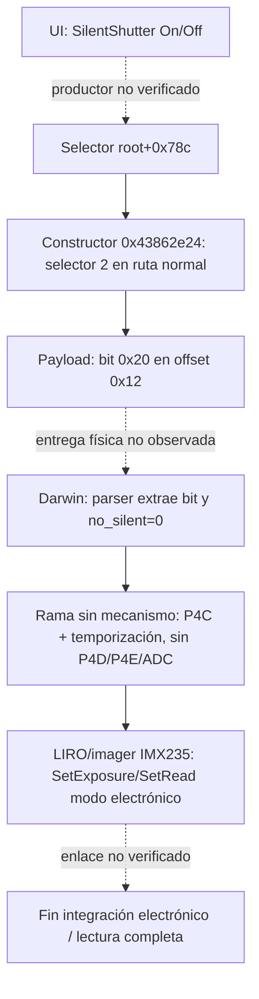

# S401 — Ruta de control SilentShutter en A7S fw3.20 vs A6000 fw3.21: configuración → LIRO → imager

> Hito de la **línea del obturador electrónico** (Agente C, sesión S401+).
> Análisis estático de `av-cam.bin` A7S fw3.20 (SHA `b857d338...5103e`) y A6000 fw3.21 (SHA `b60c845c...56bb9`), base lógica `0x43541000`.
> Complementa: [silent-shutter-status.md](silent-shutter-status.md) (E015–E019), [S174](s174-forliro-api.md), [S53](s53-darwin-a7s-a6000-comparison.md), [S54](s54-mechanism-type-zero.md), [silent-caif-transport.md](silent-caif-transport.md), [darwin-state-machine.md](darwin-state-machine.md).

**Actualización 25-10-2026:** constructor A7S y condición del bit `0x20`
resueltos por REA e instrucciones. [Contrato y límites](capture-static-followup-2026-10-25.md).

---

## Resumen de hallazgos

| # | Diferencia | A7S fw3.20 | A6000 fw3.21 | Evidencia | Etiqueta |
|---|---|---|---|---|---|
| 1 | Handler LIRO `0x40e3` (SilentShutter) | **Ausente** en tabla de 220 comandos | Presente en offset `0xabec60` → handler `0x438032d5` (Thumb) | Bytes tabla `0x43fff30c` | **VERIFICADO** |
| 2 | Mensajes `...ForLiro` en `libObj.so` | 221 nombres, **0 soportados** (todos `NON SUPPORTED`) | 216 nombres, **0 soportados** (todos `NON SUPPORTED`) | S174 | **VERIFICADO** |
| 3 | Parser Darwin: bit Silent `pkt[+0x12]&0x20` | **Extrae y usa** → `no_silent` en `S+0xd0.b5` | **No extrae**; no hay predicado `no_silent` | S53, S54, darwin-state-machine.md | **VERIFICADO** |
| 4 | Rama "sin mecanismo" Darwin | Sí: omite P4D/P4E/ADC, solo P4C + temporización | Tipo 0: similar pero **sin control de cortinas en reposición** | S54, darwin-state-machine.md | **VERIFICADO** |
| 5 | Construcción payload CAIF | `0x43862e24`: pone bit `0x20` cuando `C+0x76c == 2` en ruta normal; override diagnóstico escribe 1 | `0x43841070`: escribe **solo 0 o 1** en el campo examinado | [Verificador](../../analysis/s401_a7s_caif/verify_caif.py) | **VERIFICADO estático**; entrega física abierta |
| 6 | Sensor / driver imager | IMX235 (RTTI `Camera::Imager::IMX235::...`) | IMX210 (RTTI `Camera::Imager::IMX210::C_ImagerCtrl_IMX210`) | E017, s171-imager-api.md | **VERIFICADO** |
| 7 | API imager (`Get/Set*Imager*`) | 4 nombres comunes + `GetImagerStabilizationTime`, `SetImagerFrameSize`, `SetImagerMode` | 4 nombres comunes **sin** los 3 anteriores | s171-imager-api.md | **VERIFICADO** |
| 8 | Capa `LiroSeq` validación parámetros | **Ausente** (0 `CheckSet*`, 0 `ParamCheckErr`) | **Ausente** (igual que A7S) | S169 | **VERIFICADO** |

---

## Detalle por diferencia

### Diferencia 1: Tabla de despacho LIRO — ausencia de handler `0x40e3` en A7S

**Evidencia**: Lectura de 3000 bytes de la tabla de despacho LIRO en `0x43fff30c` (misma VA en ambos firmwares). La tabla tiene 220 entradas de 12 bytes `{u16 cmd, u16 flags, u32 handler, u32 pad}`.

- **A6000**: Entrada en offset `0xabec60` (índice ~199): `{0x40e3, 0x0001, 0x438032d5, 0}` → handler Thumb en `0x438032d4` (escribe estado `+0x238` en bloque `0x43edf684`).
- **A7S**: **No existe** ninguna entrada con `cmd == 0x40e3` en los 3000 bytes leídos (cubre toda la tabla). Rangos de comandos observados: `0x1159–0x117d`, `0x012e–0x01f4`, `0x065d–0x0668`, `0x052f–0x055b`, `0x04ae–0x04d3`, `0x0781–0x07c4`, `0x0444–0x0454`, `0x0895–0x08a0`, `0x0a34–0x0a36`, `0x0fbb–0x0fd8`, `0x1224–0x1227`, `0x183b–0x183f`.

**Límite**: La ausencia en la tabla no prueba que A7S no procese SilentShutter por otra vía (p. ej. mensaje directo a cola OSAL, flag en estructura de captura, o configuración por `drive_mode`).

---

### Diferencia 2: Mensajes `...ForLiro` en `libObj.so` (S174)

**Evidencia**: S174 barrió los tres `libObj.so` (A6000/A7S/A6300) buscando cadenas `...ForLiro`.

| Firmware | Nombres `...ForLiro` | En mensajes **SOPORTE** | En mensajes **RECHAZO** |
|---|---|---|---|
| A6000 fw3.21 | 216 | 0 | 216 |
| A7S fw3.20 | 221 | 0 | 221 |
| A6300 fw2.01 | 240 | 6 | 234 |

Los nombres de obturador en A6000 y A7S (`SetSilentShutterModeForLiro`, `SetShutDriveForLiro`, `SetFrontEShutterModeForLiro`, `SetIrisDriveForLiro`, `SetDriveModeForLiro`) aparecen **exclusivamente en mensajes de rechazo** (`... NON SUPPORTED MsgID[0x%04x]...`).

**Conclusión**: La capa *camera-user* (`libObj.so`) **no soporta** parámetros de obturador electrónico en **ninguno** de los dos modelos. El soporte real (en A7S) reside en capas inferiores (Darwin + CAIF + LIRO/imager).

---

### Diferencia 3: Parser Darwin — predicado `no_silent`

**Evidencia** (S53, S54, darwin-state-machine.md):

- **A7S** (ROM base `0x4200`):
  - Parser `0x18396`: `no_silent = (pkt[+0x12] & 0x20) == 0` → guarda en `S+0xd0.b5`
  - Predicado `0x19a86` / `0x216c2`: si `no_silent == 0` → **omite escrituras P4D/P4E** (bobinas 1ª/2ª cortina), omite seguimiento ADC, toma rama "sin mecanismo" (solo P4C + temporización propia)
  - En reposición/aborto: **sí acciona bobinas** con `no_silent=1` (`movs r0,#1` en `0x20db4`/`0x2112a`/`0x21130`)

- **A6000** (ROM base `0x4200`):
  - Parser `0x17f8c`: **no extrae bit `0x20`** de `pkt[+0x12]`
  - No existe predicado `no_silent`
  - Selector tipo mecanismo `0x20c74`: `tipo = (mech_type & 7) ∈ {1,2,3} ? mech_type : 0`
  - Tipo 0 → misma secuencia de exposición que A7S Silent (P4C + temporización) **PERO** en reposición/aborto **no acciona bobinas** (asume que no hay mecanismo)

**Límite**: No se ha comparado el consumidor BIONZ de P4C en A7S Silent vs A6000 tipo 0 (H54-2 en S54: PARCIAL).

---

### Diferencia 4: Rama "sin mecanismo" en Darwin

**Evidencia** (S54, darwin-state-machine.md):

| Fase | A7S Silent (`no_silent=0`) | A6000 tipo 0 |
|---|---|---|
| Exposición | Temporización propia + `P4C←0` | Idéntica |
| Seguimiento ADC | **Omite** (puerta `no_silent`) | Omite (tipo 0) |
| Escrituras P4D/P4E | **Omite** (puerta `no_silent`) | Omite (tipo 0) |
| Reposición/aborto | **Acciona bobinas** (`no_silent=1`) | **No acciona** (tipo 0) |
| Notificación fase | `u16(arg+0x10) |= 0x80` (retiene planificador) | Igual |

**Conclusión**: A7S Silent **mantiene el mecanismo en reposo coherente** (acciona en reposición); A6000 tipo 0 **asume que no hay mecanismo**. Esto es crítico: si A6000 tiene cortinas físicas, forzar tipo 0 podría dejar las cortinas en estado inconsistente.

---

### Diferencia 5: Construcción paquete CAIF evento 1 — bit Silent

**Evidencia** (silent-caif-transport.md):

- **A6300** `0x4391a6f4`: `pkt[+0x12] |= 0x20` si `*(captura+0x804) == 2` (selector Silent). Longitud paquete: 31 bytes (`0x1f`).
- **A6000** `0x43841070`: `pkt[+0x12] = 0 o 1` (según otro indicador); **nunca pone bit `0x20`**. Longitud paquete: 22 bytes (`0x16`).
- **A7S**: función equivalente **`0x43862e24`**, caller `0x4382822c`. El quinto argumento apunta a `*(root+0x4ae8)+0x40` cuando existe el objeto. `C=root+0x20`; `0x4386329a..438632b4` construye `pkt[0x12]=32*(u32(C+0x76c)==2)+(otro_flag==1)` en la ruta normal. Una anulación diagnóstica toma la rama `0x43863398` y escribe 1. La longitud efectivamente transmitida sigue sin medirse.

El mismo campo `root+0x78c` se pasa en r2 al selector `0x43826d58`
(`0x43826dee/df2`), que para valor 2 elige `0x4e/0x4f`, con sus bypasses
y overrides. [Evidencia REA](../../analysis/s401_a7s_caif/rea_evidence.json),
[resultado reproducible](../../analysis/s401_a7s_caif/caif_contract.json) y
[regresiones](../../tests/test_s401_a7s_caif.py). El patrón SUB/RSBS/ADC
normaliza la comparación a 0/1 antes del desplazamiento de cinco bits.

**Pendiente**: productor UI del selector, condiciones efectivas del envío,
longitud transmitida y propagación hasta Darwin/imager. El código del
constructor no demuestra que el paquete se haya emitido en una captura real.

---

### Diferencia 6: Sensor y driver imager

**Evidencia** (E017, s171-imager-api.md):

| Atributo | A7S fw3.20 | A6000 fw3.21 |
|---|---|---|
| Sensor | IMX235 | IMX210 |
| RTTI driver | `Camera::Imager::IMX235::...` | `Camera::Imager::IMX210::C_ImagerCtrl_IMX210` |
| `GetImagerStabilizationTime` | **Sí** (1) | No (0) |
| `SetImagerFrameSize` | **Sí** (1) | No (0) |
| `SetImagerMode` | **Sí** (1, firma C++ `0x43daf786`) | No (0) |
| `Camera::Sync::SyncUtilityUpm` | **Sí** (3) | No (0) |
| `Camera::Imager::IMAGER_DRIVEMODE` | **Sí** (2) | No (0) |
| `SteadyShot` / canal objetivo | **11 / 7** | **0 / 0** |

**Conclusión**: El driver IMX235 de A7S expone **APIs adicionales de estabilización y modo de cuadro** que el driver IMX210 de A6000 no tiene. El canal `SteadyShotInfo` del objetivo (7 apariciones en driver montura BL) es exclusivo de A7S/A6300.

---

### Diferencia 7: API imager común

**Evidencia** (s171-imager-api.md): Ambos comparten 4 nombres:
- `GetImagerDriveMode`
- `GetImagerTemperature`
- `GetImagerTemperatureAD`
- `GetPrelightImagerDriveMode` (→ `drive_mode` de S134)

---

### Diferencia 8: Capa `LiroSeq` validación parámetros (S169)

**Evidencia**: A6300 tiene 201 propiedades `CheckSet*` y 370 comprobaciones `ParamCheckErr@%s[campo]`, incluyendo `sc_ShutDrive`, `uc_ShutDriveMode`, `front_eshutter`, `SilentShutterMode`, `shutterType`. **A7S y A6000 tienen 0 de todo esto**.

**Conclusión**: Ni A7S ni A6000 validan parámetros de obturador electrónico en la capa `LiroSeq` de `av-cam.bin`. El silent shutter de A7S **no usa esta capa**.

---

## Ruta reconstruida A7S SilentShutter (INFERENCIA parcial)



**Puntos no verificados (NO_VERIFICADO)**:
1. Cómo la selección UI produce `root+0x78c` y cuándo se transmite el payload.
2. Entrega efectiva y longitud del paquete A7S; la condición numérica del productor ya está verificada.
3. Enlace Darwin → LIRO/imager para modo de exposición electrónico
4. Significado físico de los registros IMX235 programados en modo Silent

---

## Comparación con A6000 (lo que tiene / lo que falta)

| Componente | A7S fw3.20 | A6000 fw3.21 | Estado A6000 |
|---|---|---|---|
| UI SilentShutter | Sí (menú) | Sí (menú, CautionConfig) | Igual |
| libObj.so mensaje | 0x768e (rechazado) | 0x768e (rechazado) | Igual |
| LIRO handler 0x40e3 | **No** | Sí (escribe estado +0x238) | **Tiene handler pero inútil** |
| CAIF bit 0x20 | **Sí** (inferido) | **No** | **FALTA** |
| Darwin no_silent | **Sí** | **No** | **FALTA** |
| Darwin rama sin meca | **Sí + reposición coherente** | Tipo 0 (solo exposición) | **Incompleto** |
| Driver imager Silent | IMX235 (APIs extra) | IMX210 (sin APIs extra) | **Diferente HW** |
| LiroSeq CheckSet* | No | No | Igual (ausente) |

---

## Artefactos y reproducción

- Tabla despacho LIRO A7S: `read_bytes 0x43fff30c 3000` (este hito)
- Tabla despacho LIRO A6000: `reports/silent-liro-dispatch.json` (E016)
- Darwin A7S/A6000: `analysis/ghidra/a6000-darwin-phase-table-verified.json`, `a6300-darwin-phase-table-verified.json`
- CAIF A6300/A6000: `analysis/ghidra/a6300-caif-silent-payload.json`, `a6000-caif-event-dispatch.json`
- IMX210 driver: `analysis/ghidra/silent-liro.gpr` (proyecto persistente)

```sh
# Verificar tabla LIRO A7S
python3 -c "
import mmap, struct
with open('firmware/extracted/a7s-fw320/payload/firmware.tar_unpacked/0700_part_image/dev/nflasha3_unpacked_unpacked/av-cam.bin','rb') as f:
    m = mmap.mmap(f.fileno(), 0, access=mmap.ACCESS_READ)
    base = 0x43541000
    table = 0x43fff30c - base
    for i in range(220):
        off = table + i*12
        cmd, flags, handler, pad = struct.unpack('<HHI', m[off:off+12])
        if cmd == 0x40e3:
            print(f'Entrada 0x40e3 en índice {i}: handler=0x{handler:x}')
            break
    else:
        print('0x40e3 NO ENCONTRADO en 220 entradas')
"
```

---

## Siguientes pasos (S401 continuado)

1. Seguir el productor de `root+0x78c` hasta la configuración UI; constructor y condición ya se conocen.
2. Seguir el propietario de `*(root+0x4ae8)+0x40` hasta el envío para medir longitud y condiciones estáticas de entrega.
3. Completar propagación Darwin/imager y semántica IMX235/IMX210. P1–P21 siguen diferidas.

---

## Impacto en S51 (decisión obturador electrónico)

| Pregunta S51 | Efecto de hallazgos S401 |
|---|---|
| A: ruta electrónica demostrada | **NO** — A7S tiene ruta pero no cerrada en A6000; falte eslabón CAIF→Darwin→imager en A6000 |
| B: parche justificable | **NO** — faltan: bit CAIF, predicado Darwin, consumidor imager, semántica registros IMX210 |
| C: hardware imposible | **NO** — IMX210 tiene lectura electrónica (LiveView/vídeo); Darwin tipo 0 existe; solo falta integración |

**Veredicto S51 inalterado**: A=NO, B=NO, C=NO.
