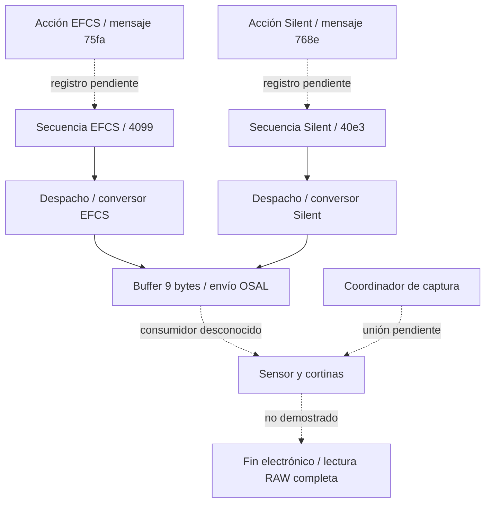

# EFCS y obturación completamente electrónica — 15-10-2026

Continuación vigente: [SilentShutter E015–E017](silent-shutter-status.md).
Ya se resolvieron la asociación acción→secuencia, CamMgr, la cola 0x30001,
el receptor LIRO y su almacenamiento del modo; también Off/On. Los pendientes
de E012/E014 que se conservan debajo son históricos. El consumidor físico y
la viabilidad de fin electrónico siguen abiertos.

**EFCS confirmado documentalmente y ruta de configuración localizada en firmware
3.21. Se localizaron también la secuencia y el envío SilentShutter. La
finalización electrónica de una fotografía A6000 sigue sin demostrarse.**
Categoría E: no hay parche, prueba física ni evidencia para declarar imposible
la función. La obturación es la prioridad vigente del pipeline.

## Métodos de obturación

| Método | Inicio | Final | Estado A6000 |
|---|---|---|---|
| Mecánico | Primera cortina | Segunda cortina | Método convencional; secuencia interna pendiente |
| EFCS | Operación electrónica del sensor | Segunda cortina mecánica | Función oficial; On por defecto; ruta FrontEShutterMode localizada |
| Electrónico completo por barrido | Reset por filas | Muestreo/lectura que termina integración por filas | Objetivo; SilentShutter no demuestra soporte funcional |
| Global electrónico | Inicio simultáneo | Fin simultáneo y almacenamiento de carga apropiado | Arquitectura no demostrada para este sensor |

La [guía específica ILCE-6000](https://helpguide.sony.net/mig/Z001924611/EN/contents/TP0000226634.html)
documenta EFCS, su ajuste predeterminado, reducción de retardo y precauciones
con determinadas ópticas y velocidades altas. No documenta aquí una opción de
segunda cortina electrónica.

El [artículo de Sony sobre EFCS](https://www.sony.com/electronics/support/e-mount-body-ilce-9-series/articles/00018997)
explica el inicio electrónico y final mecánico. La explicación de Sony del
[obturador electrónico por filas](https://support.d-imaging.sony.co.jp/support/ilc/flicker/01/en/)
relaciona inicio con reset y final con lectura. Esta fuente corresponde a otra
cámara: se usa solo para el principio, sin trasladar tiempos, antiflicker ni
capacidades a la A6000.

«Hacer electrónica la trasera» exige demostrar un modo que termine integración
y preserve cada fila a tiempo mientras sigue recibiendo luz. EFCS acredita la
mitad inicial. Desactivar la cortina mecánica sin esa lectura podría producir
exposición incorrecta o impedir completar el ciclo. Un temporizador de software
no sustituye ese modo. No hace falta global shutter para obtener silencio: un
barrido electrónico es otra posibilidad, con limitaciones propias.

Modelo conceptual, **no medición A6000**:
`T_exposición(fila) = t_fin(fila) - t_reset(fila)`.
La separación temporal entre primera y última fila es otra magnitud: velocidad
de disparo corta no implica lectura completa rápida.

## E012: rutas EFCS y SilentShutter

Archivo: `firmware/extracted/fw321/firmware.tar_unpacked/0700_part_image/dev/nflasha15_unpacked_unpacked/lib/libObj.so`.
SHA-256: `8e8a937aed23c2783e7bbee8a4afa2fb4bcd897606f190b17dccadd207d05b6a`.
Método: candidatos PC-relative Thumb16, validación LLVM Thumb-2, tabla TBH y
relocaciones ELF. SilentShutter está también decompilado en
`analysis/rea/capture-libObj-evidence.json`, evidencia
`ev_05277e507d8c5b24ce8e435a5cb68fe557c2f87c84735423fa924d31b0699ca1`.

Direcciones siguientes: **VA relativas ELF**, coincidentes con offset de archivo
solo en .text; Ghidra suma 0x10000. No son direcciones de cámara. Los nombres
locales son provisionales, asociados por diagnóstico, prólogo y comportamiento;
las etiquetas LLVM por proximidad no son nombres recuperados.

| Campo | EFCS / FrontEShutterMode | SilentShutterMode |
|---|---|---|
| Acción candidata | 0x6896ac | 0x686d10 |
| Categoría ObjMsg | 0x3100 | 0x3100 |
| Mensaje de ajuste | 0x75fa | 0x768e |
| Parámetro | 0x9776 | 0x9983 |
| Conversión del modelo | 0x68c24a: 1→0x2b4, 2→0x2b5 | 0x68c316: 1→0x450, 2→0x451 |
| Emisión de acción | IssueCommandAsync, destino obtenido con argumento 8 | Mismo patrón |
| Secuencia candidata | 0x95a308 | 0x978e0c |
| Selector del despachador | 0x4099 | 0x40e3 |
| Conversor | 0x99e968 | 0x99b004 |
| Mensajes aceptados | 0x75fa / 0x75e6 | 0x768e / 0x75e6 |
| Valores→byte de salida +8 | 0x2b4→0, 0x2b5→1 | 0x450→0, 0x451→1 |
| Bytes +2,+3 | 99 40 | e3 40 |
| Buffer enviado | 9 bytes | 9 bytes |
| Envío | 0xa1b21c → osal_snd_msg | Misma función; identidad de cola pendiente |

No se asignan todavía etiquetas On/Off a los números del modelo. Ambos
conversores escriben 5 en +0 y el tercer argumento little endian en +4..+7.
Las secuencias ponen a cero el buffer antes de convertir. Los selectores y
cabeceras son protocolo interno, **no registros del sensor**. NON SUPPORTED
rechaza mensajes no aceptados; un parámetro ausente o valor desconocido también
produce error. Estos fragmentos no contienen prueba de capacidad física por modelo.

### Despacho indirecto resuelto

Despachador 0x9bbb5c, TBH en 0x9bbd64, tabla 0x9bbd68,
índice `selector - 0x4000`, base GOT 0x102cbd0:

| Selector | Entrada TBH | Caso | Literal / valor | GOT VA | Offset GOT archivo | Puntero Thumb |
|---|---|---|---|---|---|---|
| 0x4099 | 0x9bbe9a | 0x9bc34a | 0x9bc710 / 0x31f4 | 0x102fdc4 | 0x1027dc4 | 0x99e969 |
| 0x40e3 | 0x9bbf2e | 0x9bc82e | 0x9bc930 / 0x5268 | 0x1031e38 | 0x1029e38 | 0x99b005 |

Ambas entradas tienen R_ARM_RELATIVE; los casos cargan r6 por GOT y alcanzan
`blx r6` en 0x9bc8c2. Bit 0 indica Thumb. El segmento de datos tiene VA
0xfd25a4 y offset 0xfca5a4: **no usar VA de GOT como offset**. Quedan probadas
las aristas locales secuencia→despachador→conversor, antes pendientes.

### Significado del envío y su éxito

EFCS llama al conversor en 0x95a350 y al envío en 0x95a362; SilentShutter en
0x978e54 y 0x978e66. El retorno del conversor no se comprueba en ese tramo
antes de obtener el objeto de envío. Esto no justifica enviar mensajes
inválidos: sus efectos no se comprobaron.

El envío obtiene la cola de objeto+4, reserva con osal_valloc_msg_wait en
0xa1b23e, copia payload y llama osal_snd_msg en 0xa1b294. El objeto se obtiene
mediante 0xa15fd0 (`sequence+0x20` → `+0x20`). Falta identificar consumidor y
transporte al CMOS.

Si el envío devuelve cero, construye respuesta 0x9502=0xf000, copia relay y
emite notificación EFCS 0x85a6 o SilentShutter 0x85f6. No espera en ese tramo
confirmación de lectura o de movimiento físico. **Éxito de ajuste de software
no demuestra disparo silencioso.**



Las aristas punteadas siguen abiertas: registro de comandos/secuencias,
inhibiciones por modelo, consumidor OSAL y operaciones físicas. CaptureStartCmp
y callbacks de shutter tampoco demuestran integración o lectura terminadas.

## Configuraciones y alternativas

| Factor | Relación con obturación | Estado |
|---|---|---|
| EFCS On/Off | Inicio electrónico/mecánico | Documentado y conversión localizada; ejecución física pendiente |
| Tiempo de exposición, S/M/BULB | Separación reset–fin | Límites del modo electrónico propuesto desconocidos |
| ISO/ganancia/bits | Condiciones y calidad de lectura | Sin mapa de sensor |
| Apertura/óptica | Artefactos EFCS | Precauciones oficiales; sin mediciones |
| RAW/JPEG, tamaño/aspecto | Foto completa frente a preview/recorte | Ningún RAW electrónico completo demostrado |
| Ráfaga, único, temporizador, bracketing | Rearme y buffers | Ciclo físico pendiente por modo |
| AF/AE, media pulsación | Preparación del disparo | Entrada software parcial; teclas físicas sin mapear |
| Flash, sincronía trasera, HSS | Iluminación frente al barrido | Sincronía trasera de flash no significa cortina electrónica |
| Ruido de larga exposición | Posible exposición oscura adicional | No asumir ciclo sin cortinas aunque la foto luminosa lo fuera |
| WB, estilos, DRO/HDR, ruido | Procesado o varias tomas | No prueban fin electrónico |
| AutoReview | Entrega visual | Callbacks/metadatos localizados; píxeles pendientes |
| Vídeo/live view/frame grab | Otra fuente de imágenes | No equivale a RAW ni a resolución/calidad de foto completa |
| ShutterMute | Sonido generado, según implementación | No prueba silencio mecánico |

No se identificó un selector independiente RearEShutter. Búsqueda de cadenas
Rear/Second/Electronic Shutter en libObj sin hallazgo de ese selector: no descarta
modos numéricos u otra imagen. La pista concreta es SilentShutter hasta su
receptor, junto a S_IMAGER_CURTAINMODE, sin atribuir a esta cadena un registro.

## Evidencia necesaria para implementar

### E014: avance sobre el transporte OSAL

Una inicialización local en libObj ELF 0xadaf66–0xadaf86 configura dos objetos
en owner+0x20 y owner+0x24. El setter 0xa1b198 escribe el argumento en
objeto+4. El primero recibe **0x30001**, el segundo **0x40193**; ambos reciben
0x20002 en objeto+8 mediante 0xa1b1a0. Los literales están en 0xadb080/84.
**Candidato de identidad de cola**: coincide la disposición de acceso +0x20
con el accessor de secuencia, pero aún falta demostrar que se trate de la
misma instancia/owner. No se declara 0x30001 como cola definitiva del sensor.
SHA-256 de bytes `[0xadaf66,0xadb088)`:
`87dfd4c75ae3b676099cc63297eeaaf1d5384e5d2e616be45d4051b1002b3985`.

Se analizó la copia nflasha15 de libosal_uipc.so, hash
`0c6b87a012eb757dbe0a5b9b7b19fb91fc27c1dafc0e78facb126114416cf1ef`.
Direcciones **Ghidra** de esta biblioteca:

| Función | Resultado estático |
|---|---|
| u_uipc_init 0x12160 / do_init 0x11f84 | Abre /dev/uipc, consulta configuración por ioctl 0x80000010 y mapea memoria |
| osal_snd_msg 0x1421c | Si qid & 0x8000 == 0, ioctl 0x80000004; otra rama usa cola en memoria |
| u_osal_snd_msg 0x12430 | ioctl 0x80000004 con identificador y mensaje |
| osal_reg_msg_queue_cb 0x13810 | Para qid sin bit0x8000, ioctl 0x80000008; otra rama registra callback local |

0x30001 no contiene bit0x8000: **si se confirma la instancia y resolución a
esta biblioteca**, seguiría la rama hacia el núcleo. Hay varias copias OSAL en
el firmware; DT_NEEDED/nombre no prueba cuál se carga en ejecución.
Export: `analysis/rea/shutter-osal-evidence.json`, 9 registros y snapshot.
Inicialización: evidencia
`ev_7a96a51f28a0c733430f02229f51d12d20ef4c02eed45d4d4136a5f86ce0a5ed`.

Se analizó también nflasha15/kmod/osal_uipc.ko, hash
`82a92bd4bd00d7e28237b647c93278f57d53dee241f96075798fad8a87926ab1`.
Direcciones de **su importación Ghidra**, no offsets ni direcciones del núcleo:
__k_uipc_cdev_ioctl 0x1068c valida/copia argumentos y despacha por tabla;
__k_4u_snd_msg 0x11c44 transforma el mensaje de usuario y llama osal_snd_msg;
osal_snd_msg 0x13cc0 resuelve qid, comprueba condiciones, encola con bloqueo
y activa notificación si corresponde. Es transporte genérico, sin escritura
al CMOS identificada en estas funciones. El pseudocódigo del dispatcher muestra
un índice de tabla que requiere contraste con instrucciones antes de asignar
una entrada concreta a un número ioctl; no se da por resuelto ese salto.
Export: `analysis/rea/shutter-uipc-kernel-evidence.json`, con snapshot.
Función de encolado:
`ev_1224ee0b6119335a54dc9c4db5babb7f9662c37c2b548d874348a1d3b16417c0`.

Esto acota la frontera de transporte y ofrece una cola candidata; no identifica
el consumidor final ni prueba que el selector alcance un modo electrónico del sensor.

1. Resolver inicialización/receptor de la cola de 0xa1b21c y su respuesta real.
   El nombre LIRO no identifica por sí solo procesador, RTOS o sensor.
2. Seguir 0x4099/0x40e3 en el receptor: selección por modelo, reset, fin de
   integración, lectura y accionamiento/rearme mecánico.
3. Identificar sensor/revisión y modo de foto: dimensiones, bits, ganancia,
   tiempos por fila/frame mediante documentación o tablas inequívocas.
4. Verificar ciclo sin cortinas, RAW íntegro y exposición correcta por filas;
   comprobar dependencias de dark frames y calibración.
5. Con recuperación demostrada, preparar un experimento físico autorizado que
   mida movimiento, imagen y tiempos. Esta pasada no accede a la cámara.

Código funcional de otro modelo no demostraría identidad de sensor/conexión.
Si solo existe lectura electrónica reducida, sería una alternativa con
compromisos y no cumplimiento del objetivo de foto completa.

## Reproducción

Rangos/hashes/dispatch: `reports/efcs-silent-dispatch.json`. Candidatos iniciales:
`reports/efcs-thumb-candidates.json`. Desde la raíz:

```sh
llvm-objdump -d --triple=thumbv7-linux-gnueabi --start-address=0x95a308 --stop-address=0x95a49c firmware/extracted/fw321/firmware.tar_unpacked/0700_part_image/dev/nflasha15_unpacked_unpacked/lib/libObj.so
readelf -lW firmware/extracted/fw321/firmware.tar_unpacked/0700_part_image/dev/nflasha15_unpacked_unpacked/lib/libObj.so
readelf -rW firmware/extracted/fw321/firmware.tar_unpacked/0700_part_image/dev/nflasha15_unpacked_unpacked/lib/libObj.so
```

Repetir LLVM con los otros rangos del registro. El buscador src/thumb_refs.py
solo produce candidatos: no analiza control de flujo ni clobber de registros;
puede coincidir con datos embebidos. Cuatro tests añadidos antes de implementar
(fallo inicial por módulo ausente). Resultado: 19 tests, ruff y mypy correctos.
