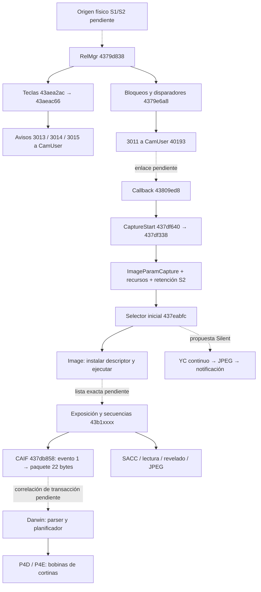

# Disparador, CaptureManager y sincronía mecánica — línea C

Análisis estático local de ILCE-6000 3.21, 16-10-2026. No se ejecutó firmware
ni se conectó una cámara. VA de LIRO directa; en bibliotecas Linux, VA ELF
y dirección Ghidra = VA + `0x10000`. Las propuestas no constituyen parches.

## Resultado y alcance de aceptación

**VERIFICADO:** el punto concreto de selección de la secuencia inicial de
captura es `0x437eabfc`, llamado por `0x437df338` después de crear el objeto
de captura y antes de instalar su descriptor en el objeto Image y ejecutarlo.
**HIPÓTESIS:** introducir allí una selección Normal/Silent es una divergencia
útil para sustituir la adquisición manteniendo el contrato del gestor.
**NO VERIFICADO:** existe una fila electrónica reutilizable que cumpla ese
contrato, o que todo lo anterior a este punto carezca de efectos mecánicos.
Por tanto se localizó un candidato de integración, no una transición segura
ya demostrada ni un selector Silent actualmente operativo en la A6000.

**DESCARTADO:** presentar `0x43841070` como el único selector de secuencias o
como un interruptor de obturador. Construye parámetros y el paquete de
exposición; cambiar su clase no sustituye el ciclo de captura.

| Tarea | Resultado |
|---|---|
| C-01 | VERIFICADO: entrada real, estructura de evento, primer consumidor y avisos. NO VERIFICADO: asignación de índices al contacto físico S1/S2. |
| C-02 | VERIFICADO: despacho diferido a CaptureStart y selección/ejecución de descriptor. NO VERIFICADO: enlace completo de `0x3011` a ese despacho. |
| C-03 | VERIFICADO: frontera CAIF y diferencias con SACC; inventario de estados afectados. NO VERIFICADO: primera orden mecánica de cada descriptor y balance de todas sus esperas. |
| C-04 | HIPÓTESIS: divergencia en `0x437eabfc`; requisitos concretos de entrada, finalización y retorno. NO VERIFICADO: suficiencia del protocolo propuesto. |
| C-05 | VERIFICADO: SFRA carece de llamadas directas a las entradas examinadas de captura/CAIF. NO VERIFICADO: ausencia total de movimientos al abrir/cerrar el path. |

## C-01 — eventos, teclas y primer consumidor

**VERIFICADO por LLVM y nueva decompilación:** RelMgr empieza en
`0x4379d838`, no en `0x4379d83a`. La primera instrucción es
`ldr r3,[r1]`; `0x4379d83a` es el `push.w` siguiente. El TBH de
`0x4379d852` selecciona por `evento[0]-1`, admite `1..0x27` y tiene ruta
desconocida fuera del intervalo. La exportación anterior
`analysis/ghidra/liro-relmgr-exec.json` empezaba dos bytes tarde y mostraba
`switch(param_4)`: **DESCARTADO** ese supuesto argumento como evento.

**VERIFICADO:** estructura consumida por `0x4379d838`:

| Offset | Uso observado |
|---|---|
| `+0` | operación/evento, `switch(*param_2)` |
| `+4` | origen; varias ramas comparan con `0x20002` |
| `+8` | clase de petición; algunas respuestas requieren valor 2 |
| `+0xc` | correlación copiada a avisos/respuestas |
| `+0x10` | índice de tecla, disparador o factor según operación |
| `+0x14` | estado byte y datos auxiliares |

**VERIFICADO:** `0x43aea208(base,id,value)` intercambia
`byte[base+id]`; `0x43aea210(base,id,value)` escribe
`byte[base+0x20+id]`. Por tanto `1` y `0x10` son **índices**, no máscaras.
El desensamblado de `0x43aea210` es `adds r1,r0,r1` seguido por
`strb.w r2,[r1,#0x20]`. Esto corrige la inferencia de bits S1/S2 en el
documento de integración, sin modificar ese documento ajeno a esta tarea.

**VERIFICADO:** operaciones relevantes de RelMgr:

| Evento | Efecto y consumidor inmediato |
|---|---|
| 1/2 | actualizan disparadores mediante `0x43aea49a`; pueden sintetizar una tecla asociada por tabla `0x43bc4634`; reevaluación de bloqueos |
| 3/4 | cambios de tecla; `0x43aea2ac` guarda estado y registro de 24 bytes por índice; después `0x43aeac66` evalúa cambio de tecla prioritaria |
| 3/4, índice 9 | ruta especial: `0x4379ea00`/`0x4379e9c8` emiten `0x302d/0x302e`, con campo `+8=9` |
| 5 | limpia grupos de teclas y disparadores, reevalúa el estado |
| `0xf/0x10` | escriben 1/0 en los índices 1 y `0x10` de varios grupos, actualizan `0x4372a940`, responden `0x404a/0x404b` |
| `0x11..0x1f` | consulta/configuración de bloqueos, recursos y captura; no son exclusivamente pulsaciones físicas |

**VERIFICADO:** el primer consumidor de la tecla actualizada es
`0x43aeac66(RelMgr+0xbac)`. Llama primero a `0x43aeac16`, que obtiene el
índice prioritario mediante `0x43aea264` y compara con el previo; para
índices `{1,0x10,2,0x11}` avisa con `0x4379ea9c` → mensaje `0x302b`.
Después `0x43aeac66` emite:

| Transición observada | Emisor | Mensaje a CamUser |
|---|---|---|
| previo 0 → tecla no nula admitida | `0x4379eb04` | tipo 0, `0x3013` |
| tecla previa no nula → 0 | `0x4379ea38` | tipo 0, `0x3015` |
| otra tecla prioritaria | `0x4379eacc` | tipo 0, `0x3014` |

**VERIFICADO:** el camino de petición de captura es distinto:
`0x4379e6a8(RelMgr+0xbcc,flag)` consulta métodos del objeto de bloqueos
(`vtable+0x18/+0x1c`, factores 1, `0xf`, `0x11`, `0x15`), detecta el
disparador prioritario y, si admite la petición, llama `0x4379eba0`.
Esta última construye tipo 2, id `0x3011`, copia correlación
`registro+0xc` e índice `registro+0x10`, y envía por
`0x43aeaf18(msg,0x30001,0x40193)`. El cambio 0↔no nulo del disparador
también emite tipo 2, `0x3030`, mediante `0x4379eb3c`.
Si bloqueado, una rama emite tipo 5, `0x4045`, a `0x40193`.

**VERIFICADO:** `IsNeedForceS1ON` tiene entrada `0x4379d378`, no
`0x4379d37a`; la entrada correcta conserva `param_2<0xb` en lugar de
flags de CPU sin definir. Para disparadores `{3,8,9,10}` retorna 1;
para `{0,1,4,5,6,7}` retorna 0; para 2 depende de los índices `0xb/0x13`.
La tabla `0x43bc4634` transforma disparadores 8→`0x11`, 9→`0x13`,
10→`0x14`, 12/13→`0xb` y 1/2/3→sí mismos.

**INFERENCIA:** hay estado de media pulsación forzada, estado de tecla y
estado de petición de disparo separados. **NO VERIFICADO:** los índices
físicos S1/S2 y el origen hardware de esas operaciones. No identificar
`0xf/0x10` con pulsar/soltar S2 solo porque escriben ambos índices.

## C-02 — gestor y despacho de secuencia

**VERIFICADO:** `0x43809ed8` toma el gestor `0x437de2fc()`
(`0x43ed4cb8`), construye un callback con `0x43ada220` desde
`GOT[0x44021ed0]=0x437df641`, y lo entrega a
`0x439018b0(gestor,callback,seqId,0)`. El bit 0 identifica Thumb:
el destino es `0x437df640`, cuyo log dice `CapMgr) CaptureStart`.
También `0x4380db04` agenda ese callback para ramas de mensajes de entrada
`0x104/0x141`, después de configurar el objeto de petición.
No son pruebas de que `0x3011` llegue directamente a estas funciones.

**VERIFICADO:** `0x437df640` consulta
`(cfg[+0x265]&0xf)>>2`. Ramas 1/2/3 separan DualRec/Panorama/otra
captura; la rama ordinaria y una condición de la rama 2 llaman
`0x437df338(seqId,primeraActivacion)` (`BL 0x437df87a`).
Al salir llama `0x437dfc98(seqId)` y `0x4372a540(0x12)`.

**VERIFICADO:** dentro de `0x437df338`, el orden es:

1. Reinicio condicional `0x437de2a4`, selección de petición
   `0x437dfe4c`, marcas `EnterCapturing`/`EnterCapturingLv`.
2. `0x437e067c` normaliza el tipo de captura, número de imágenes y campos
   asociados. No selecciona directamente el modo IMX210.
3. Prepara memoria RAW (`0x437e1e48`), recursos de intervalo
   (`0x437e0fc0`) y aumenta la retención S2 con `0x43afbe46`.
4. Crea `ImageParamCapture` por `0x437dcfc8`; configura ráfaga/contexto
   compartido en `+0x4ad4`, índice `+0x54a8`, flags `+0x54a5`.
5. Crea Image por `0x4381bd4c`; selecciona descriptor de 20 bytes con
   `0x437eabfc`; lo instala con `0x43afb408` en `Image+8..+0x18`.
6. Ejecuta `0x43b04730(Image)`: llamada indirecta al primer método del
   objeto apuntado por `Image+4`, pasando Image como argumento.

**VERIFICADO:** `0x437eabfc` lee captura `+0x4b70`, `+0x54a5`,
`+0x54a8`, `+0x70`, `+0x1d8`, `+0x1e0`; tabla base
`GOT[0x44022934]=0x43edccf8`. Copia cinco palabras de una fila.
La tabla reside después del intervalo tratado como constante por el script;
su contenido inicializado y las cinco palabras no se identifican aquí como
una lista de etapas mecánicas.

**VERIFICADO:** otro selector, `0x437ea8cc`, usa
`GOT[0x44025f60]=0x43eddd08` y filas de 20 bytes, con campos
`+0x73a/+0x4b84/+0x4b80/+0x4ee4/+0x4ee8`. Es una selección posterior
de exposición; no intercambiar esas dos tablas ni sus índices.
`0x43841070` prepara parámetros y paquete; la clase EFCS se propaga por
`0x43eedecc`, como documenta [efcs-capture-selector.md](efcs-capture-selector.md).



Las flechas discontinuas son **NO VERIFICADO** o **HIPÓTESIS**, según su
etiqueta. El grafo no establece un orden temporal total entre SACC y Darwin.

## C-03 — frontera mecánica y estado que no puede omitirse

**VERIFICADO:** `Stage_SACC=0x43782464` reserva memoria, adquiere NFLASH
(`0x43b6da42`) y lo inicia con `0x439d4cc4`; no equivale a una orden de
cortina. En las secuencias de `a6000-all-exposure-sequences.json`, por ejemplo
`0x43b1aea2`, se separan preparación de modo y fases de lectura:
estado 0 aplica SetMode, estado 1 llama `0x438c828c`, estado 2
`0x43b1e7f2`, estado 3 limpia flags/esperas y llama `0x438c867c`,
estado 4 llama `0x437ed568`. **NO VERIFICADO:** descriptor exacto que
selecciona cada variante para un disparo ordinario.

**VERIFICADO:** `0x438c828c` recalcula exposición mediante `0x437f8a50`,
aplica `SetExposure`/`SetRead` (`0x436d6320/0x436d6398`), selecciona
callbacks y configura lectura por `0x43795dec`. Saltarlo elimina también
configuración del sensor/receptor; no es solo suprimir una cortina.

**VERIFICADO:** frontera de petición de parámetros CAIF:
`0x437db858(evento=1,ca_buffer)` → `0x436b8a50(ca_buffer+0x40)`;
esta copia `0x16` bytes a `0x43f91e32`, envía
`0x436ba234(0x10300,0x16,buffer)` y notifica `0x436b96b4(0x122,buffer)`.
El evento 0 usa `0x436b896c`; 2..8 incluyen otros comandos sin ese paquete.
**NO VERIFICADO:** cuál de esos eventos constituye el primer compromiso
mecánico en cada secuencia. Evitar solo el evento 1 no prueba independencia.

**VERIFICADO:** en Darwin A6000, el parser `0x17f8c` recibe 22 bytes;
los helpers `0x20c90/0x20cb2` controlan P4D y
`0x20d00/0x20cd4` P4E. El vínculo eléctrico a las dos bobinas está en
[fm3-gpio-shutter-mapping.md](fm3-gpio-shutter-mapping.md). Los helpers
filtran por tipo HW `0x20c74`, no por Silent. El motor de fases, DMA,
temporización e interlocks se conserva en las evidencias Darwin existentes;
una orden eléctrica no demuestra por sí sola posición final de la cortina.

**VERIFICADO:** el fin de la secuencia RAW tiene contabilidad real:
`0x437de9f0` decrementa `0x43ed4cf8` y condicionalmente
`0x43ed4cf0` y captura `+0x1d8`; devuelve recursos con `0x437e240c`,
notifica `0x43787988`, retira marca 8 y agenda callbacks de S2.
Termina llamando `0x437e4e94` para liberar una retención. Esta ruta es
condicional: no copiar sus decrementos sin reproducir el camino de entrada.

## C-04 — divergencia candidata y vuelta a convencional

**HIPÓTESIS de implementación:** decidir en el límite
`0x437df338 → 0x437eabfc`, usando el ajuste Silent congelado por petición,
y devolver un descriptor alternativo con adquisición YC continua.
Es anterior al lanzamiento de Image y conserva el gestor de disparo.
La rama debe tener finalización y cancelación propias; no basta desviar una
etapa a `Stage_Notify`, ni elegir arbitrariamente una clase EFCS.

**VERIFICADO:** `S2Handler` vive en `0x43ed87c8`:
`0x43afbe46` incrementa el contador `ushort+2` y devuelve si antes era cero;
`0x43afbe5a` marca el byte `+0` y retiene solo la primera vez.
`0x437e4de4` administra tres slots de 24 bytes con callbacks y argumentos;
si el contador ya está en cero puede ejecutar el callback inmediatamente.
`0x437e4e94` decrementa; al pasar de 1 a 0 despacha y limpia los tres slots.
Si ya era cero registra error. `0x437e4f44` limpia la marca y libera.
Las firmas inferidas omiten argumentos en algunas llamadas: antes de
implementar hay que contrastar registros de llamada y ABI, no copiarlas.

| Estado/contrato observado | Requisito de una rama Silent (INFERENCIA) |
|---|---|
| RelMgr: grupos de tecla/disparador, bloqueos y avisos | mantener pulsación/soltado, AF y cancelación; una petición admitida conserva su correlación |
| S2Handler: marca, contador y tres callbacks | emparejar cada adquisición y liberación; no ejecutar callbacks de otra captura ni provocar underflow |
| CaptureManager: contadores `43ed4cf8/43ed4cf0`, `+1d8`, `+4b68` | definir cuántas imágenes se deben producir y cuándo termina/cancela cada una |
| Image/descriptor: cinco palabras en `+8..18`, estado y ownership | usar un ciclo completo alternativo; no dejar etapas RAW esperando callbacks que nunca existirán |
| Memoria RAW, intervalo y contexto ráfaga | reservar solo lo necesario y liberar exactamente lo adquirido, también en error |
| Captura `+74f`, `+4fd0`, `+54a5/+54a8/+4ad4` | preservar error/cancelación y correlación de ráfaga; no simular éxito de lectura ausente |
| Sensor/DFE/CamCore y buffers YC | retener un frame completo y coherente; garantizar su duración hasta terminar JPEG |
| Darwin: fases, DMA, interlocks y respuestas | no iniciar transacción de cortina y luego omitir su terminación; no falsificar posición ni limpiar errores |
| `Stage_Notify 437efe78`, tipo 4/id `1006` | completar StillInfo válido y ownership de handles, o devolver error por el contrato ordinario |

**HIPÓTESIS:** transición Silent→convencional en reposo del gestor:
terminar/cancelar la petición Silent, consumir sus callbacks y liberar sus
handles; esperar liberación de los recursos realmente adquiridos; aplicar
el cambio de política a la siguiente petición, y dejar que su descriptor
convencional programe modo/exposición y Darwin desde un estado conocido.
No resetear globales ni forzar GPIO para aparentar reposo.

**NO VERIFICADO:** predicado completo de reposo, exclusión con ráfaga/vídeo,
restauración de LV y estado físico de cortinas. Contador S2=0 es una
condición de ciclo de software, no prueba suficiente de reposo mecánico.
Hasta cerrar esas condiciones, la transición no se califica como segura.

## C-05 — Live View/SFRA y movimiento

**VERIFICADO:** [electronic-still-low-resolution.md](electronic-still-low-resolution.md),
sesión 6, y `analysis/sfra-outcalls.json` distinguen codificación SFRA desde
SDS YC (`0x439a2f8c` → SDF `0x56000f`) de captura fotográfica.
GET_JPEG (`0x439a282c`) recoge buffers READY; no inicia una exposición.
El grafo de llamadas directas SFRA no alcanza las entradas examinadas de
SetMode/CAIF/captura. Es evidencia de separación de servicios.

**NO VERIFICADO:** productor del YC, llamadas indirectas, cambios de estado
del cliente Linux al abrir/cerrar SET_PATH y actuación previa para entrar en
LV. No deducir «sin movimiento en todo el ciclo» de la ausencia de BL.
**INFERENCIA:** tomar un frame de un path continuo ya activo podría evitar
una nueva secuencia fotográfica mecánica; su apertura y la transición de
vuelta requieren otra demostración. No equivale a exposición independiente.

## Evidencia reproducible y validación

**VERIFICADO:** las cinco consultas nuevas verificaron en memoria los
11 427 236 bytes originales de LIRO y SHA-256
`b60c845ccb90c0ff86b7f62f1f3f2ecda714aa20c37805959ebee2b429e56bb9`.
Se usó `silent-liro`, `-noanalysis -readOnly`, `QuerySilentLiro.java`;
no se abrió ni modificó el proyecto compartido `a6000-libs`.
Solo se conserva este archivo de salida, conforme a `_common.md`.
Los JSON temporales no son necesarios para reproducir las consultas.

Direcciones consultadas y usadas para las conclusiones nuevas:
`0x4379d838`, `0x4379d378`, `0x43aea208/210/264/2ac`,
`0x43aeac16/66`, `0x4379e6a8`, `0x4379e9c8/ea00/ea38/ea9c/eacc/eb04/eb3c/eba0`,
`0x437df640`, `0x437eabfc`, `0x4381bd4c`, `0x43afb408`,
`0x43b04730`, `0x43809ed8`, `0x4380db04`, `0x437de9f0`,
`0x437de2fc`, `0x437e4dd8/de4/e94/f44`, `0x43afbe46/5a`.
Para repetir, por ejemplo:

```sh
mkdir -p /tmp/task-c-java
env JAVA_TOOL_OPTIONS=-Duser.home=/tmp/task-c-java \
  JAVA_HOME="$PWD/tools/providers/jdk-21.0.12.1+1" \
  tools/providers/ghidra_12.1.4_PUBLIC/support/analyzeHeadless \
  analysis/ghidra silent-liro -process av-cam.bin -noanalysis -readOnly \
  -scriptPath analysis/ghidra -postScript QuerySilentLiro.java \
  /tmp/task-c-recheck.json '!0x4379d838' '!0x4379d378' \
  0x43aea210 0x43aeac66 0x4379e6a8 0x437eabfc 0x437e4e94
llvm-objdump -d --triple=thumbv7-none-eabi \
  --start-address=0x4379d838 --stop-address=0x4379d856 \
  analysis/av-cam-analysis-view.elf
```

**DESCARTADO:** una consulta exploratoria en `0x43809e00` produjo una
función interior dependiente de flags entrantes. No se usa como evidencia;
LLVM permitió localizar la función pertinente en `0x43809ed8`.

Evidencia previa reutilizada: `analysis/ghidra/{liro-relmgr-helpers,lv-enter,
lv-capmgr,capture-exposure-selector-recovered,a6000-all-exposure-sequences,
silent-capture-config-folded,efcs-capture-param-driver-link,
a6000-caif-event-dispatch,a6000-caif-parameter-payload}.json`;
documentos Darwin y GPIO enlazados arriba. Las decompilaciones con funciones
solapadas son apoyo local, no listas completas de etapas.

**VERIFICADO, validación:** LLVM confirmó las dos correcciones de entrada
y acceso por byte; Ghidra devolvió decompilación en las consultas nuevas,
aunque ese estado por sí solo no valida límites ni semántica. No se añadió
código ni pruebas artificiales para un cambio documental. Mypy solicitado:
`Success: no issues found in 5 source files`; Ruff solicitado: 9 errores
preexistentes en tests ajenos, sin modificarlos. Se ejecutaron con las
herramientas de `/home/nicolas/Documents/GPREMIUM/ingreso-agentes/.venv/bin/`,
cachés desactivada/temporal, sin instalar paquetes.
Sin commit: el directorio no tiene un repositorio Git utilizable.

## Bloqueos exactos y decisión

**ACEPTO:** entrada `0x4379d838`, índices de bytes, avisos separados de
captura, callback a CaptureStart, selector inicial `0x437eabfc` y balance
S2 como requisitos comprobados de integración.

**RECHAZO:** dar por resuelta la asignación física S1/S2, el salto
`0x3011→CaptureStart`, una fila Silent existente o una transición sin
movimientos. Faltan el consumidor CamUser de `0x3011` y su vuelta a LIRO,
la inicialización de `0x43edccf8/0x43eddd08`, el primer evento CAIF por
descriptor y el camino de apertura/cierre de LV/SFRA.

**Siguiente tarea sugerida:** resolver en CamUser el handler tipo 2/id
`0x3011` y seguir su petición hasta `0x43809ed8`, reconstruyendo a la vez
las cinco palabras del descriptor instalado por `0x437eabfc`. Así se podrá
comprobar el punto anterior a cualquier compromiso mecánico y el contrato
completo de finalización, en vez de suponerlo.

**VEREDICTO: CAMBIOS**. Se examinaron C-01..C-05 y se identificó una
divergencia candidata con estados concretos; la aceptación completa exige
cerrar los enlaces y condiciones todavía NO VERIFICADOS.
