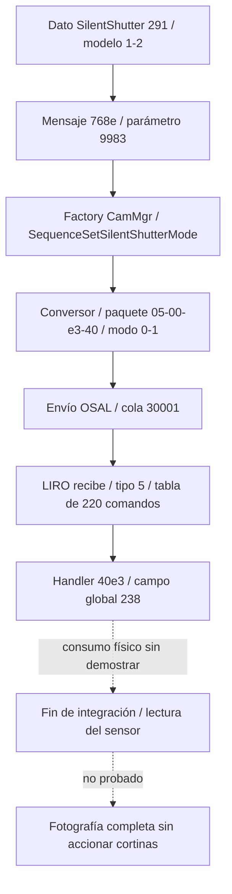

# SilentShutter: ruta reconstruida y límite actual

Actualización 16-10-2026: [fases Darwin y escrituras de control](darwin-state-machine.md)
y [campos adicionales/ABI serie CAIF](silent-caif-transport.md). Las tablas TBB
están reconstruidas. El indicador80 retiene la etapa del planificador y no
certifica movimiento terminado. Se localizaron escrituras42668000+offset,
pero su función eléctrica y enlace con Silent siguen sin demostrar.

| Escenario de viabilidad IMX210 | Estado vigente | Evidencia que falta |
|---|---|---|
| A: ruta compatible presente y no seleccionada | HIPÓTESIS / NO VERIFICADO | Secuencia A6000 completa con final electrónico, condiciones de selección y lectura fotográfica |
| B: capacidad del sensor con implementación ausente | HIPÓTESIS / NO VERIFICADO | Documentación o secuencia específica IMX210 que acredite integración/final/lectura apropiados |
| C: limitación física | HIPÓTESIS / NO VERIFICADO | Restricción técnica del IMX210 o controladores físicos, no ausencia de referencias |

**DESCARTADO:** interpretar un ACK del ajuste, EFCS, clase2, tipo4 Darwin,
el modo4e IMX284 o el bit20 CAIF como prueba intercambiable de Silent A6000.
No hay parche funcional ni fotografía totalmente electrónica validada.

Fecha: 15-10-2026. Firmware oficial A6000 3.21.

Continuación: [E018: consumidores y correcciones](silent-imager-consumers.md)
y [E019: exposición IMX210 y P2S](imager-exposure-p2s.md). El proyecto fue
ampliado y dos entradas candidatas de E017 resultaron interiores a variantes
ZAF; las entradas normales se contrastaron con la vtable. Los resultados
inferiores se conservan como historial. Para continuar, usar las consultas
incrementales; no ejecutar el antiguo script que limpia el proyecto.

**Se ha seguido la configuración hasta un receptor real de software en LIRO:
comando 0x40e3 → almacenamiento del modo en un bloque de parámetros.** Ya no
es solo una cadena o un menú compartido. No se ha demostrado que ese estado
controle una finalización electrónica de exposición en fotografía completa.
La investigación de viabilidad sigue en categoría E; no se produjo un parche.

## E015: configuración, valores y selección de secuencia

Biblioteca: nflasha15/lib/libObj.so, SHA-256
`8e8a937aed23c2783e7bbee8a4afa2fb4bcd897606f190b17dccadd207d05b6a`.
REA 6.5.0 / Ghidra 12.1.4, ARMv7, perfil reducido conservado en el export.

Esta tabla usa **direcciones Ghidra**; para obtener VA ELF se resta 0x10000.
No trasladar esta regla a av-cam.bin ni a módulos del núcleo.

| Función o dato | Dirección / comportamiento verificado |
|---|---|
| pvt_ActionSetSilentShutterMode, nombre provisional | ELF 0x689ea4; extrae dato 0x291 y, si es válido, llama ELF 0x686d10 |
| pvt_SetInit_SilentShutterMode | Ghidra 0x68e48c: dato 0x291 → conversión → parámetro 0x9983 |
| Conversión modelo→protocolo | 0x69c316: 1→0x450; 2→0x451; otros valores fallan |
| Acción de ajuste | ELF 0x686d10: categoría 0x3100, mensaje 0x768e, parámetro 0x9983, IssueCommandAsync |
| Factory de CamMgr | Función que contiene Ghidra 0xae81b6: compara mensaje con 0x768e, construye secuencia 0x988fa0, pasa CamMgr y la encola |
| Constructor Silent | 0x988fa0: instala la ejecución 0x988e0d (puntero Thumb), mediante objeto de función |
| SeqBase | 0xa25ee0: conserva mensaje, relay y mp_CamMgr en sequence+0x20 |
| Ejecución Silent | 0x988e0c: selector 0x40e3, conversor, buffer de 9 bytes y envío OSAL |
| Acceso al objeto de envío | 0xa25fd0: sequence+0x20 → CamMgr+0x20 |
| Constructor CamMgr | 0xaeade4: crea ese objeto de envío y configura su cola como 0x30001; segundo objeto usa 0x40193 |
| Conversión inversa | 0x6a415a: 0x450→1, 0x451→2; valores distintos fallan |
| Actualización SET/ACT | 0x68984c: lee 0x9984/0x9985, convierte, actualiza objeto+0x54c y publica 0x768f |

La asociación de acciones y secuencias que estaba abierta en E012 queda
sustentada por la rama del factory, el constructor y SeqBase. También queda
resuelta la identidad de clase del owner de E014: es CamMgr, no un objeto
arbitrario de disposición parecida. Son relaciones estáticas; no una traza viva.

### Off y On ya tienen correspondencia verificada

El nombre no se deduce solo de dos cadenas contiguas. La función Ghidra
0xb04d20 comprueba el rango y consulta una tabla indexada por el valor recibido:
base Ghidra 0xff565c, VA ELF 0xfe565c, offset de archivo 0xfdd65c.
En el índice 0x450 está el puntero a VALUEID_SILENT_SHUTTER_OFF; en 0x451,
a VALUEID_SILENT_SHUTTER_ON. La consulta indexada se contrastó con LLVM y
los bytes originales.

| Significado | Modelo | Valor de protocolo | Byte +8 |
|---|---|---|---|
| Off | 1 | 0x450 | 0 |
| On | 2 | 0x451 | 1 |

Esto resuelve la hipótesis de etiquetas de E009/E012. No asigna idénticos
valores semánticos a enums de otras propiedades.

El conversor acepta 0x768e o 0x75e6 y exige 0x9983 con valor conocido.
El paquete es `05 00 e3 40 rr rr rr rr mm`, donde `rr` son los cuatro bytes
del tercer argumento en little endian y `mm` es 0/1. La secuencia parte de un
buffer a cero; +1 permanece cero en ese recorrido. Los bytes no son un mapa
de registros del sensor.

### Respuesta de ajuste frente a confirmación física

Después del envío exitoso, la secuencia actualiza datos de software y construye
respuesta 0x9502=0xf000 y evento 0x85f6. No espera en ese tramo un frame ni una
confirmación de cortina. El callback SET/ACT refleja parámetros del protocolo;
su nombre «actual» no acredita una medición física independiente del sensor.
Un retorno exitoso al forzar una opción no sería prueba de foto silenciosa.

## E016: receptor de LIRO identificado

Archivo: `firmware/extracted/fw321/firmware.tar_unpacked/0700_part_image/dev/nflasha3_unpacked_unpacked/av-cam.bin`.
Tamaño: 11427236 bytes. SHA-256:
`b60c845ccb90c0ff86b7f62f1f3f2ecda714aa20c37805959ebee2b429e56bb9`.
No es ELF y por eso no forma parte de los 679 ELF del atlas.

Cabecera: palabra 0x4c49524f en offset 4, versión 4 en offset 8;
vectores pre/main 0x43541044/0x43541058 y descriptor 0x435410b4.
Se adopta base **lógica de análisis 0x43541000**, consistente con esos vectores.
No es una dirección física medida ni prueba de mapa RAM vivo.

liro.ko verifica magic/versión y copia 0x344 bytes de funciones API al
descriptor+0x24 antes de invocar los vectores. La tabla `.rel.init.data` del
módulo identifica las API OSAL por símbolos, lo que permite interpretar las
llamadas indirectas del blob. Evidencia del cargador:
`analysis/rea/silent-liro-loader-evidence.json`, hash liro.ko
`7b10868067752913541c83e998783f51b51f13d7e1ca677d98fb3db7027ab2d4`.
Esto demuestra un mecanismo de carga e interfaz; el nombre LIRO por sí solo
no establece que sea un procesador separado o un RTOS independiente.

Las direcciones siguientes pertenecen al **blob con esa base**, sin sumar 0x10000.

| Etapa | Evidencia |
|---|---|
| Espera de mensajes | 0x437fee08; carga cola 0x30001 del literal 0x437feedc y llama 0x43561260 con timeout -1 |
| API de recepción | 0x43561260 usa descriptor+0x1e0 = API table+0x1bc, relocación liro_osal_rcv_msg_tmo |
| Selección de paquete | Si byte +0 es 5, rama 0x437feeb0 llama al despachador 0x438052d8 |
| Despacho | Lee ID little endian de +2/+3, recorre 220 registros de 12 bytes y llama puntero en registro+4 |
| Tabla | Offset [0xabe30c,0xabed5c), dirección [0x43fff30c,0x43fffd5c) |
| Entrada Silent | Offset 0xabec60: {0x40e3,0x438032d5,0}; bit 0 del puntero indica Thumb |
| Handler Silent | 0x438032d4: carga byte +8, guarda palabra en bloque 0x43edf684 +0x238 = 0x43edf8bc, devuelve 1 |
| Postprocesado | Flag de tabla cero: llama 0x4375dcd4, que pone un byte global a 1; significado de hardware no demostrado |
| Fin del mensaje | El bucle libera el mensaje y vuelve a esperar |

Handler Silent, bytes originales en offset [0x2c22d4,0x2c22e8):
`034b027a01207b44c3f83822704700bfa6c36d00`.
La asociación ID→handler está sustentada por la tabla **y su lector**, no solo
por una coincidencia del número 0x40e3.

Como control, EFCS aparece en offset 0xabe954:
{0x4099,0x43802e4d,0}; su handler 0x43802e4c guarda byte +8 en el mismo bloque
pero campo +0x210 = 0x43edf894. Los dos ajustes siguen separados en el receptor.



El transporte /dev/uipc y encolado del núcleo siguen documentados en E014.
La resolución exacta de las varias copias de libosal_uipc en una cámara viva
no se observó; la correspondencia estática productor/receptor sí es consistente.

## Consumo del estado: hasta dónde se llegó

Se localizaron getters del bloque (0x43804de8; retorno global) y una selección
alternativa (0x43804c38). Hay una ruta que copia **0x560 bytes** desde ese bloque
al objeto de trabajo+0x48 en 0x437dfd58. El rango incluye el campo Silent +0x238;
en esa copia corresponde a trabajo+0x280. Es propagación de estado, no una
operación de sensor. No se reconstruyó su consumidor físico final.

La búsqueda de cargas con desplazamiento +0x238 dio funciones de varias
estructuras. Se descartó identificarlas automáticamente como lectores Silent:
igual desplazamiento no significa igual objeto. Algunas funciones de captura
copian valores de otras estructuras a ese offset. Las xrefs automáticas al
campo global devolvieron cero, con cobertura incompleta; no demuestra que el
campo sea código muerto ni que no exista un consumo indirecto/bulk.

## E017: controlador IMX210 presente, identificación física pendiente

El blob contiene RTTI `Camera::Imager::IMX210::C_ImagerCtrl_IMX210` en offset
0x7531b0 y `Camera::Imager::ImagerDrvParam_IMX210` en 0x753269. También hay
diagnósticos de SetMode, SetExposure y SetRead, además de parámetros de lectura.
**VERIFICADO: existe código/datos de un controlador llamado IMX210** en la
imagen oficial. **INFERENCIA: candidato relevante al sensor de esta cámara.**
No sustituye identificar chip/revisión de placa ni una hoja de datos verificada.

Candidatos asociados por diagnósticos: 0x436d62e4, 0x436d67ec, 0x436d74bc,
0x436d7e08. Sus límites/nombres deben tratarse como inferidos hasta contrastar
vtable y flujo; no se asigna a un registro un nombre por proximidad a una cadena.
No se demostró aún el enlace entre el campo Silent +0x238 y el final de
integración o una modalidad de lectura completa de este controlador.

Se conservaron ocho funciones candidatas en un **proyecto Ghidra persistente**:
`analysis/ghidra/silent-liro.gpr`, con export
`analysis/ghidra/silent-liro-functions.json` y script `ExportSilentLiro.java`.
Se fijó Thumb explícitamente antes de desensamblar; no se ejecutó el firmware.
Las ocho decompilaciones terminaron, incluida la del handler y el bucle de
recepción antes omitidos por el análisis automático. El script verifica el
SHA-256 de los 11427236 bytes cargados antes de operar sobre metadatos.

En el candidato 0x436d7e08 se observan validación de estado 0x11, tablas de
parámetros, cálculo de valores y varias llamadas a 0x43ad9262 antes de ejecutar
operaciones con flags 1/8. No se identifican esos números como una modalidad
silenciosa ni registros concretos del CMOS sin resolver sus tablas/callees.
Este avance tampoco une el campo de SilentShutter con esa rutina.

Consulta incremental actual, sin reimportar ni limpiar el proyecto:

```sh
env JAVA_HOME="$PWD/tools/providers/jdk-21.0.12.1+1" tools/providers/ghidra_12.1.4_PUBLIC/support/analyzeHeadless analysis/ghidra silent-liro -process av-cam.bin -noanalysis -scriptPath analysis/ghidra -postScript QuerySilentLiro.java "$PWD/analysis/ghidra/silent-final-integrity.json" 0x438032d4 0x43802e4c 0x436d6f6c 0x436d7e08 0x43b0893c
```

El antiguo ExportSilentLiro.java limpia las definiciones de código/datos del proyecto
y vuelve a crear solo sus ocho candidatos; no usarlo en un proyecto anotado
manualmente que se quiera conservar. QuerySilentLiro.java preserva esas definiciones.
El proyecto actual contiene análisis ampliado parcial, no un análisis total.
Dos intentos iniciales chocaron con contextos de instrucciones existentes;
se corrigió separando limpieza, selección de modo y desensamblado. El éxito
se comprobó por export, ocho estados decompilados y guardado del proyecto;
el código de salida de headless por sí solo no detectaba el error del script.

## Interfaz de usuario y condiciones por modelo

CautionConfig construye el nodo SilentShutter y sus opciones, como establecía
E007. viewUnified7.so importa cmnViewSettingNodeRootSilentShutter con relocación
R_ARM_ABS32 en VA ELF 0x5f7b8. Hash de esta biblioteca:
`ca581f5a23361d0a0467e4ae02415281dd61dfd39dfa7bd2bea47f93da8858b1`.
Es referencia desde la biblioteca de interfaz, no prueba de menú visible ni de
condición de habilitación satisfecha en A6000. No se resolvieron todas las
propiedades de inhibición, la rama por modelo o las restricciones por modo.

## Veredicto técnico

| Afirmación | Evaluación y evidencia |
|---|---|
| Solo hay cadenas de SilentShutter | **RECHAZO**: factory, conversor, envío, receptor y escritura de estado identificados |
| NON SUPPORTED demuestra incapacidad del sensor | **RECHAZO**: compara IDs/valores en el conversor; no mide capacidad física |
| Off/On y 0/1 son una conjetura | **RECHAZO**: tabla indexada de nombres y conversiones verificadas |
| La orden tiene receptor en el código LIRO | **ACEPTO**: bucle de cola 30001, tipo 5, lector de tabla y handler 40e3 |
| El éxito del ajuste confirma foto silenciosa | **RECHAZO**: respuesta de software tras envío; handler guarda estado |
| El firmware demuestra obturación electrónica completa | **RECHAZO** por falta de evidencia de fin de integración/lectura y ciclo sin cortinas |
| El hardware es incapaz de hacerlo | **RECHAZO** por falta de prueba de imposibilidad |

No se puede dar por terminada la viabilidad ni fabricar un parche a partir de
este resultado. El punto pendiente queda acotado: seguir el estado desde el
bloque/copia de trabajo hasta los controles de exposición y lectura IMX210,
resolver inhibiciones y verificar un ciclo de foto con datos completos. No hay
una prueba sobre cámara ni recuperación de hardware demostrada.

## Reproducción, artefactos y validación

- `reports/silent-liro-dispatch.json`: cabecera y los 220 registros, con hash.
- `analysis/rea/silent-deep-libObj-evidence.json`: 34 registros de esta pasada.
- `analysis/rea/silent-deep-avcam-evidence.json`: 61 registros.
- `analysis/rea/silent-liro-loader-evidence.json`: 5 registros.
- `analysis/rea/silent-ui-evidence.json`: 3 registros.
- Snapshots asociados conservados; sesiones REA cerradas.

```sh
python3 -m src.liro firmware/extracted/fw321/firmware.tar_unpacked/0700_part_image/dev/nflasha3_unpacked_unpacked/av-cam.bin reports/silent-liro-dispatch.json --base 0x43541000 --table 0xabe30c --count 220
python3 -m unittest discover -s tests -v
```

Para LLVM se generó `analysis/av-cam-analysis-view.elf`, un envoltorio de
análisis con los bytes originales en .text. No es firmware de reemplazo ni
se ejecuta. Generación: llvm-objcopy -I binary -O elf32-littlearm -B arm con
renombrado .data→.text y, en una segunda operación, dirección .text=0x43541000.
Contrastar el contenido completo de .text contra el blob original. En la
cabecera hay ARM; en los handlers identificados hay Thumb. No decodificar
toda la imagen con un único modo ni considerar datos de tablas instrucciones.

REA raw verificó mapeo e identidad, pero no descubrió todos los handlers Thumb:
«no procedure» o xrefs vacías no significan ausencia de código. El override de
lenguaje no es admitido en raw; se retiró y el perfil raw seleccionó ARMv7.

TDD del extractor: siete pruebas añadidas antes de implementar (fallo inicial
por módulo ausente); **26 pruebas totales**, ruff/mypy sin avisos nuevos.
No se instalaron paquetes en esta pasada, no se accedió a la cámara ni se
modificaron originales. Sin commit: no existe un repositorio Git utilizable.
