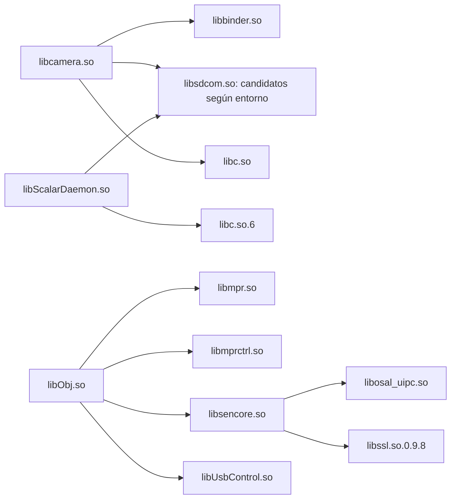
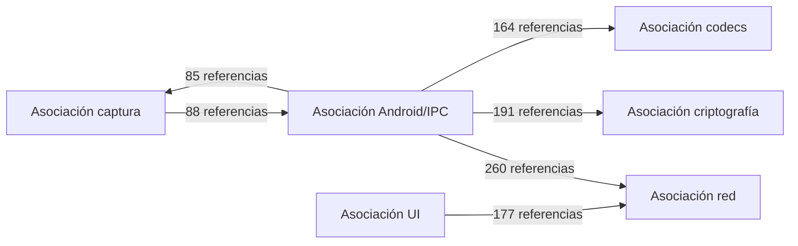

# Dependencias entre subsistemas

Fuente: `reports/elf-atlas.json`, campos `dependencies` y
`subsystem_dependencies`. Se extrajeron **3890 declaraciones DT_NEEDED**:
3882 tienen candidatos de un único contenido y 8 tienen alternativas de
contenido distinto. No hay dependencias sin candidato en este inventario.

Las declaraciones son [VERIFICADO]; la resolución local y las asociaciones de
subsistemas son [INFERENCIA]. Ninguna arista verifica una carga real, llamada
ejecutada, protocolo IPC ni conexión física.

## Fragmento concreto

El nodo libsdcom agrupa nombres declarados, no afirma identidad binaria entre
entornos. La separación libc.so/libc.so.6 exige comprobar ABI, cargador y ruta;
no se deben intercambiar bibliotecas de Android y del entorno nativo.

## Agregación exploratoria

Se cuenta cada par ruta-origen/DT_NEEDED una vez por pareja de etiquetas.
Un binario puede tener varias etiquetas y una resolución ambigua puede
contribuir a varias parejas. Los números no son llamadas ni rendimiento.
La tabla completa conserva `ambiguous_references` y `runtime_verified=false`.

## Resoluciones pendientes

Las ocho ambigüedades corresponden a `libosal_uipc.so` desde bksb.elf y siete
utilidades ud/uc. Para todas hay dos candidatos con contenido distinto. La
selección usa primero mismo directorio, después misma región y finalmente
inventario global; es una búsqueda candidata, no reproduce ld.so. Falta leer
configuración efectiva de los cargadores y probar rutas sin ejecutar firmware.

Este mapa no contiene dlopen, JNI dinámico, ioctl, mensajes o buses físicos.
Esas aristas se añadirán con evidencias separadas de los enlaces ELF.
